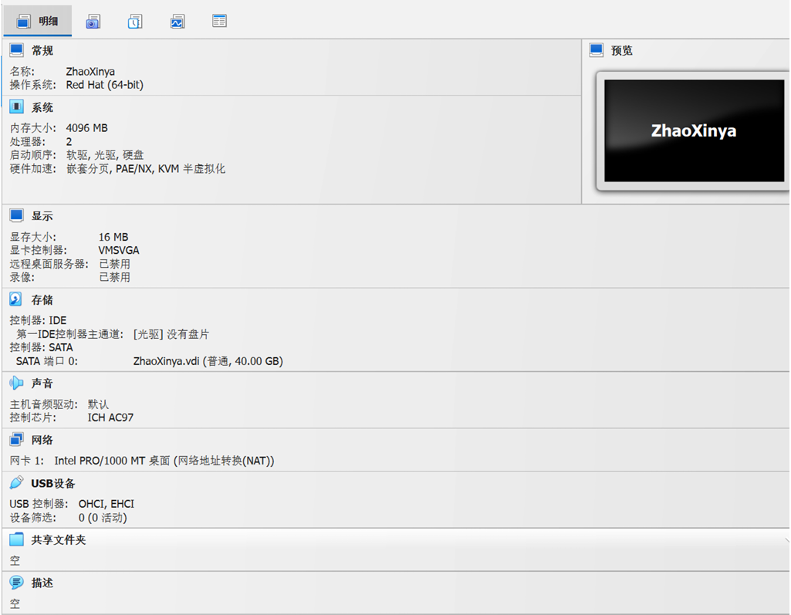
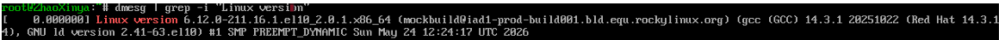

# Информация

## Докладчик

::: {.columns align=center}
::: {.column width="50%"}
- Чжао Синья
- Группа: НПИбд-03-25
- Направление: Прикладная информатика
- РУДН им. П. Лумумбы
- Студенческий билет: 1132258332
:::
::: {.column width="50%"}
{width=80%}
:::
:::

# Вводная часть

## Актуальность и объект

- **Актуальность:** Навыки установки и настройки Linux — базовые компетенции для любого системного администратора.
- **Объект исследования:** Процесс установки и первоначальной конфигурации ОС.
- **Предмет исследования:** ОС Rocky Linux 9 и среда виртуализации VirtualBox.

## Научная новизна и значимость

- **Научная новизна:** Освоение современных версий дистрибутивов (Rocky Linux 9) и актуальных инструментов виртуализации.
- **Практическая значимость:** Полученные навыки могут быть применены при развертывании серверных инфраструктур и настройке рабочих станций.

## Цели и задачи

- **Цель:** Приобретение практических навыков установки ОС на виртуальную машину.
- **Задачи:**
  - Создать виртуальную машину в VirtualBox.
  - Установить ОС Rocky Linux 9.
  - Проанализировать последовательность загрузки системы (`dmesg`).
  - Получить информацию о файловых системах.

## Материалы и методы

- Операционная система: Rocky Linux 9
- Среда виртуализации: Oracle VM VirtualBox
- Основные инструменты: терминал, команды `dmesg`, `mount`

# Выполнение работы

## Создание виртуальной машины

- Создана виртуальная машина `zhaoxinya`.
- Выделено: 4096 МБ ОЗУ, 2 ядра CPU, 40 ГБ ПЗУ.
- Подключен образ `Rocky-9.4-x86_64-dvd.iso`.

## Анализ системы

- Проведен анализ журнала `dmesg`.
- **Ядро:** 6.12.0-211.16.1.el10_2.0.1.x86_64
- **Процессор:** Intel(R) Core(TM) i9-13900HX (2419.200 MHz)
- **ОЗУ:** 3.8Gi
- **Файловая система:** xfs

## Монтирование

- Проверена последовательность монтирования через `mount`.
- Корневой раздел `/dev/mapper/rl-root` смонтирован как `xfs`.

# Заключение

## Выводы

- Успешно установлена и сконфигурирована ОС Rocky Linux 9.
- Получены навыки работы с установщиком и командной строкой.
- Проведен анализ загрузки и оборудования.
- **Все поставленные задачи выполнены в полном объеме.**