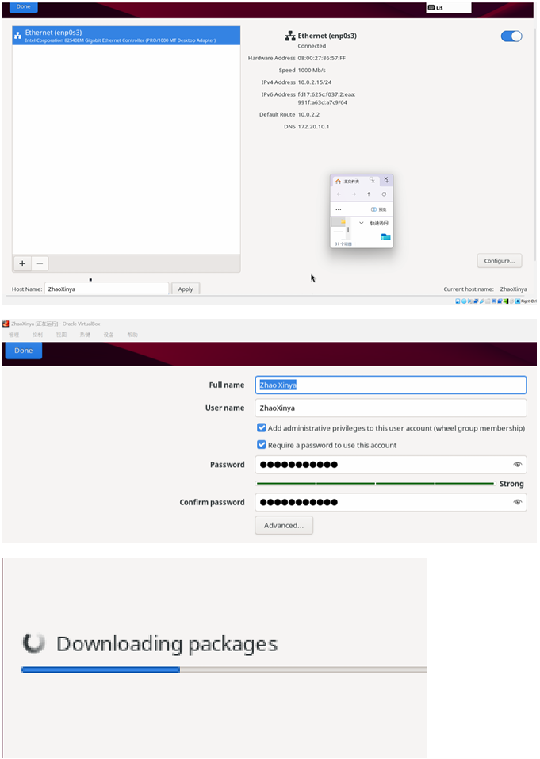
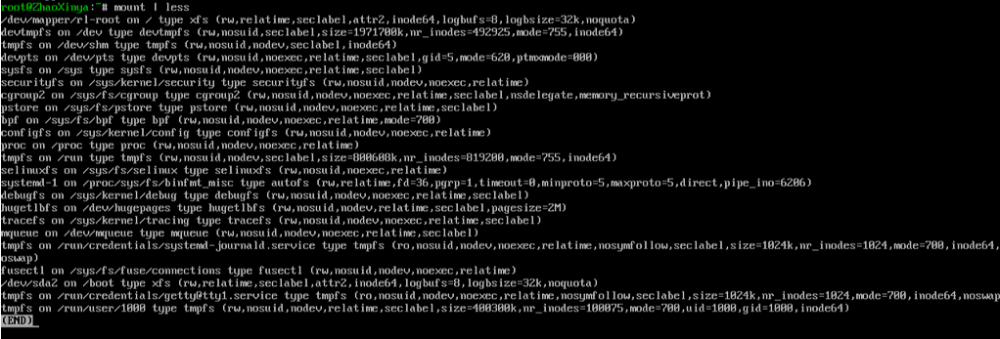

# Цель работы

Приобретение практических навыков установки операционной системы на виртуальную машину, настройки минимально необходимых для дальнейшей работы сервисов.

# Задание

1. Установить на виртуальную машину дистрибутив ОС Linux (Rocky Linux 9).
2. Дождаться загрузки графического окружения и открыть терминал.
3. В окне терминала проанализировать последовательность загрузки системы, выполнив команду `dmesg`.
4. Получить информацию о версии ядра, частоте и модели процессора, объеме доступной оперативной памяти, типе файловой системы корневого раздела и последовательности монтирования файловых систем.

# Выполнение работы

## Создание виртуальной машины

Была создана виртуальная машина в среде VirtualBox со следующими параметрами:
- Имя: `ZhaoXinya`
- Тип ОС: Red Hat (64-bit)
- Объем ОЗУ: 4096 МБ
- Процессоры: 2
- Виртуальный жесткий диск: 40 ГБ

{#fig-01-01 width=90%}

## Установка Rocky Linux 9

Установка производилась с использованием образа Rocky-9.4-x86_64-dvd.iso. В процессе установки были выполнены следующие настройки:
- Язык интерфейса: English
- Программное обеспечение: Server with GUI + Development Tools
- KDUMP: отключен
- Тип установки: автоматическая разметка диска
- Имя хоста: `ZhaoXinya`
- Создан пользователь: `ZhaoXinya` с правами администратора

{#fig-01-02 width=90%}

## Настройка системы и анализ загрузки

После перезагрузки системы был выполнен вход под учетной записью `ZhaoXinya`. Для получения прав суперпользователя использовалась команда `su -`.

Далее был проведен анализ последовательности загрузки системы. С помощью команды `dmesg` была получена информация об аппаратном обеспечении:

- **Версия ядра:** `6.12.0-211.16.1.el10_2.0.1.x86_64`
- **Частота процессора:** `2419.200 MHz`
- **Модель процессора:** `Intel(R) Core(TM) i9-13900HX`
- **Объем доступной ОЗУ:** `3.8Gi`
- **Тип файловой системы корневого раздела:** `xfs` (`/dev/mapper/rl-root`)

{#fig-01-03 width=90%}

Последовательность монтирования файловых систем была проверена с помощью команды `mount`.

{#fig-01-04 width=90%}

# Выводы

В ходе выполнения лабораторной работы была успешно установлена операционная система Rocky Linux 9 на виртуальную машину. Были получены навыки работы с установщиком, настройки параметров системы. С помощью команды `dmesg` проведен анализ загрузки системы и получена информация об аппаратном обеспечении. Все поставленные задачи были выполнены.