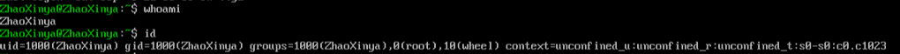
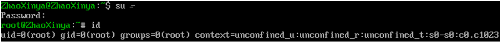
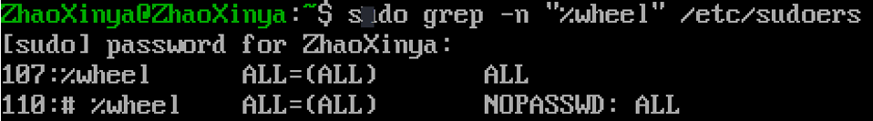
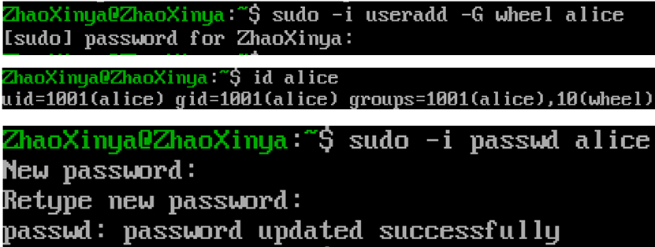
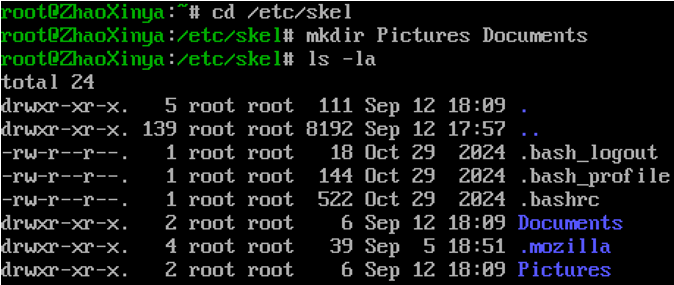
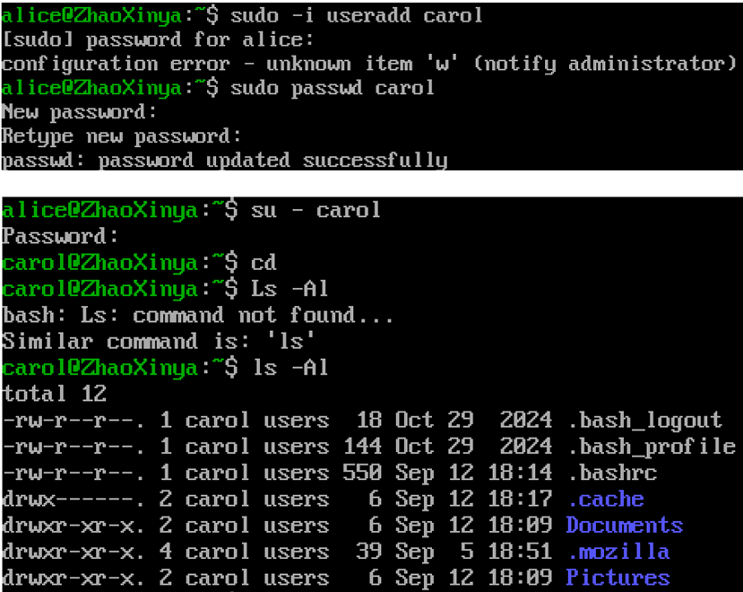
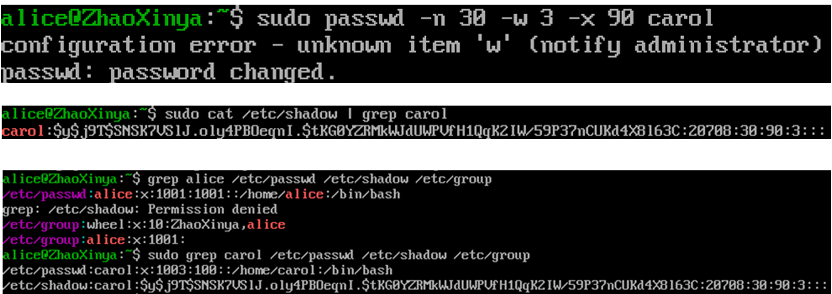
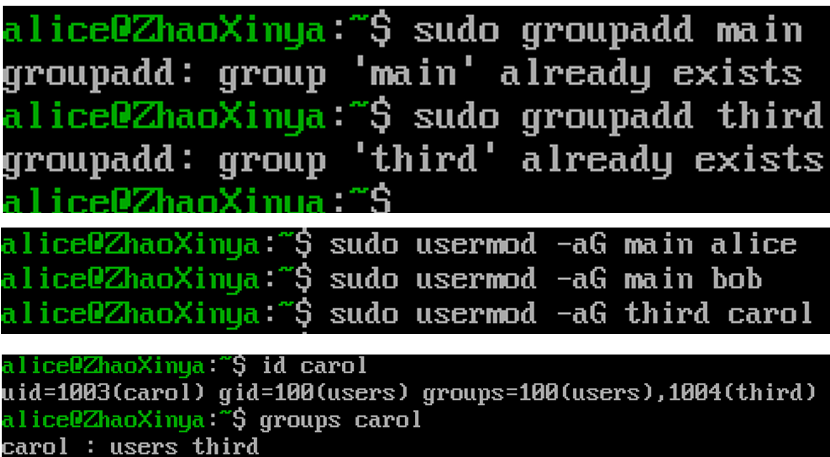

# Цель работы

Получить представление о работе с учётными записями пользователей и группами пользователей в операционной системе типа Linux.

# Задание

1. Прочитать справочное описание `man` по командам: `ls`, `whoami`, `id`, `groups`, `su`, `sudo`, `passwd`, `vi`, `visudo`, `useradd`, `usermod`, `groupadd`, `groupdel`.
2. Выполнить действия по переключению между учётными записями пользователей.
3. Выполнить действия по созданию пользователей и управлению их учётными записями.
4. Выполнить действия по работе с группами пользователей.

# Выполнение работы

## Переключение учётных записей пользователей

Вход в систему был выполнен под обычным пользователем `zhaoxinya`. Для определения текущего пользователя и его идентификаторов были использованы команды `whoami` и `id`.

{#fig-02-01 width=90%}

Для получения прав суперпользователя был выполнен вход под учетной записью `root` с помощью команды `su -`. Проверка прав подтвердила успешный вход.

{#fig-02-02 width=90%}

Был осуществлен просмотр конфигурационного файла `/etc/sudoers` с помощью утилиты `visudo`. В файле присутствует строка `%wheel ALL=(ALL) ALL`, дающая права администратора членам группы `wheel`.

{#fig-02-03 width=90%}

В соответствии с заданием были созданы новые пользователи. Пользователь `alice` был создан с добавлением в группу `wheel`, и для него был установлен пароль.

{#fig-02-04 width=90%}

## Создание учётных записей пользователей

Далее были изучены параметры создания пользователей. В файле `/etc/login.defs` были проанализированы настройки по умолчанию.

Также были внесены изменения в шаблон домашнего каталога `/etc/skel` — созданы каталоги `Pictures` и `Documents`.

{#fig-02-05 width=90%}

Пользователь `carol` был создан после модификации `/etc/skel`. Проверка её домашнего каталога показала, что новые каталоги `Pictures` и `Documents` были успешно скопированы.

{#fig-02-06 width=90%}

С помощью утилиты `grep` была проверена информация о созданных пользователях в файлах `/etc/passwd`, `/etc/shadow` и `/etc/group`. Также были изменены параметры пароля с помощью `passwd -n 30 -w 3 -x 90 carol`.

{#fig-02-07 width=90%}

## Работа с группами

Были созданы новые группы `main` и `third`. С помощью команды `usermod -aG` пользователи были добавлены в соответствующие группы (`alice` и `bob` в `main`, `carol` в `third`). Проверка с помощью `id` и `groups` подтвердила успешное добавление.

{#fig-02-08 width=90%}

# Выводы

В ходе лабораторной работы были получены навыки работы с учётными записями пользователей и группами в Linux. Были изучены файлы `/etc/passwd`, `/etc/shadow`, `/etc/group`, `/etc/login.defs`, `/etc/skel`. Освоены команды `useradd`, `usermod`, `groupadd`, `passwd`, `su`, `sudo`, `vigr`. Для редактирования конфигурационных файлов использовался редактор `nano`. Все поставленные задачи выполнены.