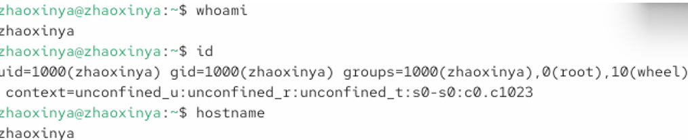
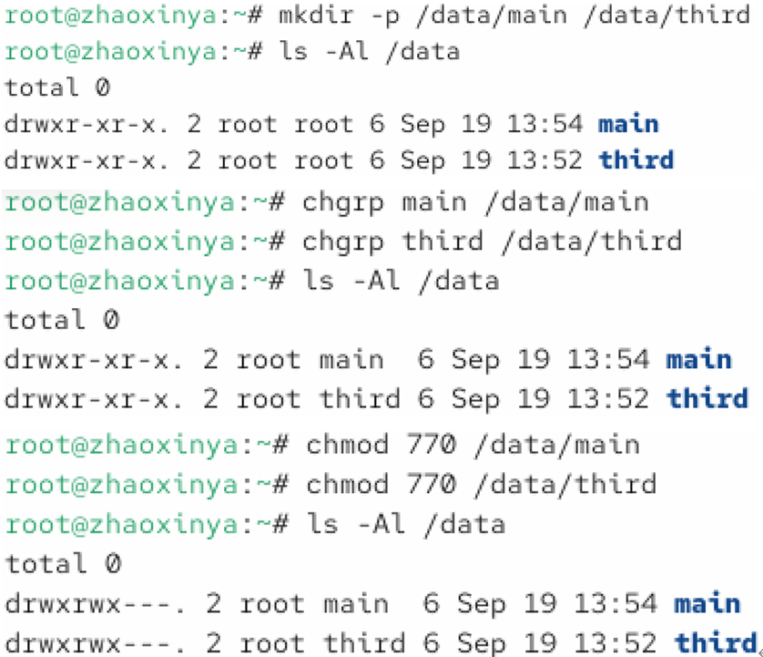
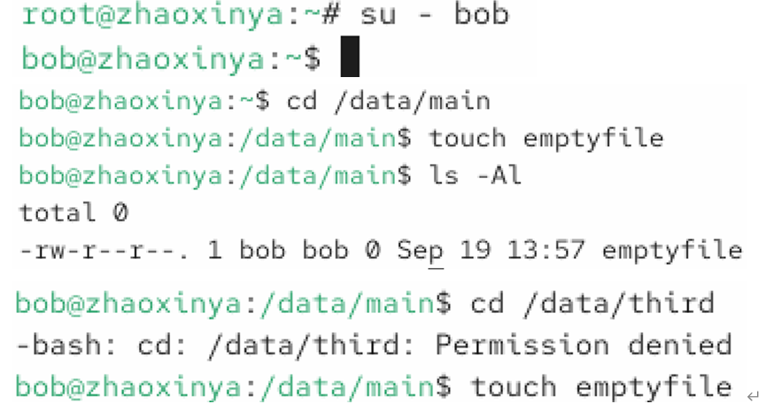
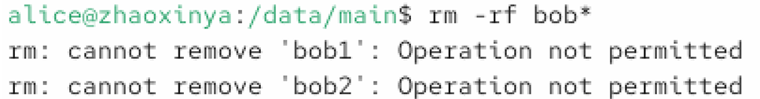
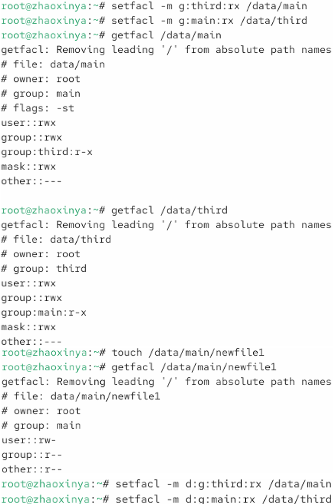

# Цель работы

Получение навыков настройки базовых и специальных прав доступа для групп пользователей в операционной системе типа Linux.

# Задание

1. Изучить справочное описание `man` по командам: `chgrp`, `chmod`, `getfacl`, `setfacl`.
2. Выполнить действия по управлению базовыми разрешениями для групп пользователей.
3. Выполнить действия по управлению специальными разрешениями для групп пользователей.
4. Выполнить действия по управлению расширенными разрешениями с использованием списков ACL.

# Выполнение работы

## Управление базовыми разрешениями

В соответствии с соглашением об именовании проверены пользователь, хост и виртуальная машина.

{#fig-03-01 width=90%}

Были созданы каталоги `/data/main` и `/data/third`. С помощью команд `chgrp` каталогам были назначены группы `main` и `third`. Далее с помощью `chmod 770` были установлены базовые права доступа (полный доступ для владельца и группы, запрет для остальных).

{#fig-03-02 width=90%}

## Проверка базового доступа

Пользователь `bob`, входящий в группу `main`, успешно перешел в каталог `/data/main` и создал там файл. Однако при попытке перейти в `/data/third` ему было отказано в доступе (`Permission denied`), так как он не входит в группу `third`.

{#fig-03-03 width=90%}

## Управление специальными разрешениями

Для каталога `/data/main` были установлены специальные биты: SGID (`g+s`), чтобы новые файлы наследовали группу каталога, и Sticky bit (`o+t`), чтобы удалять файлы мог только их владелец.

{#fig-03-04 width=90%}

## Управление ACL

С помощью утилиты `setfacl` были настроены расширенные списки контроля доступа (ACL). Группе `third` был разрешен доступ на чтение и выполнение в каталог `/data/main`. Аналогично для `/data/third`. Затем были установлены ACL по умолчанию (`d:g:...`), чтобы новые файлы автоматически наследовали эти права.

{#fig-03-05 width=90%}

# Выводы

В ходе лабораторной работы были получены навыки:
- управления базовыми правами доступа с помощью команд `chmod` и `chgrp`;
- установки специальных битов (sticky bit, SGID);
- работы с расширенными списками контроля доступа (ACL) с помощью `setfacl` и `getfacl`;
- проверки прав доступа от имени разных пользователей.

Все поставленные задачи выполнены.