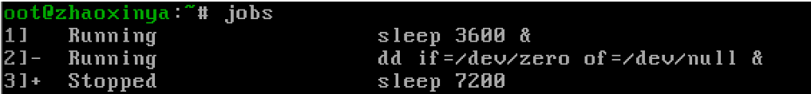
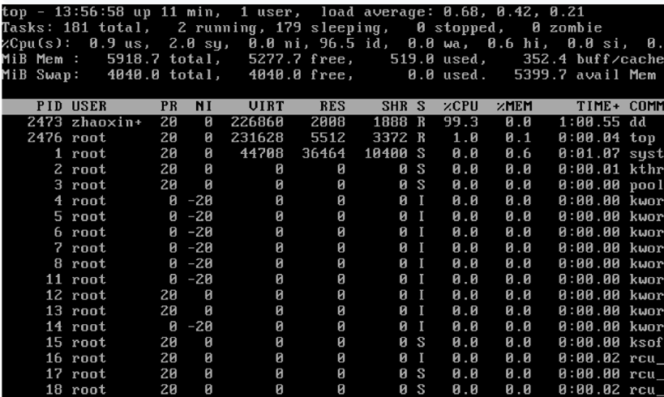
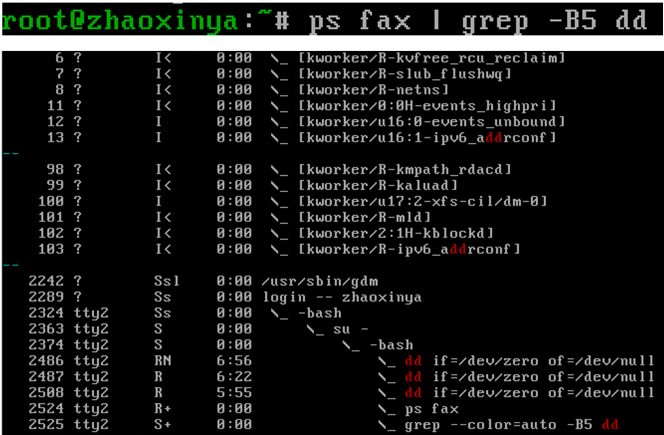
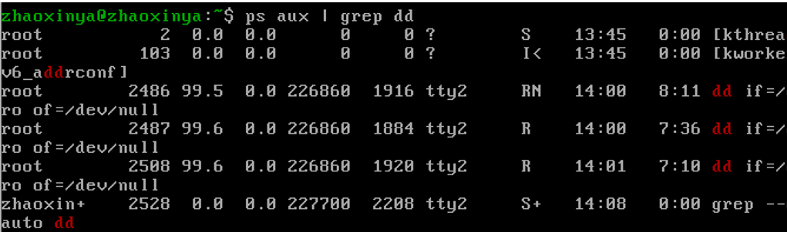
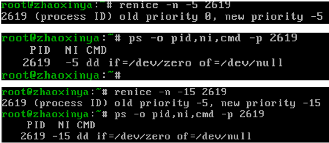

# Цель работы

Получить навыки управления заданиями и процессами операционной системы Linux.

# Задачи

1. Продемонстрировать навыки управления заданиями (`jobs`).
2. Продемонстрировать навыки управления процессами (`ps`, `kill`, `renice`).
3. Выполнить задания для самостоятельной работы.

# Соглашения об именовании

В соответствии с требованиями к именованию:
- Имя пользователя: `zhaoxinya`
- Имя хоста: `zhaoxinya`
- Имя виртуальной машины: `zhaoxinya`

Проверка выполнена командами:

````bash
whoami
hostname
id
Выполнение работы
Управление заданиями
Для выполнения административных операций необходимо получить полномочия суперпользователя (su -).

Были запущены фоновые задачи:

bash
sleep 3600 &
dd if=/dev/zero of=/dev/null &
sleep 7200
Третья задача была приостановлена сочетанием клавиш Ctrl + Z. Проверка статуса заданий (jobs) показала, что задачи [1] и [2] выполняются (Running), а задача [3] приостановлена (Stopped).


Задача [3] была возобновлена в фоне (bg 3), затем задача [1] была переведена на передний план (fg 1) и завершена (Ctrl + C). Остальные задачи также были завершены.

В другом терминале был запущен процесс dd if=/dev/zero of=/dev/null &, после чего терминал был закрыт командой exit. Утилита top показала, что процесс dd продолжает выполняться. Его завершение было выполнено прямо в top нажатием клавиши k с указанием PID.


Управление процессами
Были запущены три фоновых процесса dd. С помощью ps aux | grep dd были найдены их PID.

Для одного из процессов приоритет был изменен с помощью renice -n 5 <PID>.

С помощью команды ps fax | grep -B5 dd была отображена иерархия процессов. Было выяснено, что все три процесса dd являются дочерними по отношению к оболочке. Завершение родительской оболочки (kill -9 <PID_оболочки>) привело к завершению всех дочерних процессов dd.


Самостоятельная работа
Задание 1
Были запущены три процесса dd в фоне. Приоритет одного из них был последовательно изменен на -5 и -15 с помощью команды renice. Разница заключается в том, что меньшее значение nice дает процессу больше процессорного времени. После этого все процессы dd были завершены командой killall dd.


Задание 2
Программа yes была запущена в фоне (yes > /dev/null &), затем на переднем плане с приостановкой (Ctrl + Z) и повторным запуском. Проверка заданий выполнена командой jobs.

Задача была переведена на передний план (fg %1), приостановлена, а затем снова возобновлена в фоне (bg %1).

Для запуска процесса, независимого от терминала, использовалась команда nohup yes > /dev/null &. После закрытия и повторного открытия терминала проверка ps aux | grep yes подтвердила, что процесс продолжает работу.

Утилита top отобразила запущенные процессы. Один процесс был убит по PID (kill <PID>), другой — по номеру задания (kill %N). Отправка сигнала SIGHUP (kill -1) процессу, запущенному через nohup, не привела к его завершению, в отличие от обычного процесса.

Несколько процессов yes были завершены одновременно командой killall yes. Сравнение приоритетов процессов yes и nice -n 5 yes показало разницу в значениях NI и PRI. С помощью renice приоритеты были выровнены.


Выводы
В ходе лабораторной работы были получены навыки:

Управления заданиями: jobs, bg, fg, Ctrl + Z, Ctrl + C.

Управления процессами: ps, kill, killall, top.

Работы с приоритетами: nice, renice.

Использования nohup для запуска процессов, независимых от терминала.

Все поставленные задачи выполнены.

Ответы на контрольные вопросы
Какая команда даёт обзор всех текущих заданий оболочки? jobs

Как остановить текущее задание оболочки, чтобы продолжить его в фоновом режиме? Нажать Ctrl + Z, затем выполнить bg.

Какую комбинацию клавиш можно использовать для отмены текущего задания оболочки? Ctrl + C.

Необходимо отменить одно из начатых заданий. Доступ к оболочке невозможен. Что можно сделать? Из другого терминала найти PID с помощью ps aux | grep и выполнить kill <PID>.

Какая команда используется для отображения отношений между родительскими и дочерними процессами? ps fax или pstree.

Какая команда позволит изменить приоритет процесса с идентификатором 1234 на более высокий? sudo renice -n -5 -p 1234.

В системе в настоящее время запущено 20 процессов dd. Как проще всего остановить их все сразу? killall dd.

Какая команда позволяет остановить команду с именем mycommand? killall mycommand.

Какая команда используется в top, чтобы убить процесс? Клавиша k, затем ввести PID.

Как запустить команду с достаточно высоким приоритетом, не рискуя, что не хватит ресурсов для других процессов? Использовать nice -n -5 <команда> (с умеренным значением).