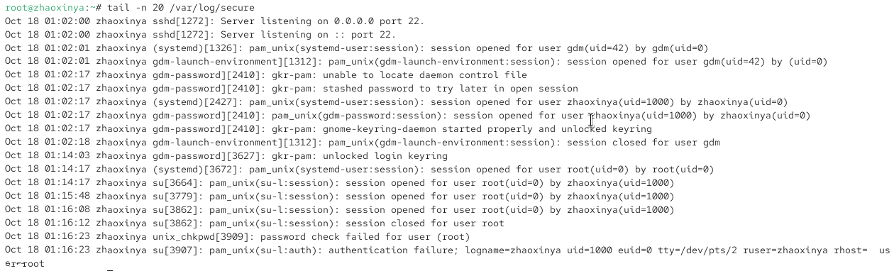
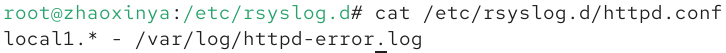
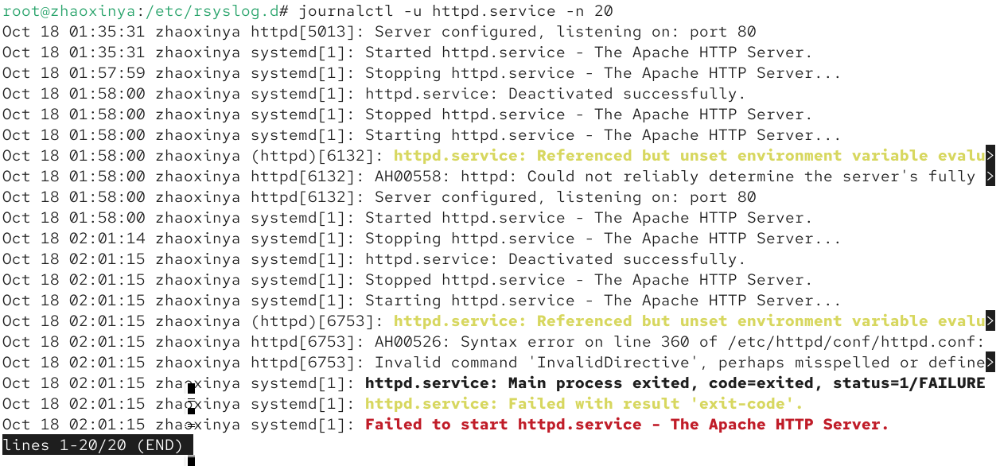
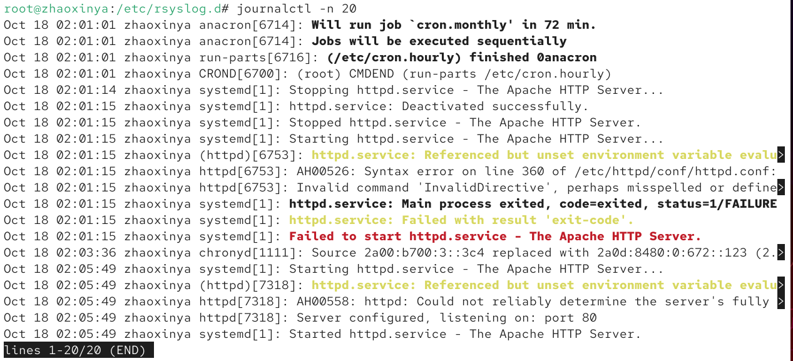
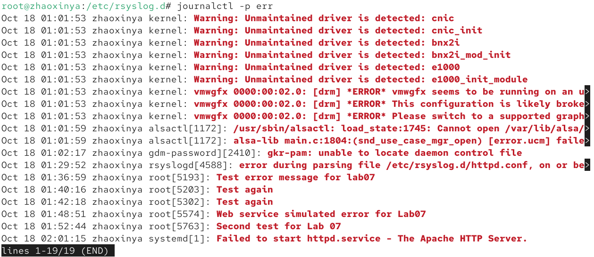
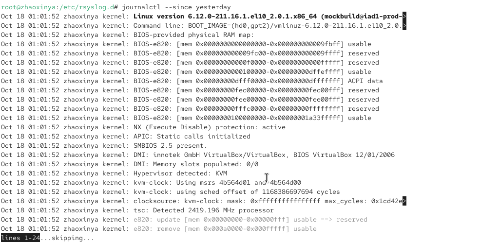
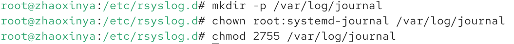
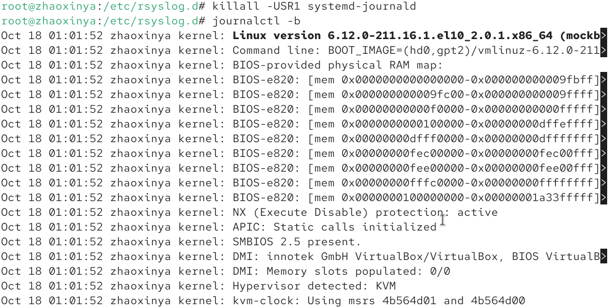

# Цель работы

Получить практические навыки работы с журналами событий в операционной системе Linux, а также освоить настройку службы `rsyslog` и утилиты `journalctl`.

# Задание

1. Продемонстрировать навыки работы с журналом мониторинга событий в реальном времени.
2. Продемонстрировать навыки создания и настройки отдельного файла конфигурации мониторинга отслеживания событий веб-службы.
3. Продемонстрировать навыки работы с `journalctl`.
4. Продемонстрировать навыки работы с `journald`.

# Выполнение работы

## Мониторинг журнала системных событий в реальном времени

Для мониторинга событий в реальном времени был использован файл `/var/log/messages`. В отдельном терминале была запущена команда `tail -f /var/log/messages`.

При попытке получить права суперпользователя с неверным паролем, в журнале было зафиксировано сообщение об ошибке аутентификации:

Также была проверена работа утилиты `logger`. Отправленное сообщение `hello` успешно появилось в журнале:

Для просмотра журнала безопасности было выполнено чтение последних 20 строк файла `/var/log/secure`:

## Настройка конфигурации мониторинга веб-службы

Для перенаправления логов веб-службы Apache в syslog, в конец файла `/etc/httpd/conf/httpd.conf` была добавлена строка `ErrorLog syslog:local1`.

Была создана конфигурация в каталоге `/etc/rsyslog.d/httpd.conf`:

*(Из-за политик безопасности SELinux в Rocky Linux 10, запись в новый файл `/var/log/httpd-error.log` была заблокирована ядром, поэтому для проверки ошибок службы был использован штатный инструмент `journalctl`)*:

## Работа с journalctl

Утилита `journalctl` позволяет гибко фильтровать системные журналы.

Просмотр последних 20 строк журнала:

Просмотр только сообщений об ошибках (`-p err`):

Просмотр событий за определенный период (с вчерашнего дня):

## Настройка постоянного журнала journald

По умолчанию `journald` хранит журналы в оперативной памяти. Для того чтобы сделать журнал постоянным, был создан каталог `/var/log/journal` и настроены права доступа:

После перезапуска службы и применения изменений, была просмотрена история загрузок:

# Выводы

В ходе выполнения лабораторной работы были получены навыки работы с системными журналами Linux. Были изучены принципы работы службы `rsyslog`, её конфигурационные файлы и категории сообщений. Освоены основные команды утилиты `journalctl` для фильтрации и просмотра событий в реальном времени. Также была выполнена настройка постоянного хранения журналов `systemd-journald`. Все поставленные задачи выполнены.

# Ответы на контрольные вопросы

1. **Какой файл используется для настройки rsyslogd?**
   Главный файл конфигурации — `/etc/rsyslog.conf`. Дополнительные файлы конфигурации хранятся в каталоге `/etc/rsyslog.d/`.

2. **В каком файле журнала rsyslogd содержатся сообщения, связанные с аутентификацией?**
   В файле `/var/log/secure`.

3. **Если вы ничего не настроите, то сколько времени потребуется для ротации файлов журналов?**
   По умолчанию (в конфигурации `logrotate`) ротация происходит еженедельно, а старые файлы хранятся в течение 4 недель.

4. **Какую строку следует добавить в конфигурацию для записи всех сообщений с приоритетом info в файл /var/log/messages_info?**
   `*.info /var/log/messages_info`

5. **Какая команда позволяет вам видеть сообщения журнала в режиме реального времени?**
   `journalctl -f` или `tail -f /var/log/messages`.

6. **Какая команда позволяет вам видеть все сообщения журнала, которые были написаны для PID 1 между 9:00 и 15:00?**
   `journalctl _PID=1 --since "09:00" --until "15:00"`

7. **Какая команда позволяет вам видеть сообщения journald после последней перезагрузки системы?**
   `journalctl -b`

8. **Какая процедура позволяет сделать журнал journald постоянным?**
   Необходимо создать каталог `/var/log/journal`, назначить ему владельца `root:systemd-journal` и права `2755`, после чего перезапустить службу `systemd-journald` (или перезагрузить систему).