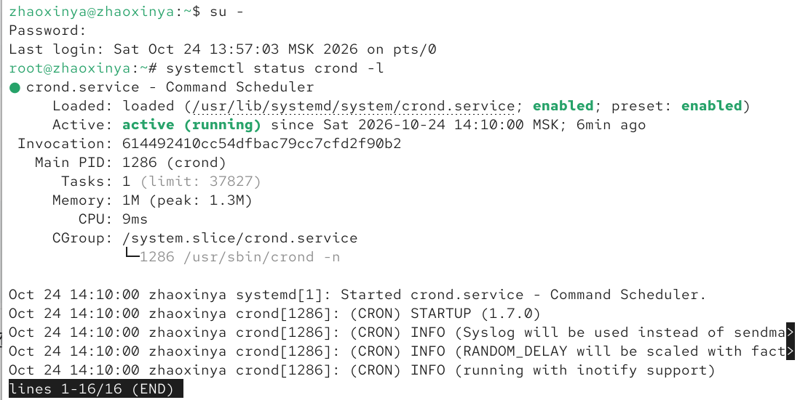
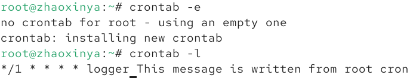
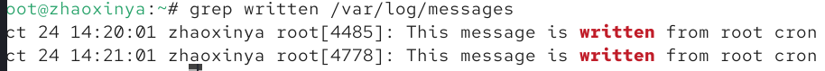
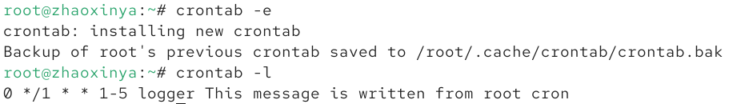
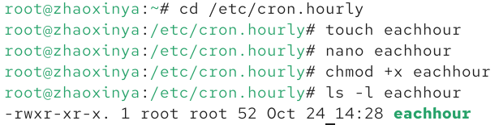
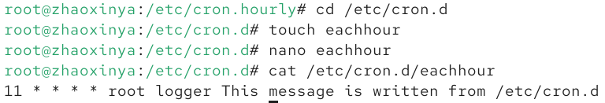
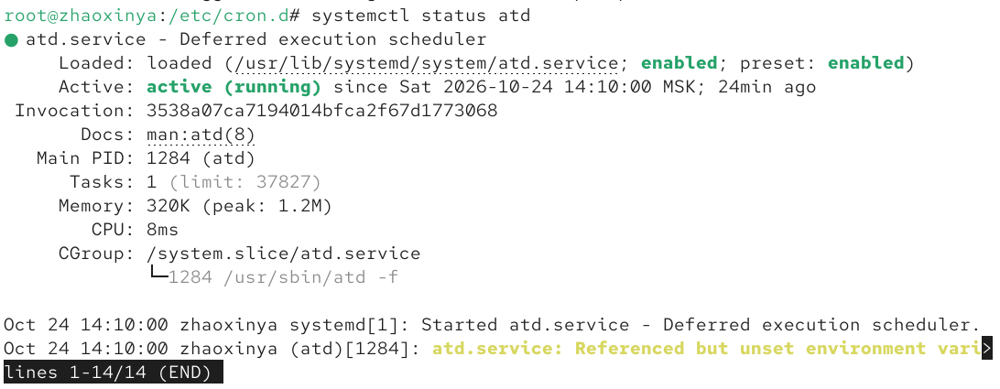
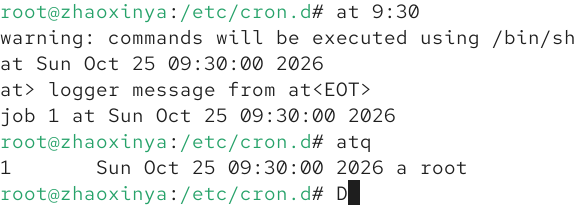

# Цель работы

Получение навыков работы с планировщиками событий `cron` и `at`.

# Задание

1. Выполнить задания по планированию задач с помощью `cron`.
2. Выполнить задания по планированию задач с помощью `at`.

# Выполнение работы

## Планирование задач с помощью cron

Демон `cron` используется для регулярного выполнения задач. Была проверена его работоспособность:

Была создана задача для пользователя `root`, выполняющаяся каждую минуту и записывающая сообщение в системный журнал:

Через несколько минут было подтверждено, что задача успешно выполняется:

Затем расписание было изменено: задача должна выполняться каждый час с понедельника по пятницу:

Также были созданы скрипты для автоматического запуска. В каталоге `/etc/cron.hourly` был создан исполняемый скрипт `eachhour`:

А в каталоге `/etc/cron.d` был создан конфигурационный файл с расписанием:

## Планирование задач с помощью at

Демон `atd` используется для однократного выполнения задач в заданное время. Была проверена его работоспособность:

Была запланирована команда `logger message from at` на 9:30. Проверка очереди подтвердила, что задание поставлено:

# Выводы

В ходе выполнения лабораторной работы были получены практические навыки работы с планировщиками событий. Было изучено планирование регулярных задач с помощью демона `cron` (путем редактирования `crontab`, создания скриптов в `/etc/cron.hourly` и конфигураций в `/etc/cron.d`), а также планирование одноразовых задач с помощью демона `at`. Все поставленные задачи выполнены.

# Ответы на контрольные вопросы

1. **Как настроить задание cron, чтобы оно выполнялось раз в 2 недели?**
   `0 0 */14 * * команда` (выполняется каждые 14 дней в полночь).

2. **Как настроить задание cron, чтобы оно выполнялось 1-го и 15-го числа каждого месяца в 2 часа ночи?**
   `0 2 1,15 * * команда`

3. **Как настроить задание cron, чтобы оно выполнялось каждые 2 минуты каждый день?**
   `*/2 * * * * команда`

4. **Как настроить задание cron, чтобы оно выполнялось 19 сентября ежегодно?**
   `0 0 19 9 * команда`

5. **Как настроить задание cron, чтобы оно выполнялось каждый четверг сентября ежегодно?**
   `0 0 * 9 4 команда` (4 — четверг).

6. **Какая команда позволяет вам назначить задание cron для пользователя alice?**
   `crontab -u alice -e`

7. **Как указать, что пользователю bob никогда не разрешено назначать задания через cron?**
   Необходимо добавить его имя в файл `/etc/cron.deny`.

8. **Вам нужно увериться, что задание выполнится каждый день, даже если сервер во время выполнения временно недоступен. Как это сделать?**
   Для этого используется демон `anacron`, который запускает пропущенные задачи при следующем включении системы.

9. **Какая команда позволяет увидеть запланированные в какое-нибудь задание на выполнение планировщиком atd?**
   `atq` (или `at -l`).