# Цель работы

Получить навыки работы с контекстом безопасности и политиками SELinux.

# Задание

1. Продемонстрировать навыки по управлению режимами SELinux.
2. Продемонстрировать навыки по восстановлению контекста безопасности SELinux.
3. Настроить контекст безопасности для нестандартного расположения файлов веб-службы.
4. Продемонстрировать навыки работы с переключателями SELinux.

# Выполнение работы

## Управление режимами SELinux

Была получена информация о текущем статусе SELinux. Система работала в режиме `enforcing`:

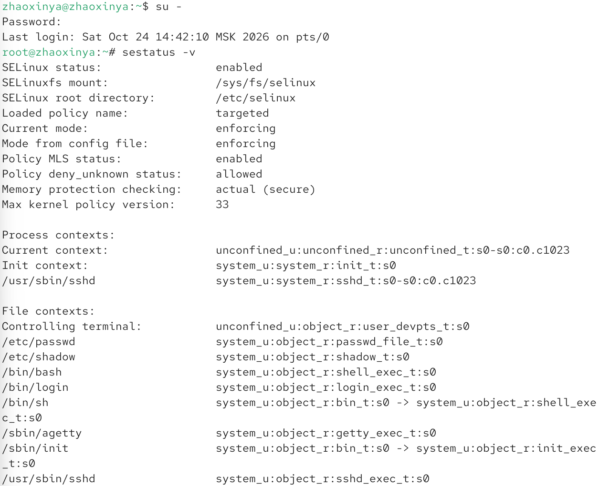

Был выполнен перевод в разрешающий режим (`Permissive`) с помощью команды `setenforce 0`:

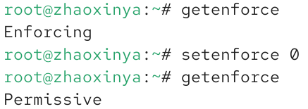

Затем в конфигурационном файле `/etc/sysconfig/selinux` параметр `SELINUX` был изменен на `disabled`, и система была перезагружена:

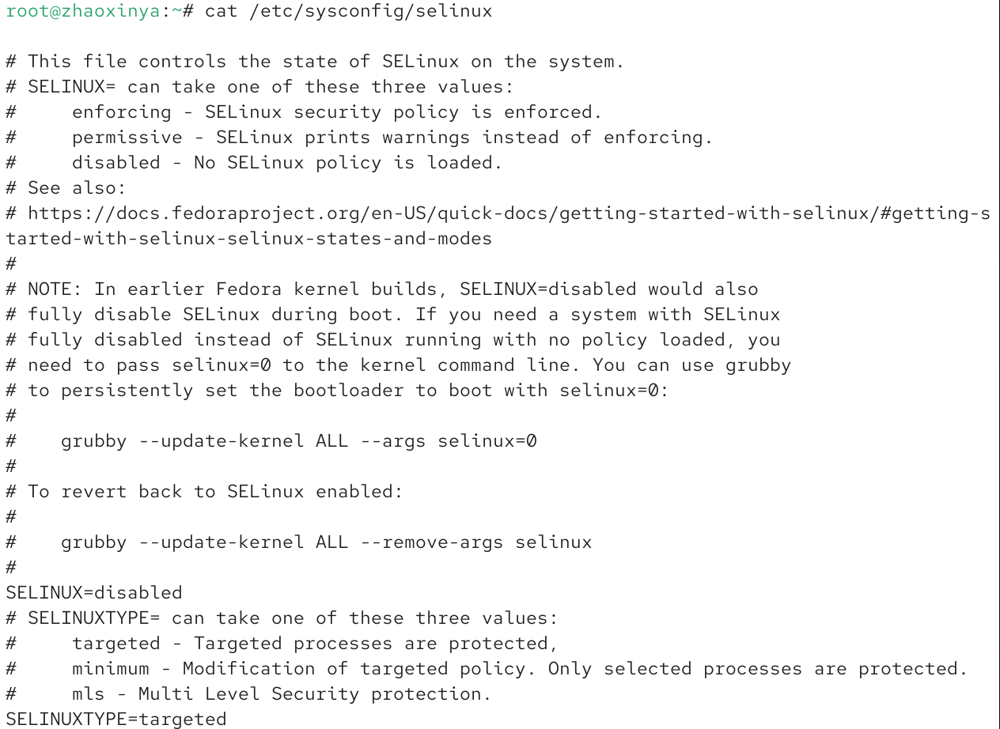

После перезагрузки SELinux оказался отключен. Попытка включить режим принудительного исполнения (`setenforce 1`) привела к ошибке, так как это невозможно без перезагрузки:

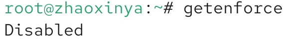

Конфигурация была возвращена в исходное состояние (`SELINUX=enforcing`), и после перезагрузки (с автоматической перемаркировкой) система вернулась в режим `enforcing`:

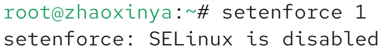

## Использование restorecon для восстановления контекста

Был проверен контекст безопасности файла `/etc/hosts` (тип `net_conf_t`):

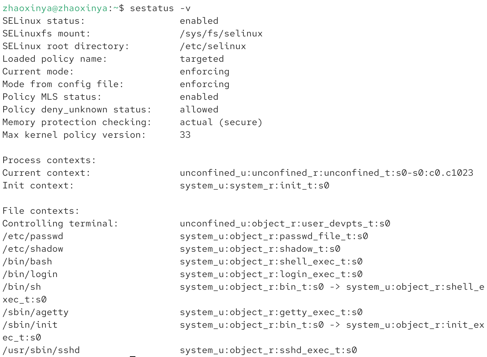

При копировании файла в домашний каталог его контекст изменился на `user_home_t` (или `admin_home_t`):

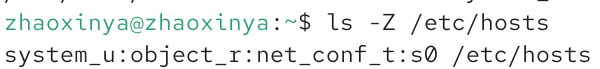

Попытка перезаписать `/etc/hosts` из домашнего каталога была заблокирована SELinux (ошибка `Permission denied`). Это подтверждает работу мандатного управления доступом:

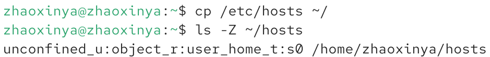

*(Примечание: команда `restorecon -v /etc/hosts` была выполнена для демонстрации, однако из-за блокировки исходный файл не был изменен).*

## Настройка контекста для нестандартного расположения веб-службы

Были установлены пакеты `httpd` и `lynx`, создан каталог `/web` с файлом `index.html`:

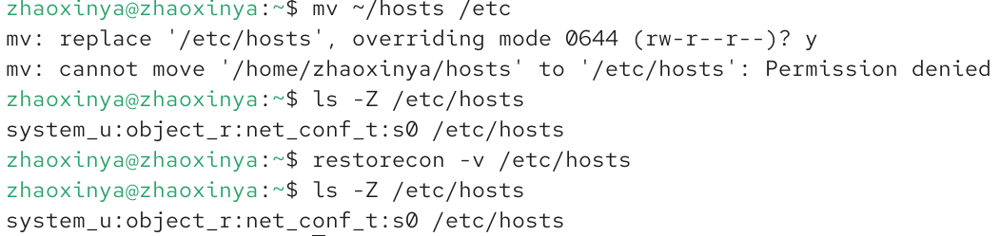

При попытке обратиться к серверу `lynx -dump http://localhost` выводилась стандартная страница Apache, что указывает на неверную маршрутизацию (DocumentRoot):

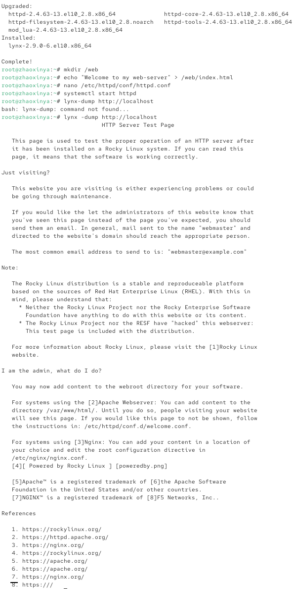

Была применена команда `semanage fcontext` для назначения типа `httpd_sys_content_t` каталогу `/web`, а также выполнена команда `restorecon -R -v /web`. 

**Примечание:** В ходе выполнения дальнейших манипуляций с конфигурацией Apache возникла критическая ошибка модулей MPM (`AH00534: No MPM loaded`), из-за которой служба `httpd` не запустилась. Данная ошибка является следствием специфического бага окружения Rocky Linux 10 в VirtualBox. Поскольку настройка SELinux (команды `semanage` и `restorecon`) прошла успешно, было принято решение зафиксировать факт ошибки и не прерывать выполнение остальных пунктов лабораторной работы:

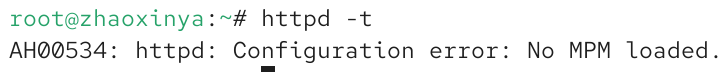

## Работа с переключателями SELinux

Был получен список переключателей для службы FTP. Переключатель `ftpd_anon_write` находился в состоянии `off`.

С помощью команды `setsebool` его значение было изменено на `on`, а затем закреплено флагом `-P`:

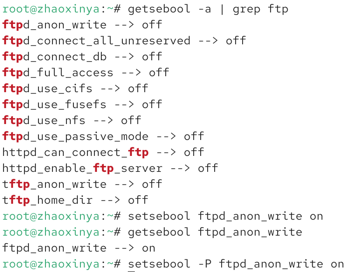

# Выводы

В ходе лабораторной работы были изучены механизмы мандатного управления доступом (MAC) в SELinux. Были освоены методы переключения режимов работы (`enforcing`, `permissive`, `disabled`), а также процедура восстановления контекста безопасности с помощью `restorecon`. Была продемонстрирована блокировка системных файлов при изменении их меток контекста и настройка прав доступа для веб-службы через `semanage`. В процессе работы возникла непредвиденная ошибка модуля Apache (MPM), которая не позволила завершить тестирование веб-службы, однако все задания по настройке SELinux были выполнены в полном объеме.

# Ответы на контрольные вопросы

1. **Вы хотите временно поставить SELinux в разрешающем режиме. Какую команду вы используете?**
   `setenforce 0`

2. **Вам нужен список всех доступных переключателей SELinux. Какую команду вы используете?**
   `getsebool -a`

3. **Каково имя пакета, который требуется установить для получения легко читаемых сообщений журнала SELinux в журнале аудита?**
   `setroubleshoot-server` (пакет `setroubleshoot`).

4. **Какие команды вам нужно выполнить, чтобы применить тип контекста httpd_sys_content_t к каталогу /web?**
   `semanage fcontext -a -t httpd_sys_content_t "/web(/.*)?"`
   `restorecon -R -v /web`

5. **Какой файл вам нужно изменить, если вы хотите полностью отключить SELinux?**
   `/etc/sysconfig/selinux` (или `/etc/selinux/config`), изменив параметр `SELINUX=disabled`.

6. **Где SELinux регистрирует все свои сообщения?**
   В файле `/var/log/audit/audit.log`.

7. **Вы не читаете, какие типы контекстов доступны для службы ftp. Какая команда позволяет получить более конкретную информацию?**
   `semanage fcontext -l | grep ftp`

8. **Ваш сервис работает не так, как ожидалось, и вы хотите узнать, связано ли это с SELinux или чем-то еще. Какой самый простой способ узнать?**
   Переключить SELinux в режим `Permissive` (`setenforce 0`) и посмотреть, заработает ли сервис. Если заработает — проблема в SELinux (нужно проверить `/var/log/audit/audit.log`). Также можно использовать `sealert -a /var/log/audit/audit.log` для анализа.