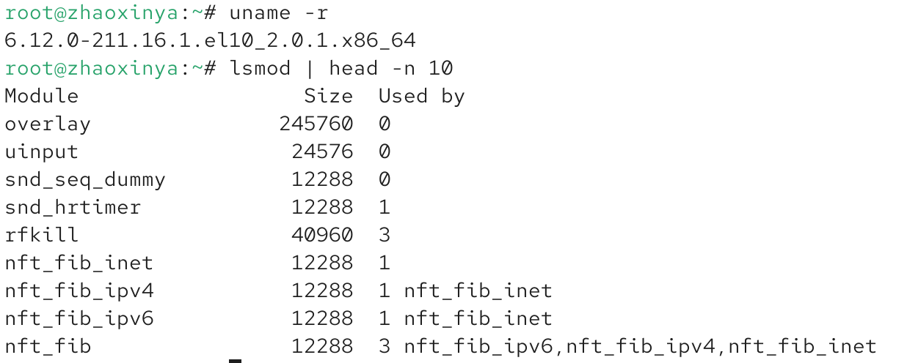
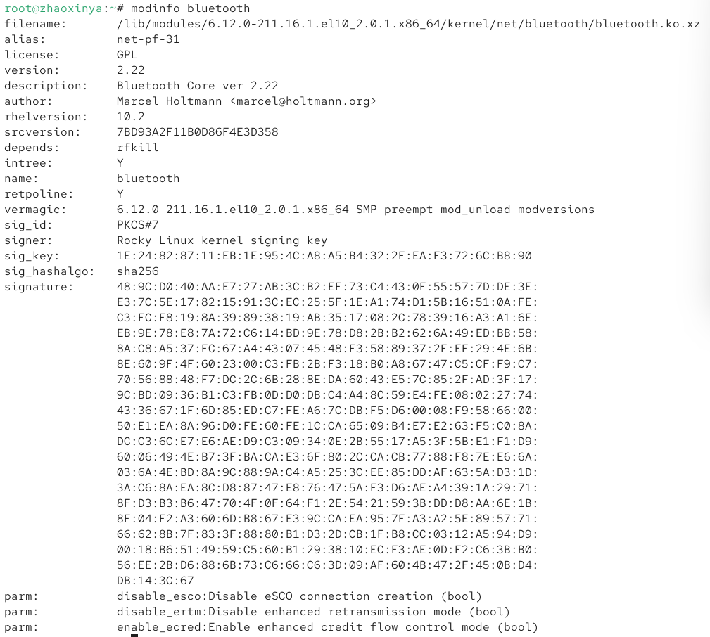
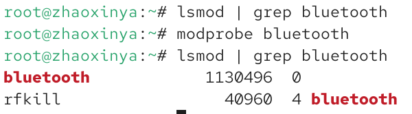
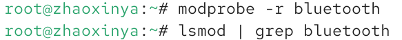
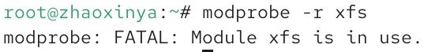
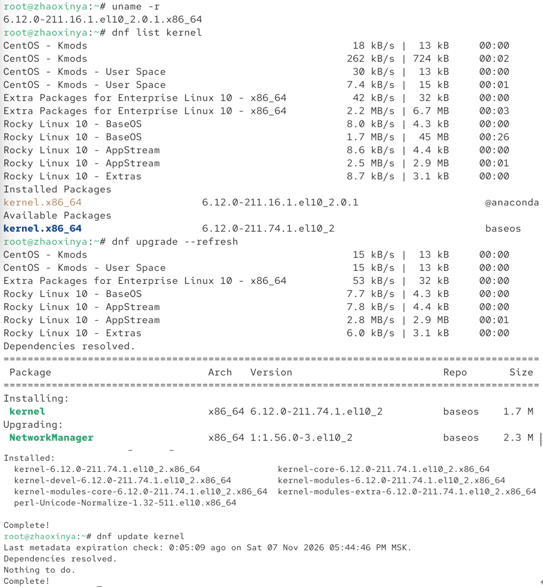
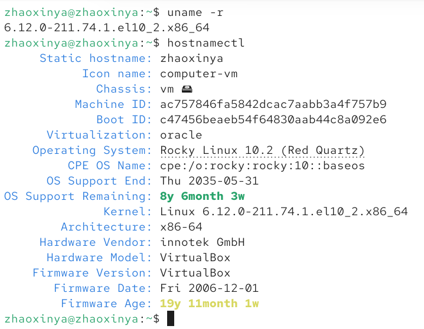

# Цель работы

Изучить основы работы с модулями ядра операционной системы Linux, а также освоить процедуру обновления ядра.

# Задание

1. Продемонстрировать навыки работы по управлению модулями ядра.
2. Продемонстрировать навыки работы по загрузке модулей ядра с параметрами.
3. Выполнить обновление ядра системы.

# Выполнение работы

## Управление модулями ядра

Сначала была получена информация о текущей версии ядра, а также список загруженных модулей с помощью команды `lsmod`:

С помощью команды `modinfo` была получена подробная информация о модуле `bluetooth`, включая его параметры и зависимости:

Далее модуль `bluetooth` был загружен в ядро с помощью команды `modprobe bluetooth`, и его наличие было подтверждено командой `lsmod`:

Затем модуль был выгружен с помощью `modprobe -r bluetooth`, и проверка показала отсутствие модуля в системе:

При попытке выгрузить модуль файловой системы `xfs`, которая используется корневым разделом, система выдала ошибку, подтверждающую, что модуль занят:

## Обновление ядра системы

Была проверена текущая версия ядра и список доступных пакетов. Затем выполнено обновление пакетов и ядра с помощью `dnf upgrade --refresh`:

После перезагрузки системы была проверена новая версия ядра с помощью `uname -r` и `hostnamectl`. Ядро было успешно обновлено до версии `.el10_2.x86_64`:

# Выводы

В ходе выполнения лабораторной работы были получены навыки работы с модулями ядра Linux. Были изучены команды `lsmod`, `modinfo`, `modprobe`. Установлено, что используемые системой модули нельзя выгрузить. Также была успешно выполнена процедура обновления ядра операционной системы Rocky Linux.

# Ответы на контрольные вопросы

1. **Какая команда показывает текущую версию ядра, которая используется на вашей системе?**
   `uname -r`

2. **Как можно посмотреть более подробную информацию о текущей версии ядра операционной системы?**
   `uname -a` или `hostnamectl`

3. **Какая команда показывает список загруженных модулей ядра?**
   `lsmod`

4. **Какая команда позволяет вам определять параметры модуля ядра?**
   `modinfo <имя_модуля>`

5. **Как выгрузить модуль ядра?**
   `modprobe -r <имя_модуля>` или `rmmod <имя_модуля>`

6. **Что вы можете сделать, если получите сообщение об ошибке при попытке выгрузить модуль ядра?**
   Это означает, что модуль в данный момент используется. Необходимо остановить службы или размонтировать файловые системы, зависящие от этого модуля.

7. **Как определить, какие параметры модуля ядра поддерживаются?**
   С помощью команды `modinfo <имя_модуля>`, в разделе `parm`.

8. **Как установить новую версию ядра?**
   С помощью пакетного менеджера (например, `dnf update kernel` или `dnf upgrade`), после чего необходимо перезагрузить систему.