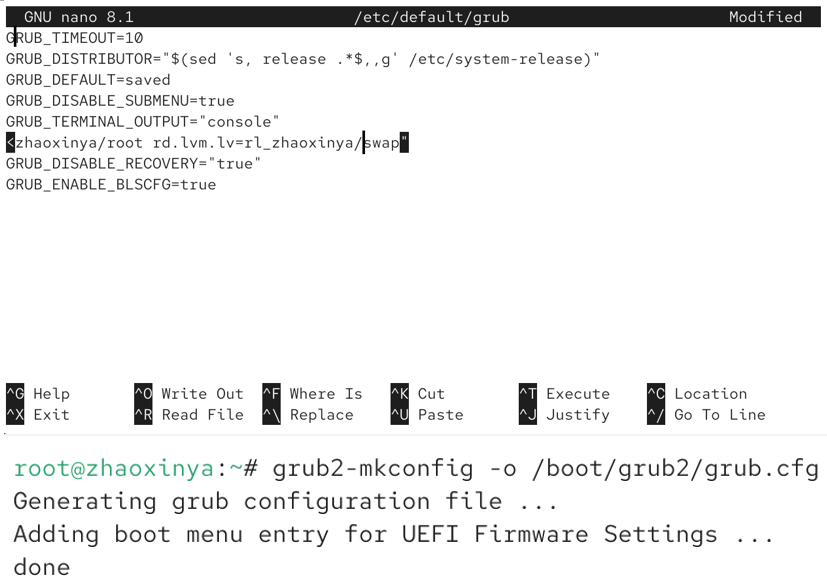
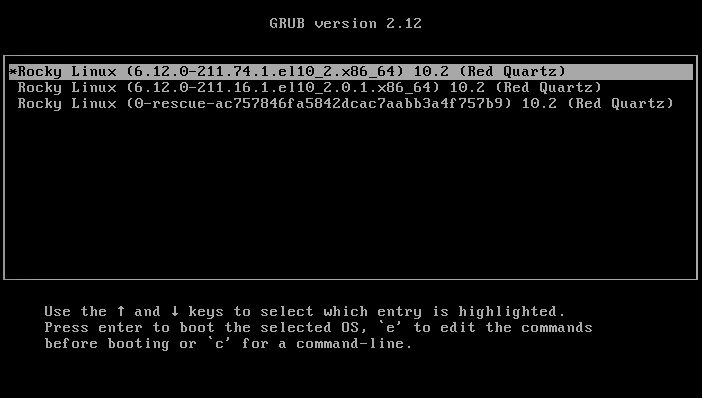
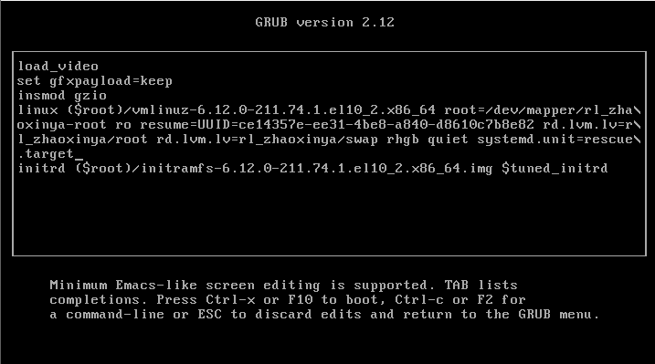
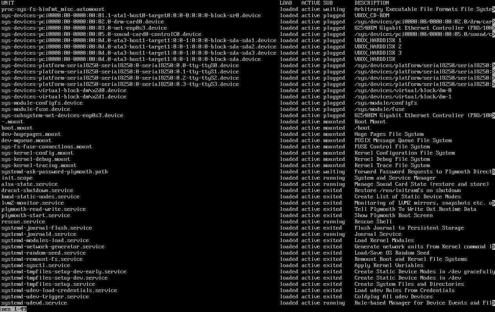
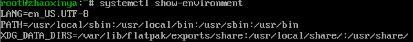
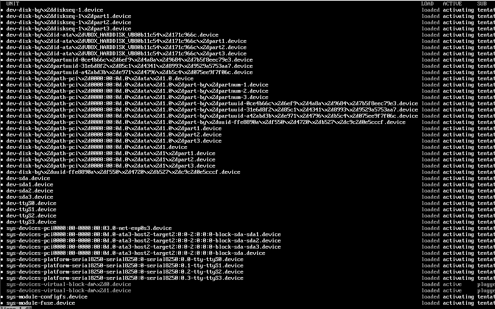
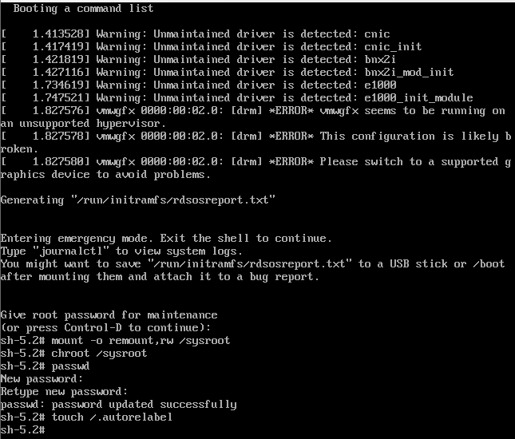
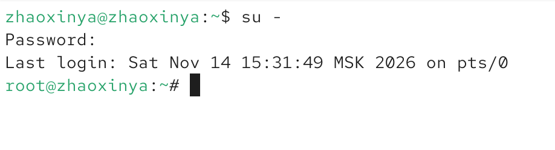

# Цель работы

Получить навыки работы с загрузчиком системы GRUB2, а также освоить методы восстановления системы и сброса пароля root.

# Задание

1. Продемонстрировать навыки по изменению параметров GRUB и записи изменений в файл конфигурации.
2. Продемонстрировать навыки устранения неполадок при работе с GRUB (загрузка в rescue и emergency режимах).
3. Продемонстрировать навыки работы с GRUB без использования root (сброс пароля).

# Выполнение работы

## Модификация параметров GRUB2

Был открыт файл конфигурации `/etc/default/grub`. В нем параметр `GRUB_TIMEOUT` был изменен на 10 секунд для отображения меню загрузки, а также удалены параметры `rhgb` и `quiet` для отображения процесса загрузки:

После обновления конфигурации с помощью `grub2-mkconfig` и перезагрузки, появилось меню GRUB с таймаутом:

## Устранение неполадок (Режимы восстановления)

В меню GRUB была нажата клавиша `e` для редактирования параметров ядра. В конец строки, начинающейся с `linux`, был добавлен параметр `systemd.unit=rescue.target`:

После загрузки в режиме восстановления (rescue mode) был проверен список загруженных юнитов. Количество служб было минимальным:

Также были просмотрены переменные среды оболочки:

Аналогичным образом была выполнена загрузка в `emergency.target`. Количество загруженных служб стало еще меньше (только базовые устройства):

## Сброс пароля root

Для сброса пароля в меню GRUB был добавлен параметр `rd.break`. Загрузка была остановлена на этапе initramfs. Были выполнены команды для перемонтирования файловой системы, смены корневого каталога и изменения пароля:

Поскольку на этом этапе SELinux не активен, были выполнены команды `load_policy -i` и `chcon -t shadow_t /etc/shadow` для восстановления контекста безопасности файла паролей. После перезагрузки (с автоматической перемаркировкой) вход под новым паролем прошел успешно:

# Выводы

В ходе выполнения лабораторной работы были получены навыки управления загрузчиком GRUB2. Были изучены методы изменения конфигурации загрузчика и обновления файла `grub.cfg`. Была продемонстрирована загрузка системы в режимах `rescue` и `emergency`, а также успешно выполнен сброс пароля пользователя `root` с восстановлением контекста безопасности SELinux.

# Ответы на контрольные вопросы

1. **Какой файл конфигурации следует изменить для применения общих изменений в GRUB2?**
   `/etc/default/grub`

2. **Как называется конфигурационный файл GRUB2, в котором вы применяете изменения для GRUB2?**
   `/boot/grub2/grub.cfg`

3. **После внесения изменений в конфигурацию GRUB2, какую команду вы должны выполнить, чтобы изменения сохранились и воспринялись при загрузке системы?**
   `grub2-mkconfig -o /boot/grub2/grub.cfg`