# Цель работы

Получить навыки настройки сетевых параметров системы.

# Задание

1. Продемонстрировать навыки использования утилиты `ip`.
2. Продемонстрировать навыки использования утилиты `nmcli`.

# Выполнение работы

## Проверка конфигурации сети

С помощью утилиты `ip` была получена информация о состоянии сетевых интерфейсов и статистике переданных пакетов. Интерфейс `enp0s3` находится в состоянии `UP`:

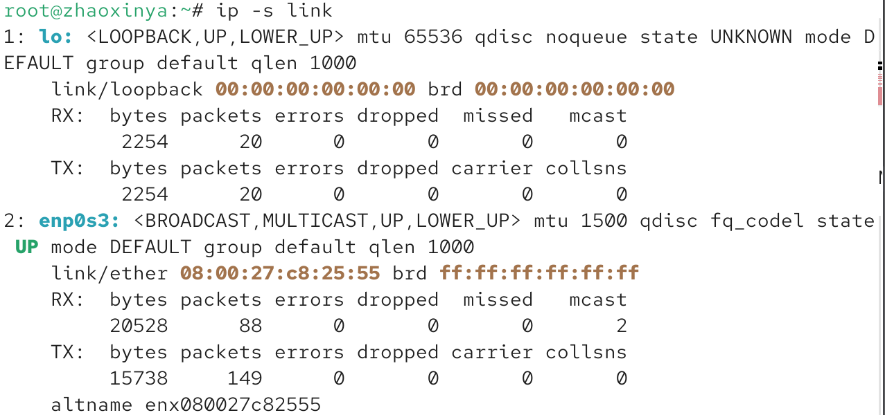

Была просмотрена таблица маршрутизации. Определен маршрут по умолчанию (`default via 10.0.2.2`):

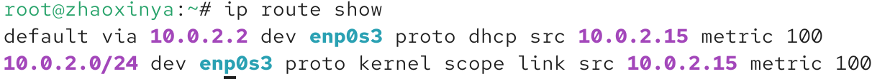

Получена информация об IP-адресах. Сетевому адаптеру `enp0s3` был автоматически назначен IPv4-адрес `10.0.2.15/24`:

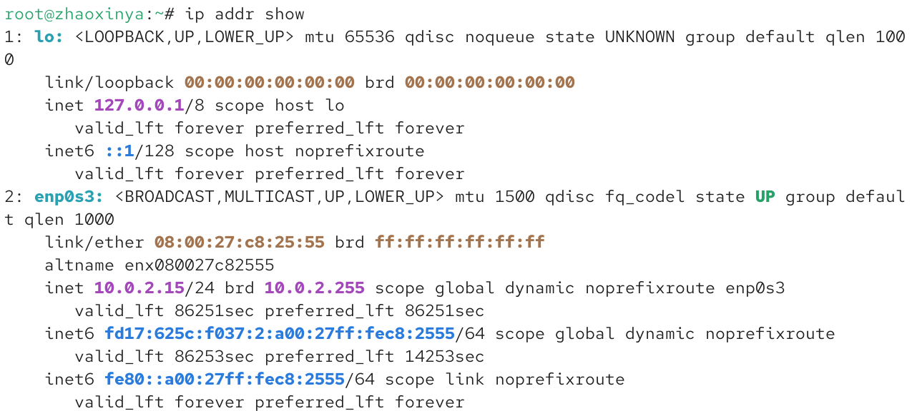

Проверена связь с внешней сетью (Интернет) с помощью утилиты `ping`. Все 4 пакета были успешно доставлены:

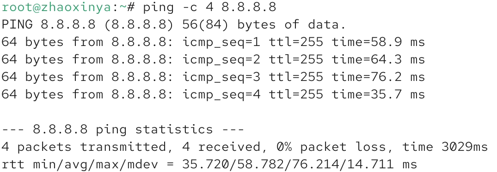

К интерфейсу `enp0s3` был добавлен дополнительный IP-адрес `10.0.0.10/24`:

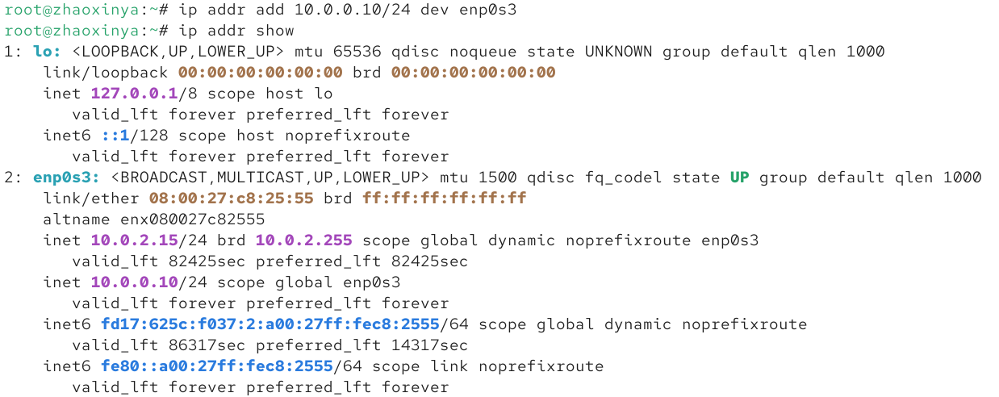

Выполнено сравнение вывода утилиты `ip` и традиционной команды `ifconfig`:

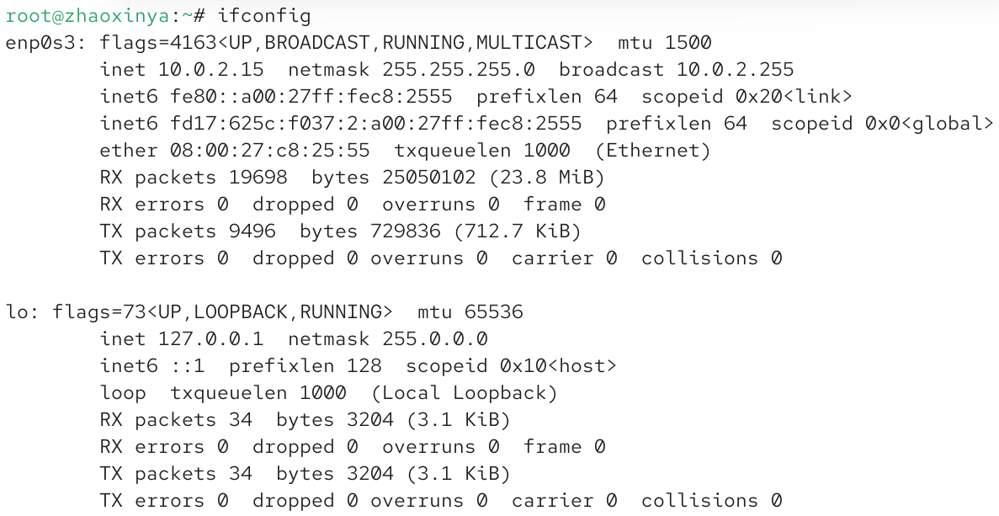

Просмотрен список прослушиваемых портов UDP и TCP с помощью утилиты `ss`:

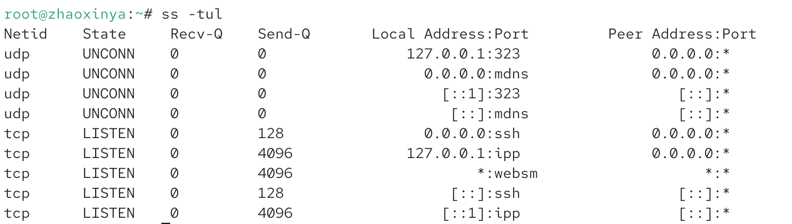

## Управление сетевыми подключениями с помощью nmcli

Был просмотрен список текущих сетевых соединений. Активно соединение `enp0s3`:

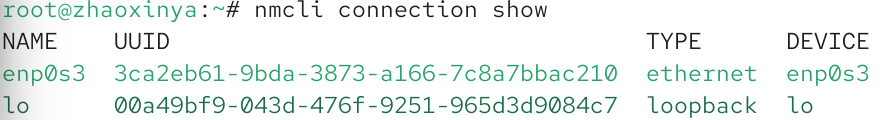

Создано новое статическое Ethernet-соединение с именем `static`, IP-адресом `10.0.0.10/24` и шлюзом `10.0.0.1`:

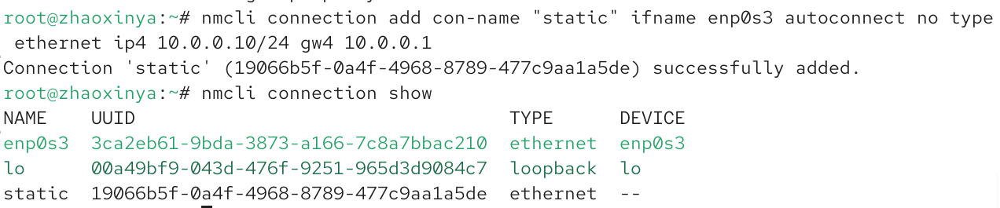

Выполнено переключение на статическое соединение. IP-адрес успешно изменился:

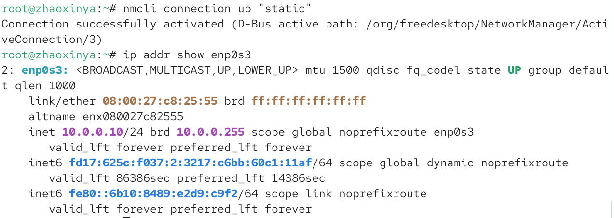

Выполнен возврат к исходному DHCP-соединению `enp0s3`:

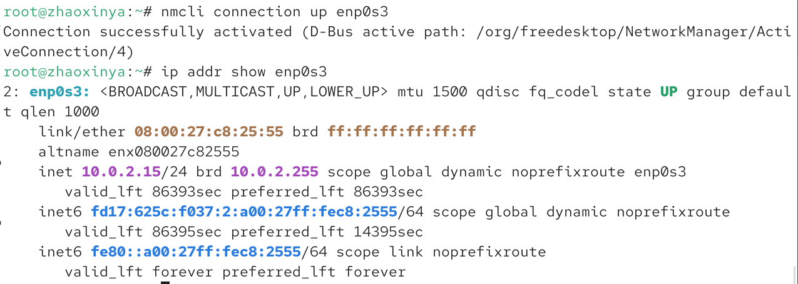

## Изменение параметров соединения

С помощью `nmcli connection modify` были изменены параметры статического соединения: добавлены DNS-серверы (`10.0.0.10` и `8.8.8.8`), изменен основной IP-адрес на `10.0.0.20/24` и добавлен дополнительный адрес `10.20.30.40/16`. После активации оба адреса были успешно применены к интерфейсу:

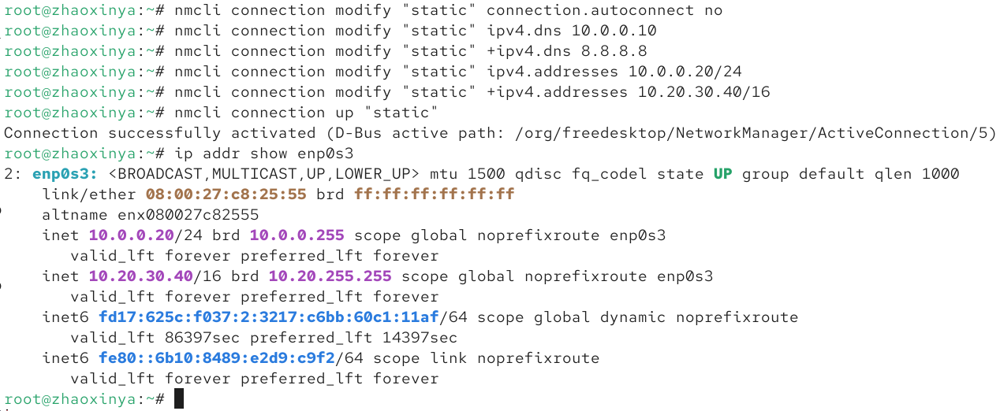

# Выводы

В ходе выполнения лабораторной работы были получены навыки настройки сетевых параметров в Linux. Были изучены современные утилиты `ip`, `ss` и `nmcli`. Освоены методы просмотра состояния сети, добавления IP-адресов, а также создания и переключения между статическими и динамическими сетевыми соединениями с помощью NetworkManager. Все поставленные задачи выполнены.

# Ответы на контрольные вопросы

1. **Какая команда отображает только статус соединения, но не IP-адрес?**
   `ip link show` или `nmcli device status`.

2. **Какая служба управляет сетью в ОС типа RHEL?**
   `NetworkManager`.

3. **Какой файл содержит имя узла (устройства) в ОС типа RHEL?**
   `/etc/hostname`.

4. **Какая команда позволяет вам задать имя узла (устройства)?**
   `hostnamectl set-hostname <новое_имя>`.

5. **Какой конфигурационный файл можно изменить для включения разрешения имён для конкретного IP-адреса?**
   `/etc/hosts`.

6. **Какая команда показывает текущую конфигурацию маршрутизации?**
   `ip route show` (или `route -n`).

7. **Как проверить текущий статус службы NetworkManager?**
   `systemctl status NetworkManager`.

8. **Какая команда позволяет вам изменить текущий IP-адрес и шлюз по умолчанию для вашего сетевого соединения?**
   `nmcli connection modify <имя_соединения> ipv4.addresses <IP/маска> ipv4.gateway <шлюз>` (затем `nmcli connection up <имя_соединения>`).