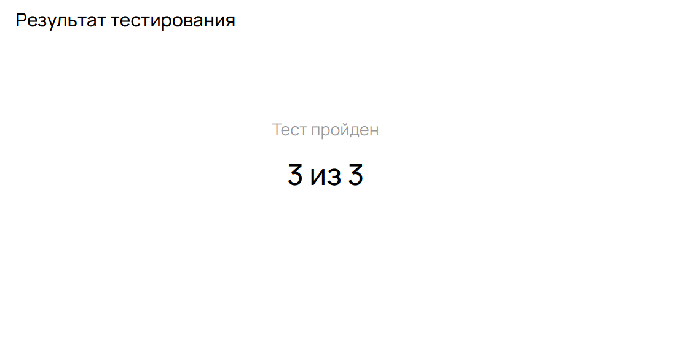
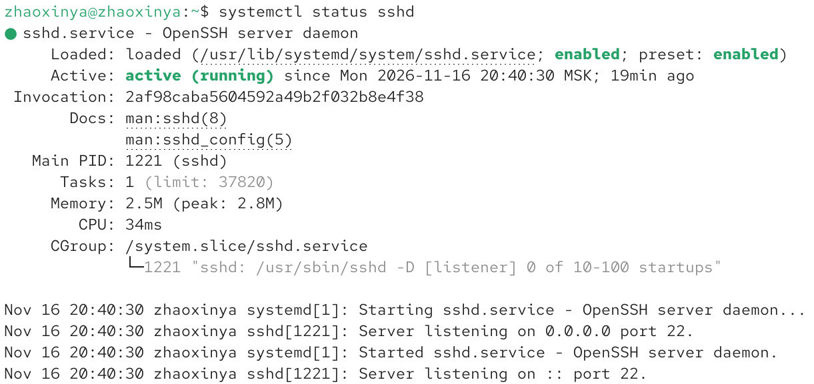
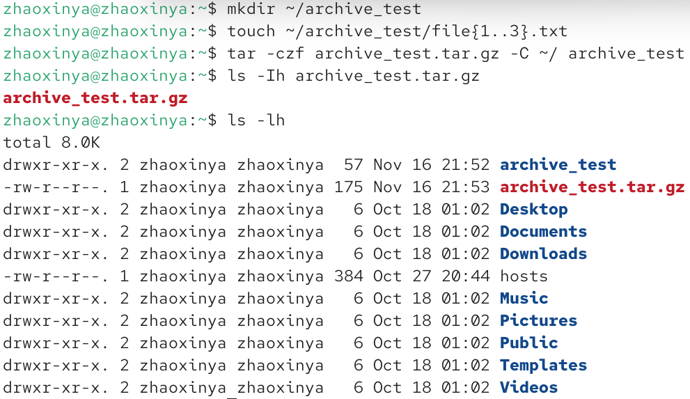
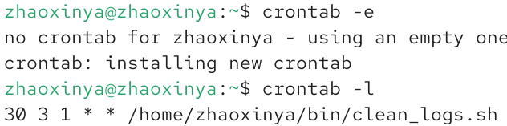

# Информация

## Докладчик

::: {.columns align=center}
::: {.column width="50%"}
- Чжао Синья
- Группа: НПИбд-03-25
- Направление: Прикладная информатика
- РУДН им. П. Лумумбы
- Студенческий билет: 1132258332
:::
::: {.column width="50%"}
{width=80%}
:::
:::

# Вводная часть

## Актуальность и объект

- **Актуальность:** Владение базовыми инструментами командной строки является фундаментальным навыком для любого системного администратора и разработчика. Понимание философии свободного ПО и структуры файловой системы Linux необходимо для эффективной работы с серверами.
- **Объект исследования:** Операционная система Linux и её базовые утилиты.
- **Предмет исследования:** Команды управления файлами, пользователями, процессами и сетью.

## Цели и задачи

- **Цель:** Пройти первый раздел внешнего курса и получить практические навыки работы в командной строке Linux.
- **Задачи:**
  - Освоить базовые команды навигации и управления файлами.
  - Изучить принципы работы со службами (systemctl) и процессами.
  - Научиться создавать сжатые архивы (tar) и передавать данные (scp).
  - Освоить автоматизацию задач с помощью Bash-скриптов и планировщика cron.

## Материалы и методы

- Операционная система: Rocky Linux 10 (в VirtualBox)
- Инструменты: Bash, утилиты GNU Coreutils, systemd, cron, tar.

# Выполнение работы

## Модуль 1. Введение в администрирование

- Изучены ключевые обязанности системного администратора (мониторинг серверов).
- Освоено понимание философии свободного ПО (свобода модификации кода).
- Успешно пройдены вводные тесты.

{width=60%}

## Модуль 2. Базовые команды и процессы

- Работа со справкой: `man`, `apropos`.
- Управление службами: `systemctl status sshd`.
- Просмотр логов ядра: `journalctl -k`.
- Управление пользователями и правами доступа (sudo).

{width=80%}

## Модуль 3. Файлы, архивы и автоматизация

- Создание иерархии каталогов: `mkdir -p`.
- Управление правами: `chmod +x`.
- Архивация данных: `tar -czf`.
- Передача данных по сети: `scp`.

{width=80%}

## Пример Bash-скрипта (Автоматизация)

Скрипт `clean_logs.sh` использует переменные для путей и формирует имя архива с текущей датой.

Основная команда архивации логов:

`sudo tar -czf "${ARCHIVE_DIR}/backup_${DATE}.log" -C "$LOG_DIR" .`

## Настройка планировщика Cron

Для регулярного выполнения скрипта очистки логов была добавлена задача в `crontab`.

Время запуска: **3:30 утра первого числа каждого месяца**.

Команда: `30 3 1 * * /home/zhaoxinya/bin/clean_logs.sh`

{width=80%}

# Заключение

## Выводы

- Полностью пройден материал 1-го раздела внешнего курса.
- Получены практические навыки работы с файловой системой и процессами в Linux.
- Освоены методы архивации и передачи данных.
- Изучена автоматизация рутинных задач с помощью Bash и Cron.
- **Все контрольные тесты и задания выполнены успешно (3 из 3).**

## Спасибо за внимание!

Готов ответить на ваши вопросы.