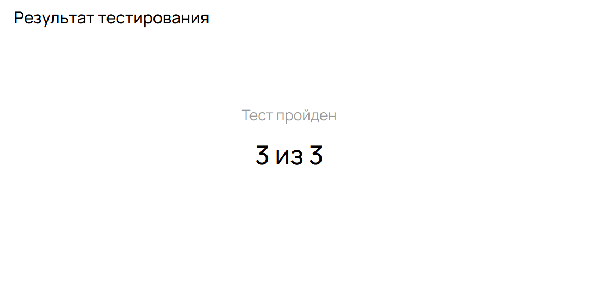
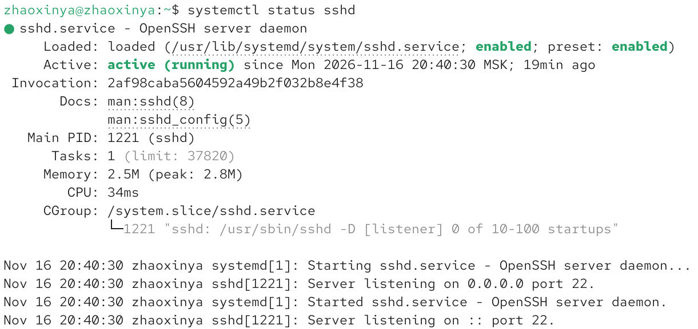
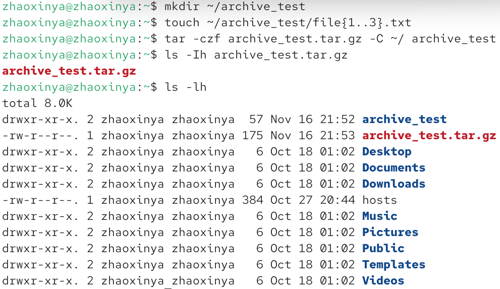

## Цель работы

Освоение базовых команд Linux, понимание структуры файловой системы и принципов работы с процессами на примере внешнего курса.

## Модуль 1. Введение в системное администрирование

- Философия свободного ПО (возможность модификации без нарушения авторских прав).
- Инструменты мониторинга (Zabbix).
- Ключевые обязанности системного администратора (мониторинг состояния серверов).

{width=50%}

## Модуль 2. Базовые команды Linux

В ходе данного модуля были изучены основные команды для работы с текстом, процессами и службами.

- `journalctl -k` — просмотр логов ядра.
- `systemctl status sshd` — проверка состояния SSH.
- `systemctl list-units` — список активных служб.

{width=70%}

## Модуль 3. Файлы и каталоги

Освоены команды управления файлами и каталогами, а также работа с архивами.

- `mkdir -p` — создание структуры каталогов.
- `tar -czf` — создание сжатых архивов.
- `scp` — передача данных между серверами.
- Автоматизация с помощью Bash-скриптов и `cron`.

{width=70%}

## Пример Bash-скрипта

```bash
#!/bin/bash
LOG_DIR="/var/log"
ARCHIVE_DIR="/var/archive"
DATE=$(date +%Y%m%d)
ARCHIVE_PATH="${ARCHIVE_DIR}/backup_${DATE}.log"

if [ -e "$ARCHIVE_PATH" ]; then
    echo "Archive already exists."
    exit 0
fi
sudo tar -czf "$ARCHIVE_PATH" -C "$LOG_DIR" .

Заключение
Изучены базовые команды Linux.

Получены навыки управления файлами, процессами и службами.

Освоена автоматизация задач с помощью Bash и Cron.

Все задания и тесты выполнены успешно.

Спасибо за внимание!