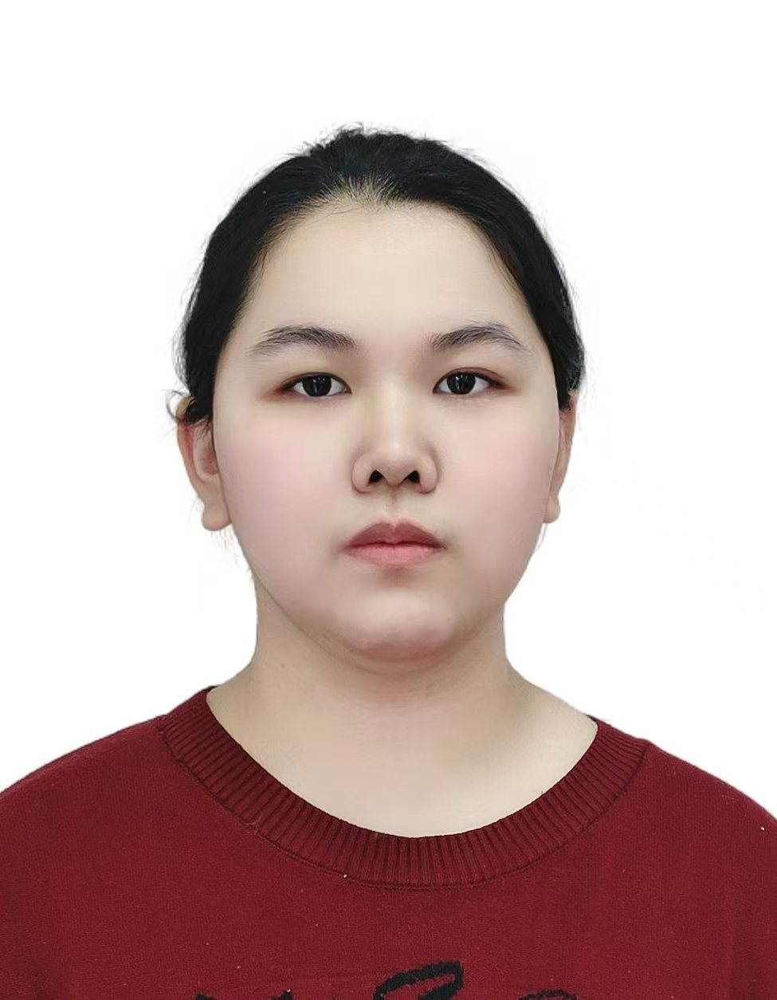
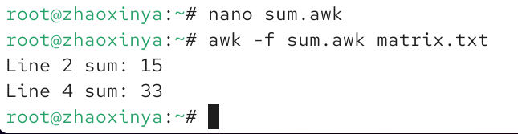
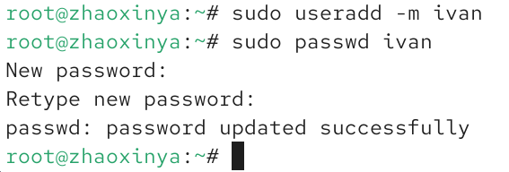
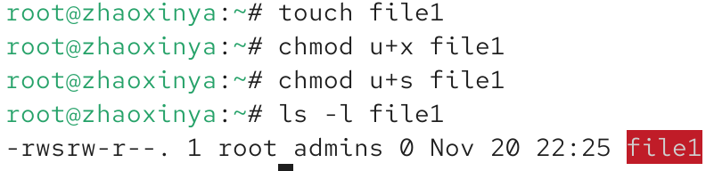
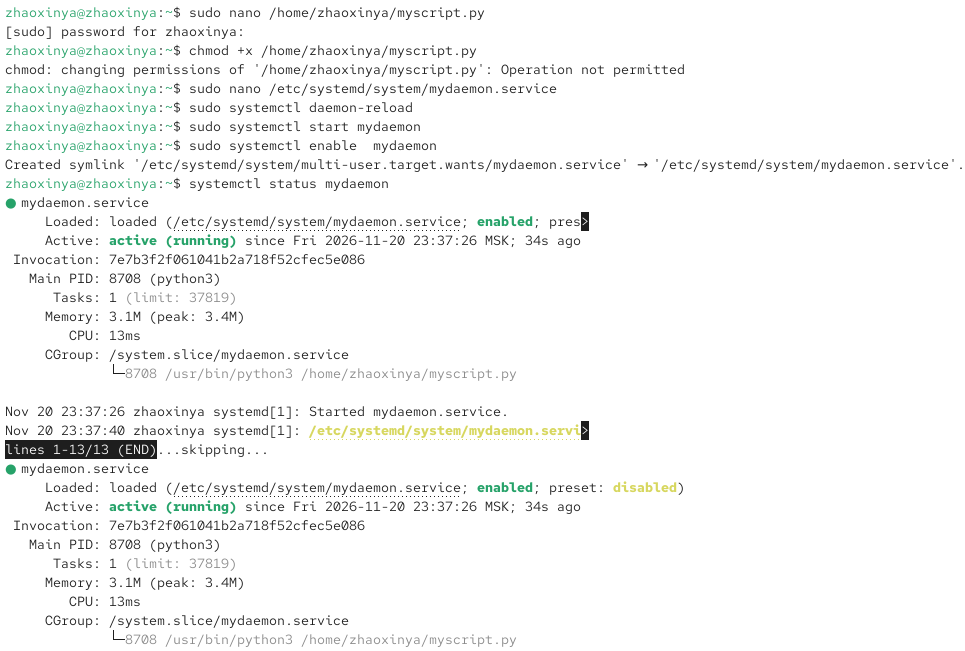

# Информация

## Докладчик

::: {.columns align=center}
::: {.column width="50%"}
- Чжао Синья
- Группа: НПИбд-03-25
- Направление: Прикладная информатика
- РУДН им. П. Лумумбы
- Студенческий билет: 1132258332
:::
::: {.column width="50%"}
{width=80%}
:::
:::

# Вводная часть

## Актуальность и объект

- **Актуальность:** Управление доступом и процессами является основой безопасности и стабильности серверной инфраструктуры.
- **Объект исследования:** Операционная система Linux и её утилиты администрирования.
- **Предмет исследования:** Команды управления пользователями, правами, процессами и сервисами systemd.

## Цели и задачи

- **Цель:** Пройти второй раздел внешнего курса и получить практические навыки администрирования Linux.
- **Задачи:**
  - Освоить работу с текстовыми файлами и логами.
  - Изучить управление пользователями и группами.
  - Настроить права доступа и специальные биты (SUID, SGID, Sticky Bit).
  - Освоить управление процессами и системными сервисами.

## Материалы и методы

- Операционная система: Rocky Linux 10 (в VirtualBox)
- Инструменты: Bash, systemd, утилиты GNU Coreutils, ACL, cron.

# Выполнение работы

## Модуль 4. Получение справки и работа с текстом

- Работа со справкой: `man`, `info`.
- Просмотр текста: `less`.
- Поиск в файлах: `grep`, `awk`.

{width=70%}

## Модуль 5. Управление пользователями и группами

- Создание пользователей: `useradd`, `passwd`.
- Управление группами: `groupadd`, `usermod -aG`.
- Политики паролей: `chage`.

{width=70%}

## Модуль 6. Управление доступом (права и специальные биты)

- Базовые права: `chmod`, `chown`, `chgrp`.
- `umask` и права по умолчанию.
- ACL: `setfacl`, `getfacl`.
- Специальные биты: SUID (`u+s`), SGID (`g+s`), Sticky Bit (`+t`).

{width=70%}

## Модуль 7. Управление процессами и сервисами

- Просмотр процессов: `ps`, `top`, `htop`.
- Завершение процессов: `kill -9`.
- Управление приоритетами: `nice`, `renice`.
- Управление сервисами: `systemctl`.

{width=70%}

# Заключение

## Выводы

- Освоены методы поиска информации и работы с текстом.
- Получены навыки управления пользователями и правами доступа.
- Изучены специальные разрешения (SUID, SGID, Sticky Bit).
- Освоено управление процессами и системными сервисами через `systemd`.
- **Все контрольные тесты и задания выполнены успешно.**

## Спасибо за внимание!

Готов ответить на ваши вопросы.