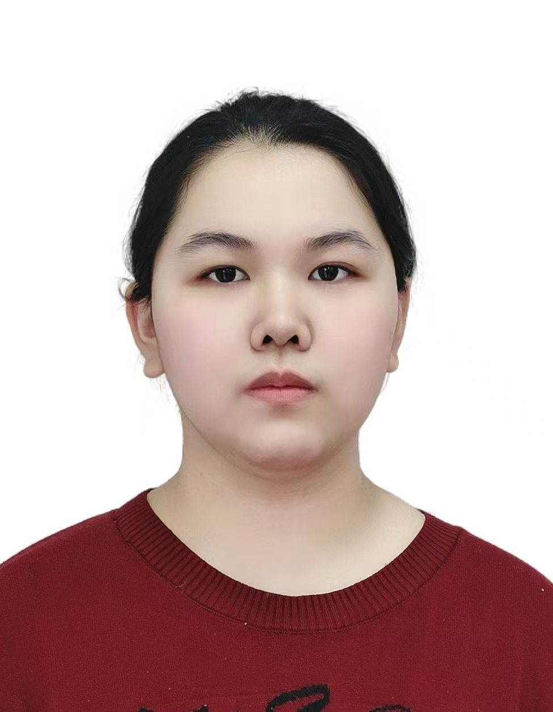
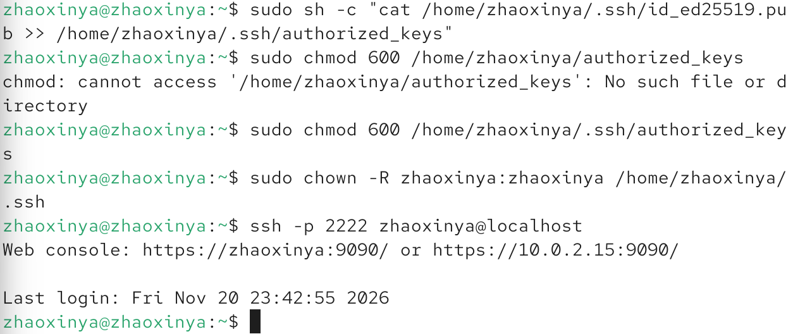
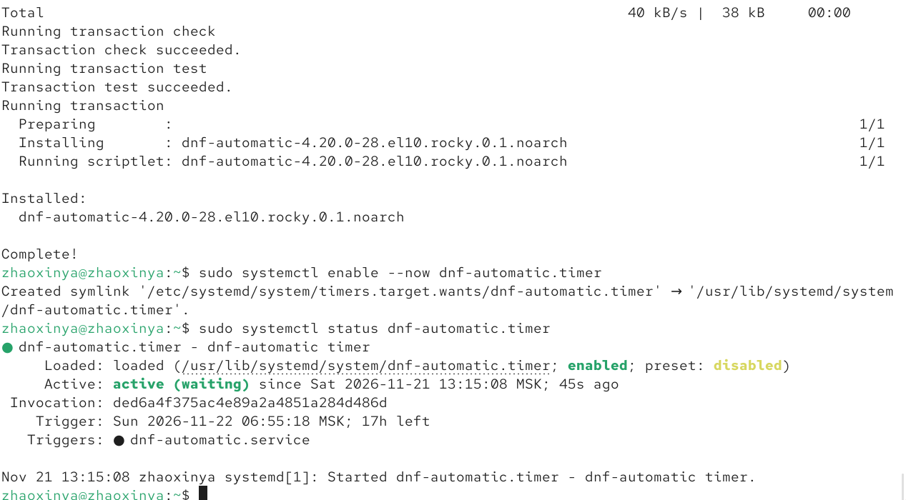
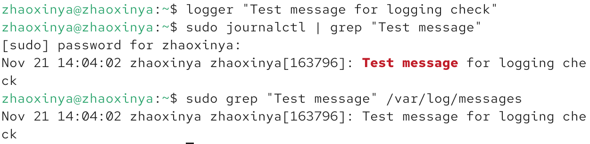
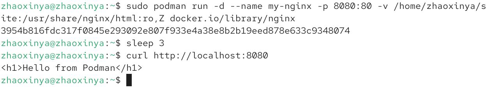
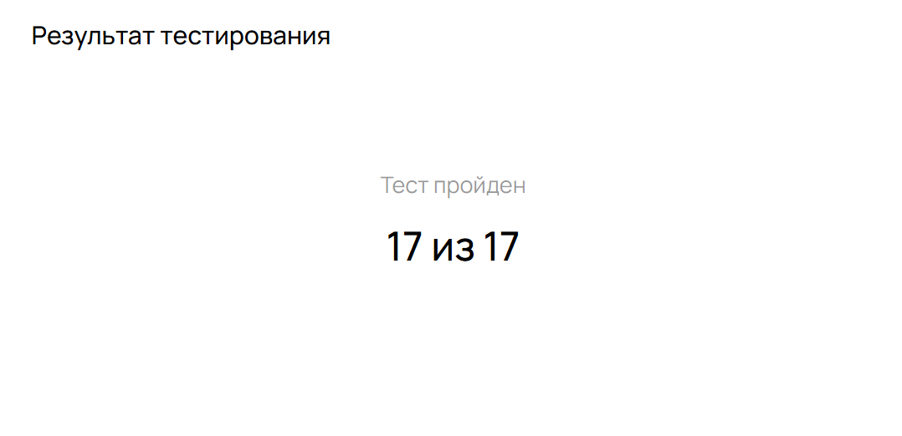
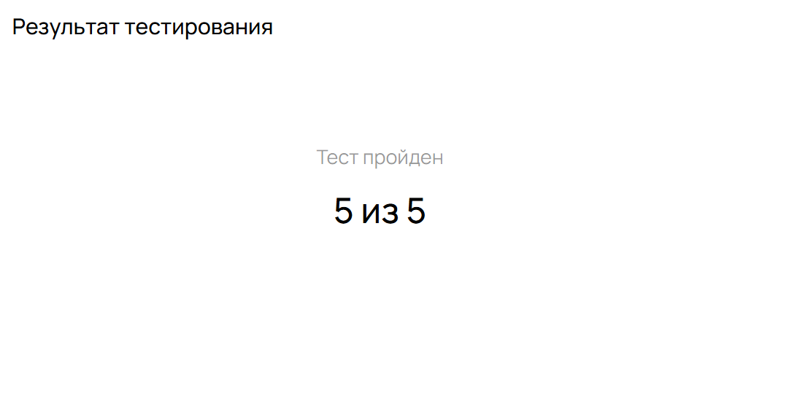

# Информация

## Докладчик

::: {.columns align=center}
::: {.column width="50%"}
- Чжао Синья
- Группа: НПИбд-03-25
- Направление: Прикладная информатика
- РУДН им. П. Лумумбы
- Студенческий билет: 1132258332
:::
::: {.column width="50%"}
{width=80%}
:::
:::

# Вводная часть

## Актуальность и объект

- **Актуальность:** Сетевые технологии, управление пакетами, логирование и контейнеризация — это ключевые области современного системного администрирования.
- **Объект исследования:** Операционная система Linux и её сетевые, пакетные, логовые и контейнерные подсистемы.
- **Предмет исследования:** Команды настройки сети, SSH, управления пакетами, ротации логов и работы с Podman.

## Цели и задачи

- **Цель:** Пройти третий раздел внешнего курса и получить практические навыки администрирования Linux.
- **Задачи:**
  - Освоить настройку сети и диагностику.
  - Изучить управление SSH-доступом и его защиту.
  - Освоить управление пакетами и логированием.
  - Познакомиться с контейнеризацией на базе Podman.
  - Дополнительно изучить основы SELinux.

## Материалы и методы

- Операционная система: Rocky Linux 10 (в VirtualBox)
- Инструменты: Bash, firewalld, Podman, rsyslog, logrotate, SELinux.

# Выполнение работы

## Модуль 8. Настройка сети и SSH

- Настройка статического IP через `ip` и `nmcli`.
- Проверка доступности через `ping`, `dig`.
- Настройка SSH-порта, ключей и ограничений.

{width=70%}

## Модуль 9. Управление пакетами

- Установка и удаление пакетов через `dnf`.
- Автоматические обновления безопасности (`dnf-automatic`).
- Работа с зависимостями и локальными RPM-пакетами.

{width=70%}

## Модуль 10. Управление логами

- Двойное логирование: `systemd-journald` и `rsyslog`.
- Фильтрация логов по уровню и по службам.
- Ротация логов через `logrotate`.
- Отправка логов на удаленный сервер.

{width=70%}

## Модуль 11. Контейнеризация (Podman)

- Установка и запуск контейнеров.
- Управление ресурсами (память, CPU).
- Создание кастомных образов и экспорт/импорт.

{width=70%}

## Финальный тест

- Успешно пройден финальный тест по всему курсу.
- **Результат: 17 из 17.**
- Дополнительно пройден бонусный модуль по SELinux.

{width=50%}

## Бонус: SELinux

- Изучены режимы SELinux (Enforcing, Permissive, Disabled).
- Освоены контексты безопасности и булевы переменные.
- **Результат теста: 5 из 5.**

{width=50%}

# Заключение

## Выводы

- Освоены настройка сети, SSH и диагностика.
- Получены навыки управления пакетами и логированием.
- Изучена работа с контейнерами Podman.
- Дополнительно освоены основы SELinux.
- **Все контрольные тесты и задания выполнены успешно.**

## Спасибо за внимание!

Готов ответить на ваши вопросы.