# Введение

## Актуальность

Управление доступом, пользователями, процессами и системными сервисами — это фундаментальные задачи системного администратора. Освоение этих инструментов необходимо для обеспечения безопасности и стабильной работы серверов.

## Цель работы

Изучить механизмы управления пользователями и правами доступа, освоить работу с процессами и системными сервисами в Linux.

# Выполнение работы

## Модуль 4. Получение справки и работа с текстом

### Задания по теме «Поиск справочной информации в Linux»

**Задание 1:** Используйте `man`, чтобы узнать, как работает команда `grep`.

Выполнена команда `man grep`, открывающая справочную страницу. Навигация в `man` осуществляется с помощью клавиш `/` (поиск), `n` (следующее совпадение) и `q` (выход).

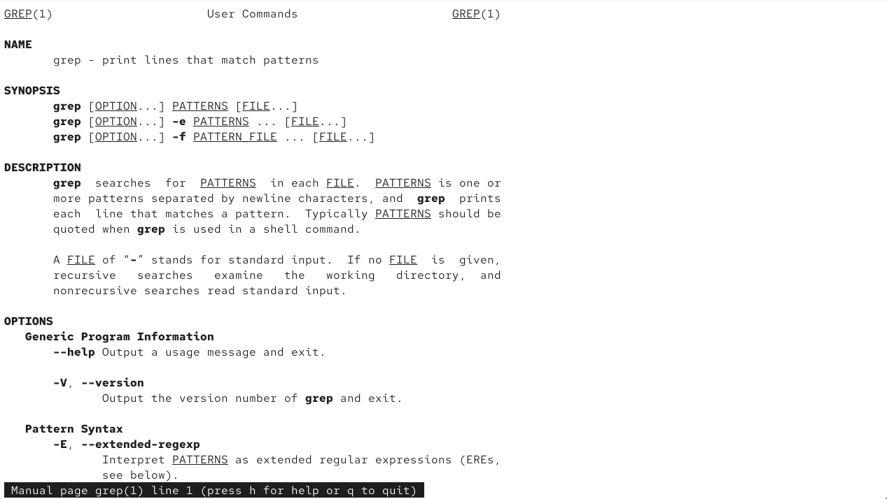{width=80% fig-pos='H'}

**Задание 2:** Найдите документацию о `systemctl` с помощью `info`.

При попытке выполнить `info systemctl` система сообщила об отсутствии утилиты `info`. После установки пакета `info` команда была выполнена.

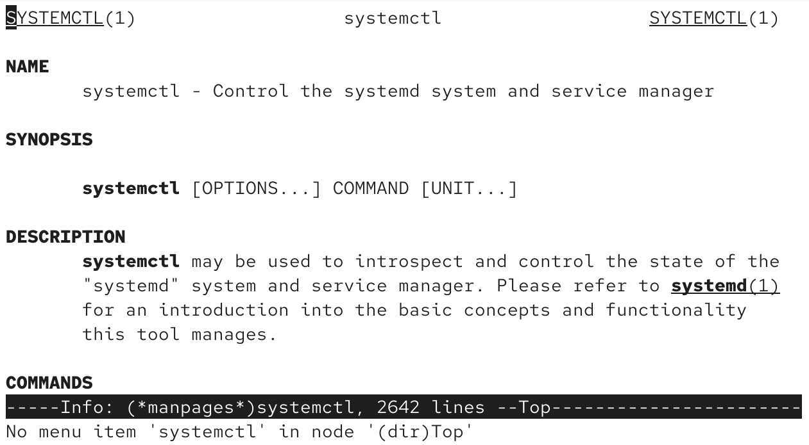{width=80% fig-pos='H'}

**Задание 3:** Откройте локальную документацию о `info`.

Команда `ls /usr/share/doc/info` вернула ошибку `No such file or directory`, что связано с различиями в структуре пакетов между дистрибутивами.

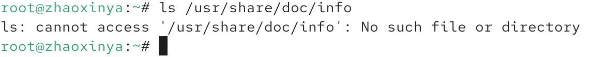{width=80% fig-pos='H'}

### Тест по теме «Поиск справочной информации в Linux»

**Вопрос 1:** Какая команда поможет узнать, как работает утилита grep?

**Ответ:** `man grep`. Команда открывает справочную страницу с описанием синтаксиса, опций и примеров использования.

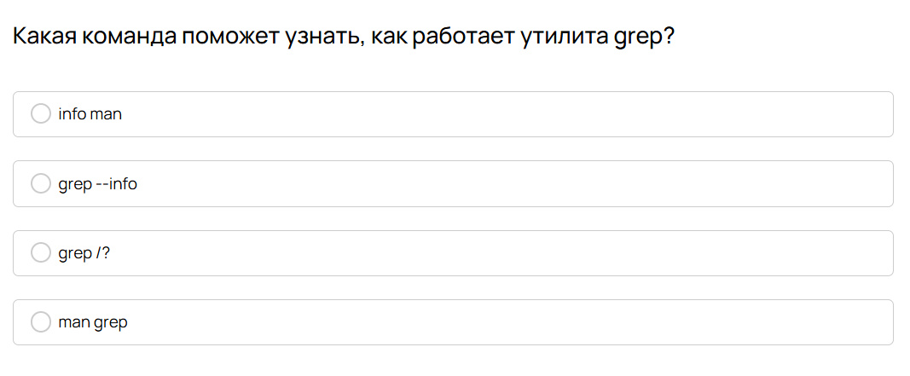{width=80% fig-pos='H'}

**Вопрос 2:** Что делает команда info?

**Ответ:** Открывает справку в формате info для заданной команды. Формат `info` представляет собой структурированное руководство с гиперссылками.

*[Изображение отсутствует: 4-2p2.png]*

**Вопрос 3:** Где чаще всего находятся текстовые справочные файлы к установленным программам?

**Ответ:** `/usr/share/doc`. Согласно стандарту FHS, документация к программам располагается в этом каталоге.

*[Изображение отсутствует: 4-2p3.png]*

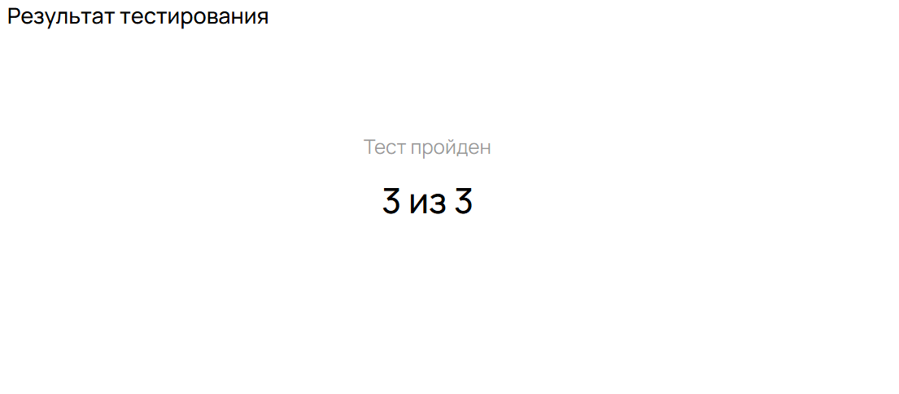{width=80% fig-pos='H'}

### Задания по теме «Работа с текстовыми файлами в Linux»

**Задание 1:** Откройте файл `/etc/os-release` с помощью `less` и найдите название дистрибутива.

Команда `less /etc/os-release` открывает файл в постраничном режиме. С помощью клавиши `/` можно найти название дистрибутива (`NAME="Rocky Linux"`).

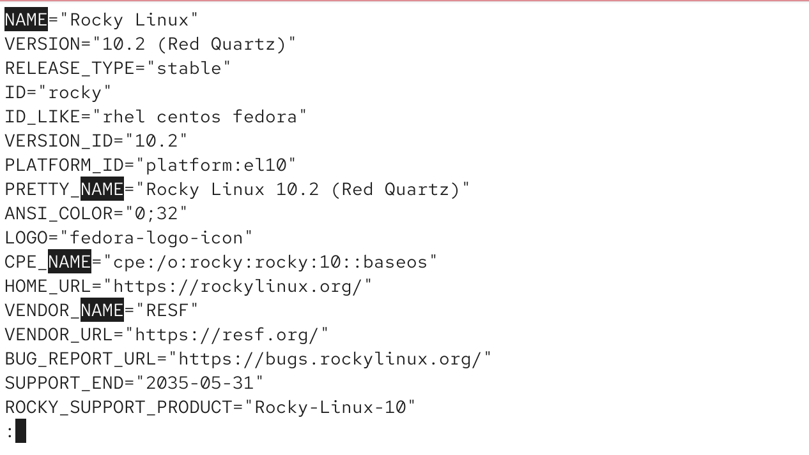{width=80% fig-pos='H'}

**Задание 2:** Используйте `grep`, чтобы найти строки с «error» в файле `/var/log/syslog`.

В Rocky Linux используется `/var/log/messages`. Команда `grep -i "error" /var/log/messages | head -n 10` ищет строки с подстрокой "error" (без учета регистра).

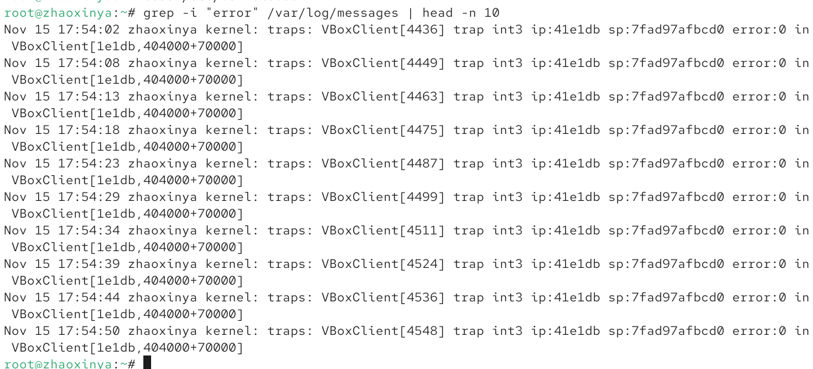{width=80% fig-pos='H'}

**Задание 3:** Отредактируйте конфигурацию SSH с помощью `nano` и измените параметр `PermitRootLogin no`.

С помощью `sudo nano /etc/ssh/sshd_config` был отредактирован файл. Параметр `PermitRootLogin` изменен на `no`.

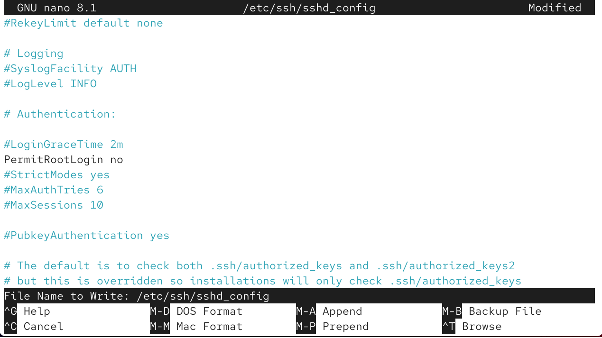{width=80% fig-pos='H'}

**Задание 4:** Создайте файл с матрицей чисел и посчитайте сумму чисел в каждой четной строке с помощью `awk`.

Создан файл `matrix.txt`. Для подсчета суммы чисел в четных строках использовалась утилита `awk`. Условие `NR % 2 == 0` выбирает четные строки, в которых вычисляется сумма всех полей.

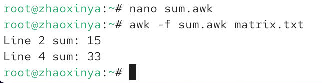{width=80% fig-pos='H'}

### Тест по теме «Работа с текстовыми файлами в Linux»

**Вопрос 1:** Что делает команда `cat > файл.txt`?

**Ответ:** Создает новый файл и записывает в него. Символ `>` перенаправляет вывод в файл.

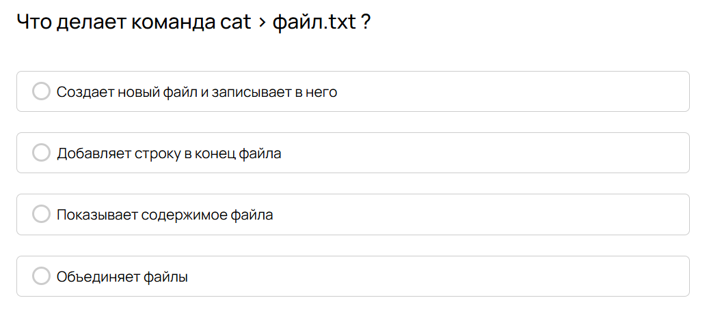{width=80% fig-pos='H'}

**Вопрос 2:** Чем отличается `cat >> файл.txt` от `cat > файл.txt`?

**Ответ:** `>>` дописывает в конец, `>` — перезаписывает.

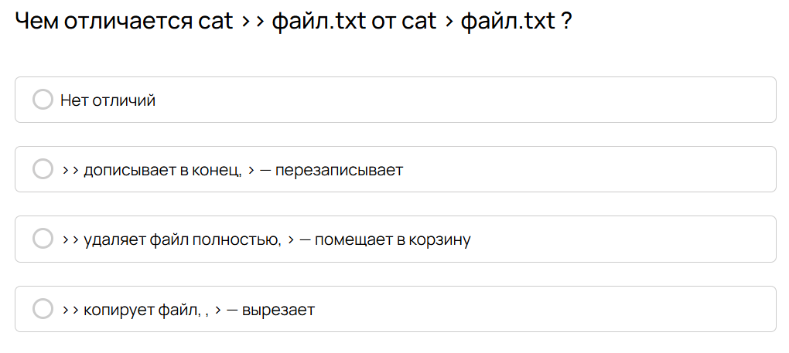{width=80% fig-pos='H'}

**Вопрос 3:** Чем `less` отличается от `cat` при просмотре больших файлов?

**Ответ:** `less` показывает содержимое постранично с навигацией и поиском.

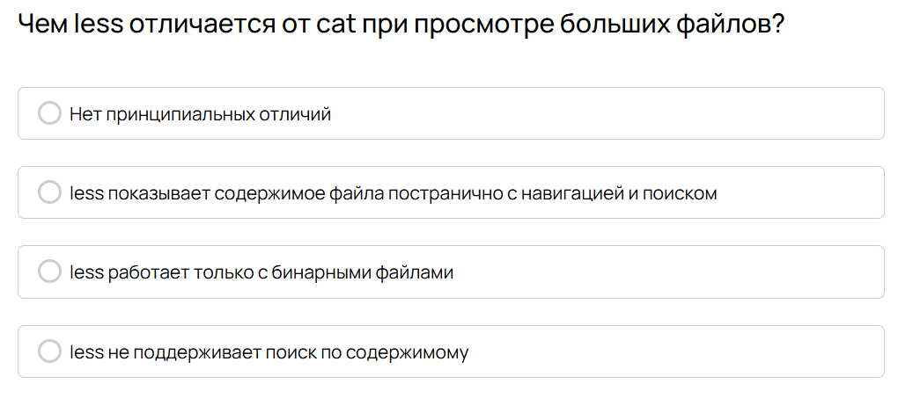{width=80% fig-pos='H'}

**Вопрос 4:** Какой клавишей можно выйти из утилиты `less`?

**Ответ:** `q`.

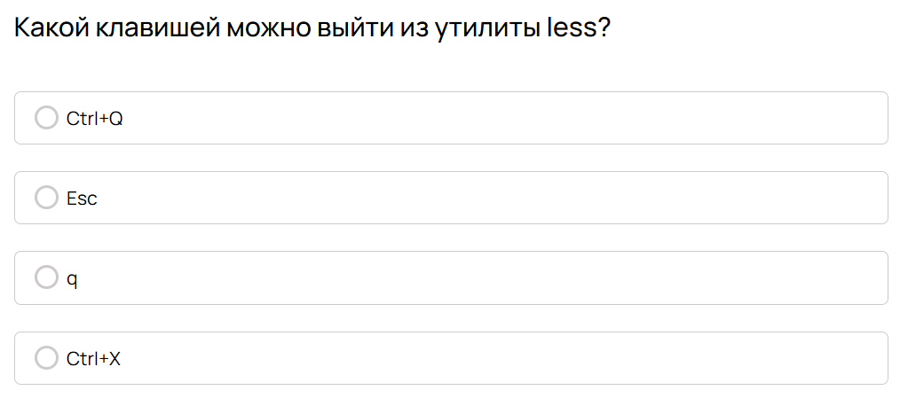{width=80% fig-pos='H'}

**Вопрос 5:** С помощью какой клавиши в Vim можно переключиться из Normal mode в Command mode?

**Ответ:** `:`.

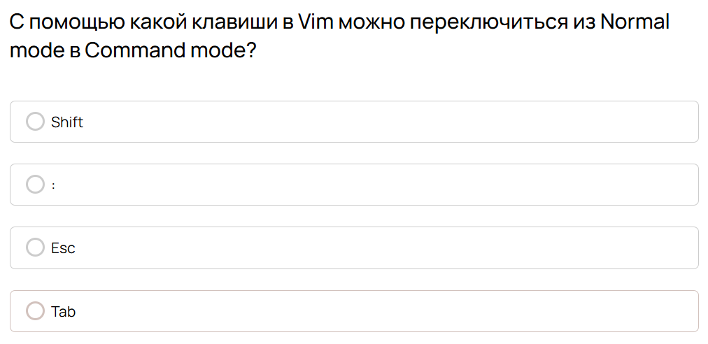{width=80% fig-pos='H'}

{width=80% fig-pos='H'}

### Задания по теме «Анализ системных логов»

**Задание 1:** Найдите все ошибки в системном журнале за последний день.

Команда `journalctl --since "yesterday" --grep "error"` выполняет поиск записей с ключевым словом "error" за последний день.

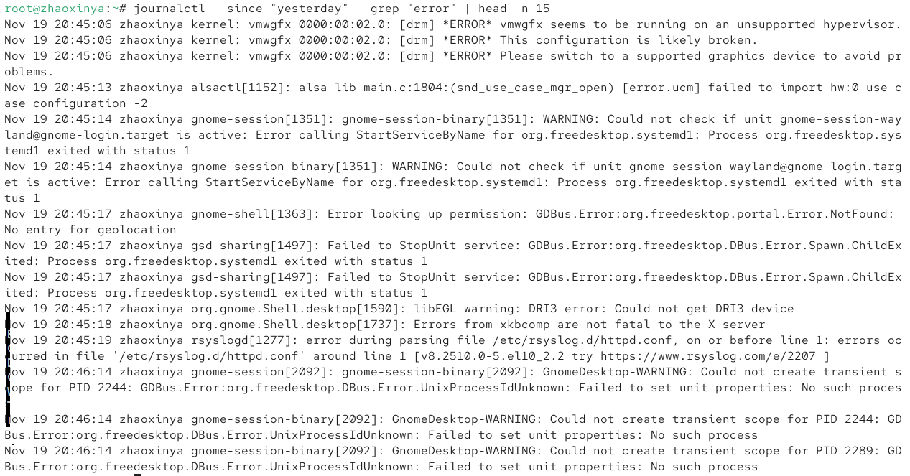{width=80% fig-pos='H'}

**Задание 2:** Проверьте логи SSH и найдите неудачные попытки входа.

Команда `journalctl -u sshd --grep "Failed password"` фильтрует логи только для службы SSH.

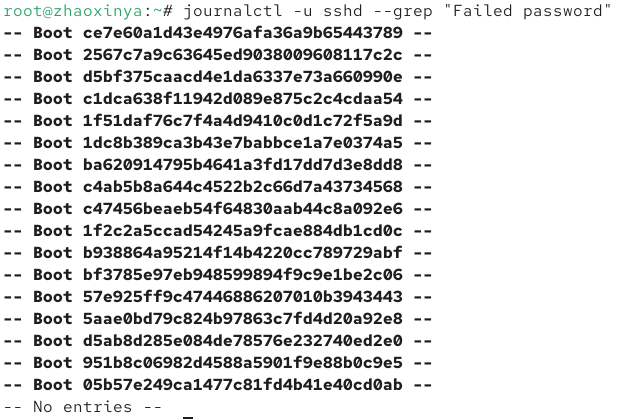{width=80% fig-pos='H'}

### Тест по теме «Анализ системных логов»

**Вопрос 1:** Где хранятся основные лог-файлы в Linux?

**Ответ:** `/var/log/`.

*[Изображение отсутствует: 4-4p1.png]*

**Вопрос 2:** Что делает команда `journalctl -u sshd --since today`?

**Ответ:** Показывает логи sshd за сегодня.

*[Изображение отсутствует: 4-4p2.png]*

**Вопрос 3:** Какой параметр `journalctl` показывает последние 20 записей?

**Ответ:** `-n 20`.

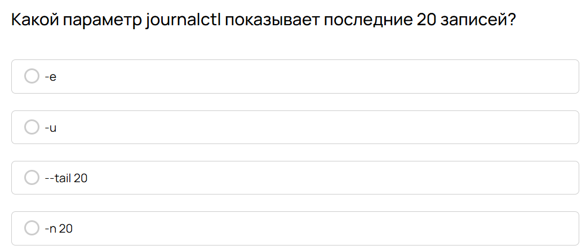{width=80% fig-pos='H'}

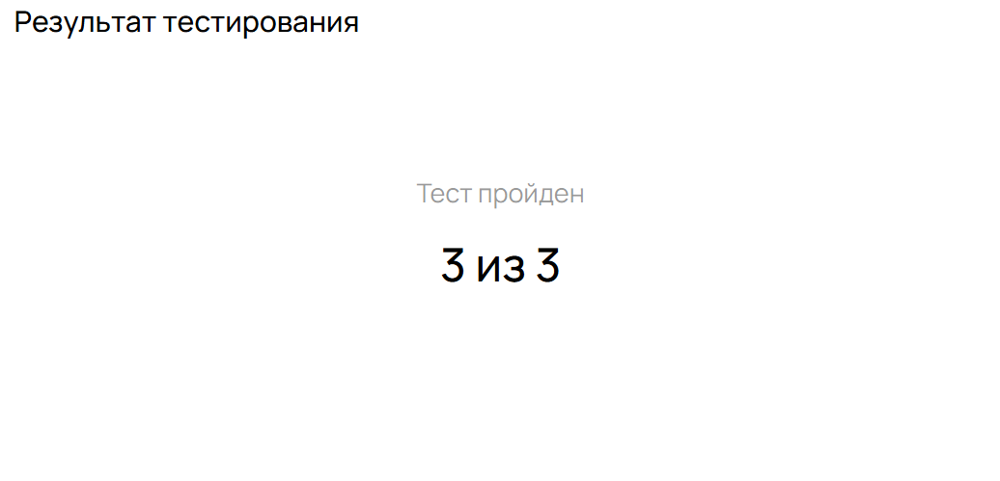{width=80% fig-pos='H'}

## Модуль 5. Управление пользователями и группами

### Задания по теме «Основы управления пользователями и группами»

**Задание 1:** Создайте нового пользователя `ivan` и задайте ему пароль.

Создан пользователь `ivan` (`sudo useradd -m ivan`), пароль задан через `sudo passwd ivan`.

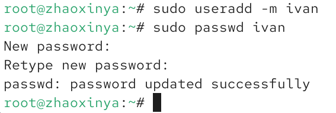{width=80% fig-pos='H'}

**Задание 2:** Создайте новую группу `developers`.

Группа создана (`sudo groupadd developers`), проверка через `cat /etc/group | grep developers`.

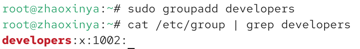{width=80% fig-pos='H'}

**Задание 3:** Добавьте пользователя `ivan` в группу `developers`.

Пользователь добавлен (`sudo usermod -aG developers ivan`). Проверка `groups ivan` показывает `developers` в списке групп.

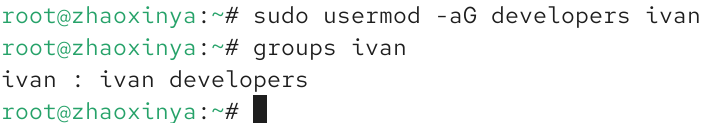{width=80% fig-pos='H'}

**Задание 4:** Создайте группу `testers` и поменяйте принадлежность `ivan` с `developers` на `testers`.

Создана группа `testers`, пользователь добавлен в неё (`gpasswd -a ivan testers`) и удален из `developers` (`gpasswd -d ivan developers`).

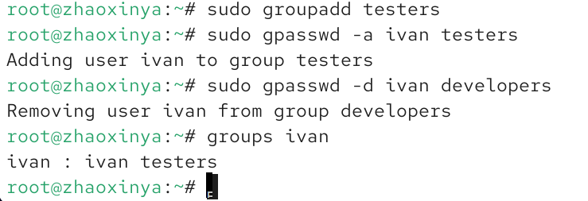{width=80% fig-pos='H'}

**Задание 5:** Удалите учетную запись пользователя `ivan` вместе с домашним каталогом.

Выполнено `sudo userdel -r ivan`. Проверка `ls /home/` подтверждает удаление.

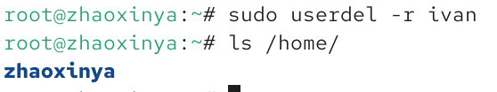{width=80% fig-pos='H'}

### Тест по теме «Основы управления пользователями и группами»

**Вопрос 1:** Какой флаг команды `useradd` используется для создания домашней директории?

**Ответ:** `-m`.

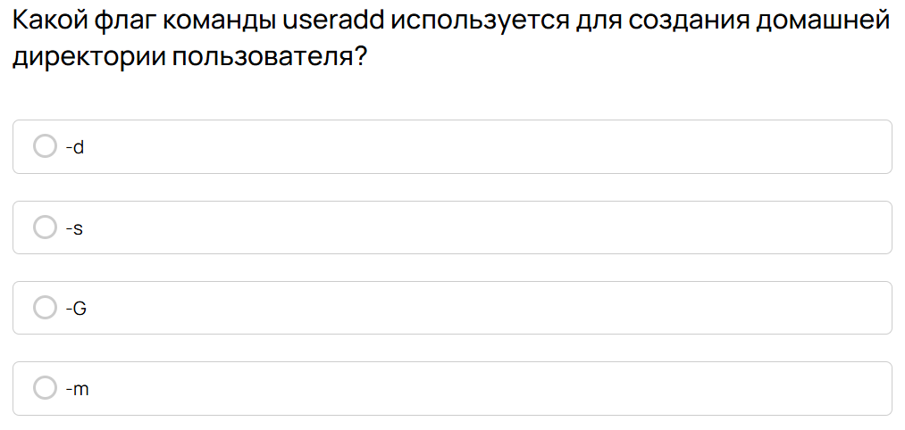{width=80% fig-pos='H'}

**Вопрос 2:** Какая команда удалит пользователя вместе с его домашней директорией?

**Ответ:** `sudo userdel -r admin`.

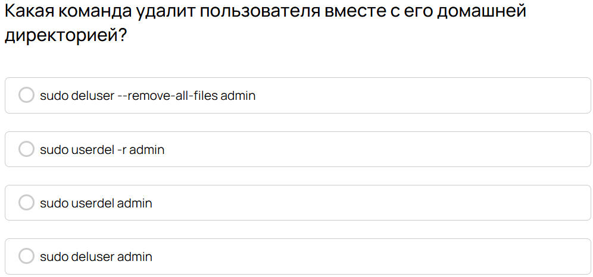{width=80% fig-pos='H'}

**Вопрос 3:** Что делает команда `sudo usermod -aG sudo admin`?

**Ответ:** Добавляет пользователя `admin` в группу `sudo`, сохранив остальные группы.

*[Изображение отсутствует: 5-2p3.png]*

**Вопрос 4:** Какая команда используется для безопасного редактирования файла `/etc/passwd`?

**Ответ:** `vipw`.

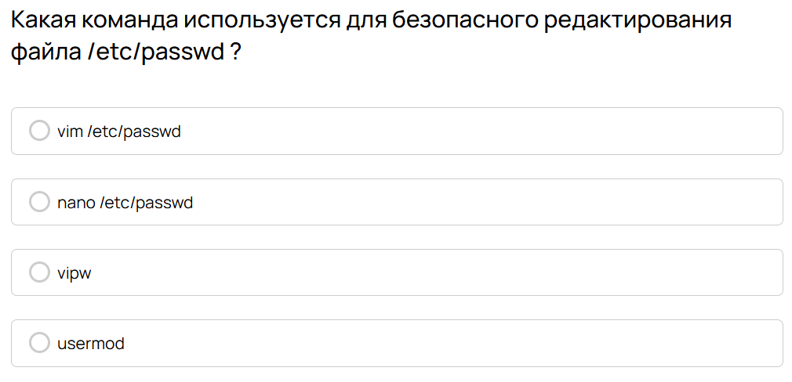{width=80% fig-pos='H'}

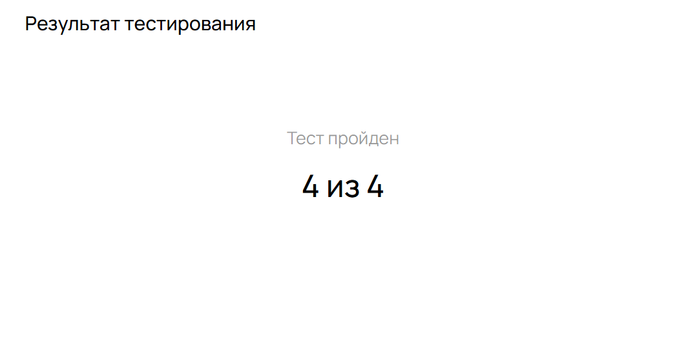{width=80% fig-pos='H'}

### Задания по теме «Права доступа и безопасность»

**Задание 1:** Создайте файл и настройте ему права 644.

Создан файл `file1`, права 644 (`chmod 644 file1`).

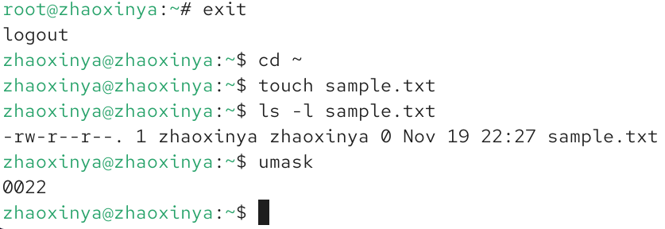{width=80% fig-pos='H'}

**Задание 2:** Уберите права на запись для группы и на чтение для всех остальных.

Команда `chmod g-w,o-r sample.txt` убирает соответствующие права.

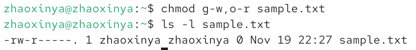{width=80% fig-pos='H'}

**Задание 3:** Верните первоначальные доступы файлу, используя числовую форму.

Команда `chmod 644 file1` возвращает права 644.

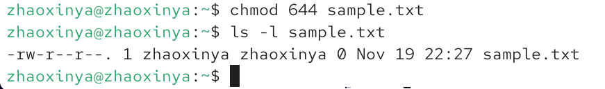{width=80% fig-pos='H'}

**Задание 4:** Сделайте владельцем файла пользователя `root`.

Команда `sudo chown root file1` меняет владельца на `root`.

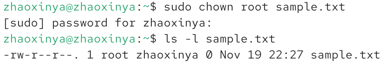{width=80% fig-pos='H'}

**Задание 5:** Верните себе владение файлом.

Команда `sudo chown zhaoxinya file1` возвращает владение текущему пользователю.

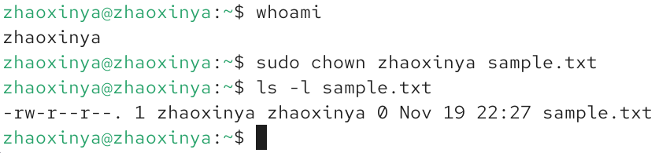{width=80% fig-pos='H'}

### Тест по теме «Права доступа и безопасность»

**Вопрос 1:** Что означает первый символ `d` в строке прав доступа?

**Ответ:** `Директория (каталог)`.

*[Изображение отсутствует: 5-3p1.png]*

**Вопрос 2:** Какая команда сменит владельца и группу файла на `ivan` и `friends`?

**Ответ:** `chown ivan:friends /home/ivan/file.txt`.

*[Изображение отсутствует: 5-3p2.png]*

**Вопрос 3:** Какие права доступа соответствуют числовому значению 754?

**Ответ:** `rwxr-xr--`.

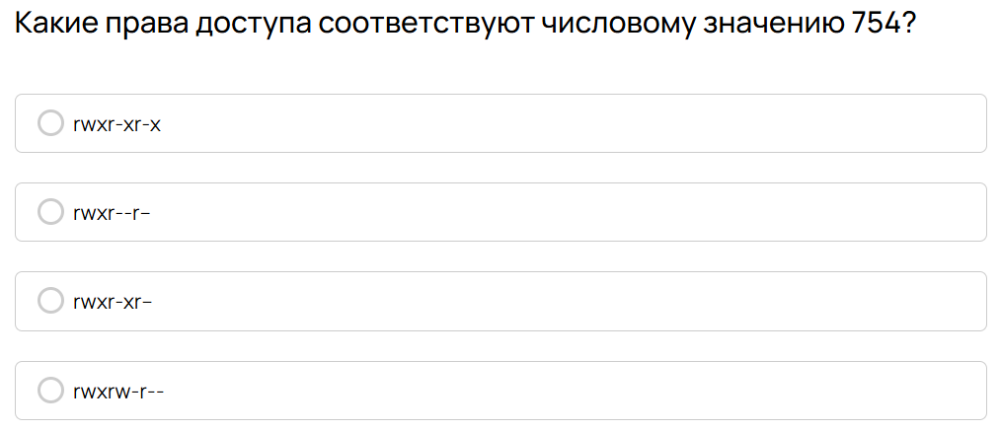{width=80% fig-pos='H'}

{width=80% fig-pos='H'}

### Задания по теме «Повышение безопасности учетных записей»

**Задание 1:** Выполните несколько действий через `sudo` и найдите их в системном журнале.

С помощью `sudo journalctl _COMM=sudo` были просмотрены записи в журнале о командах с повышением привилегий.

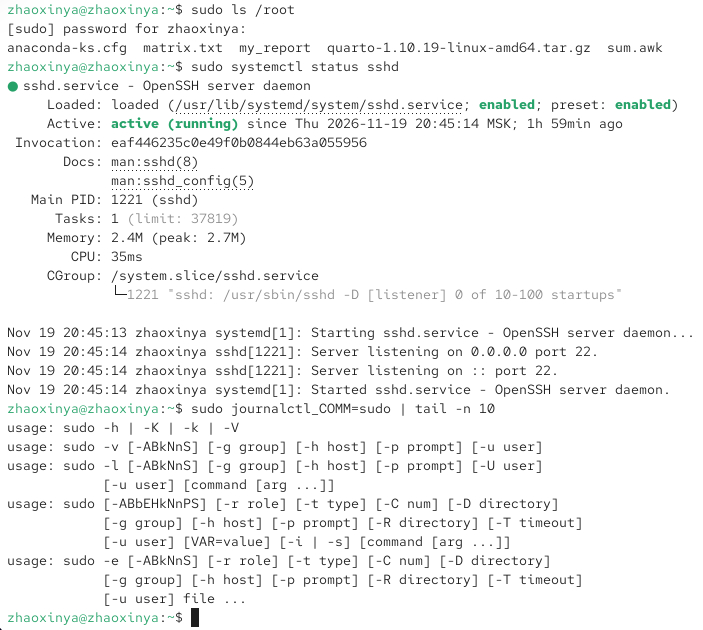{width=80% fig-pos='H'}

**Задание 2:** Проверьте, может ли `ivan` выполнять команды суперпользователя. Если нет, предоставьте ему такую возможность.

Пользователь `ivan` был создан заново. Первоначальная попытка выполнить `sudo -u ivan sudo ls /root` завершилась отказом, так как `ivan` не входил в группу `wheel`. После добавления (`sudo usermod -aG wheel ivan`) и проверки (`groups ivan`), повторная команда прошла успешно.

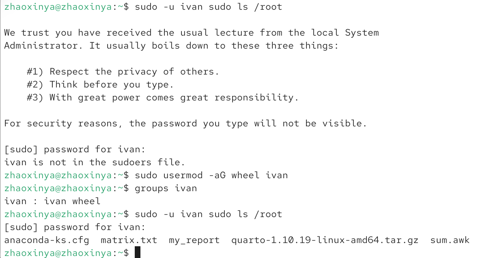{width=80% fig-pos='H'}

### Тест по теме «Повышение безопасности учетных записей»

**Вопрос 1:** Что произойдет, если вы используете `sudo` для выполнения действий?

**Ответ:** Будет зафиксировано, кто и когда выполнил команду с правами суперпользователя.

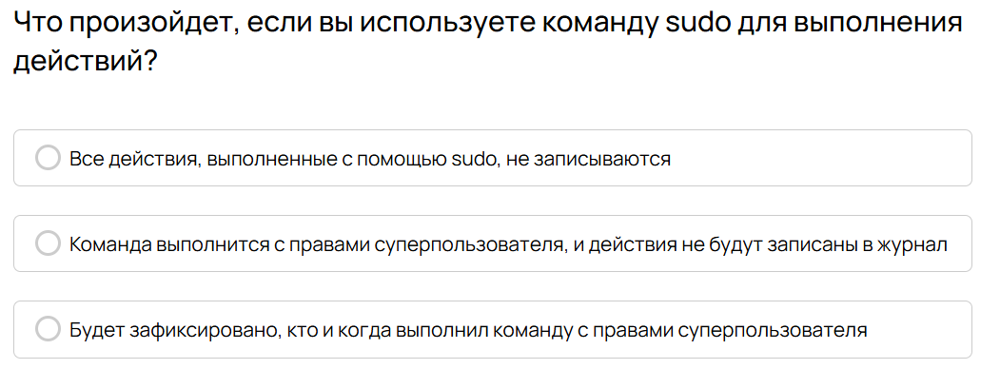{width=80% fig-pos='H'}

**Вопрос 2:** Что произойдет, если вы измените порт SSH с 22 на 47022, но не обновите файрвол?

**Ответ:** SSH будет работать на новом порту, но файрвол не разрешит подключения.

*[Изображение отсутствует: 5-4p2.png]*

**Вопрос 3:** Какую команду следует выполнить, чтобы добавить в файрвол `ufw` разрешение на подключение к порту 47022 по TCP?

**Ответ:** `sudo ufw allow 47022/tcp`.

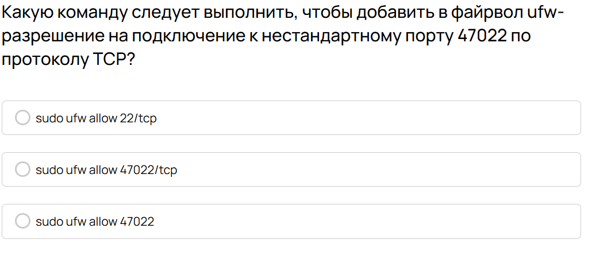{width=80% fig-pos='H'}

**Вопрос 4:** Почему рекомендуется использовать `sudo`, а не `su`?

**Ответ:** `sudo` не требует ввода пароля root, а выполняемые команды журналируются.

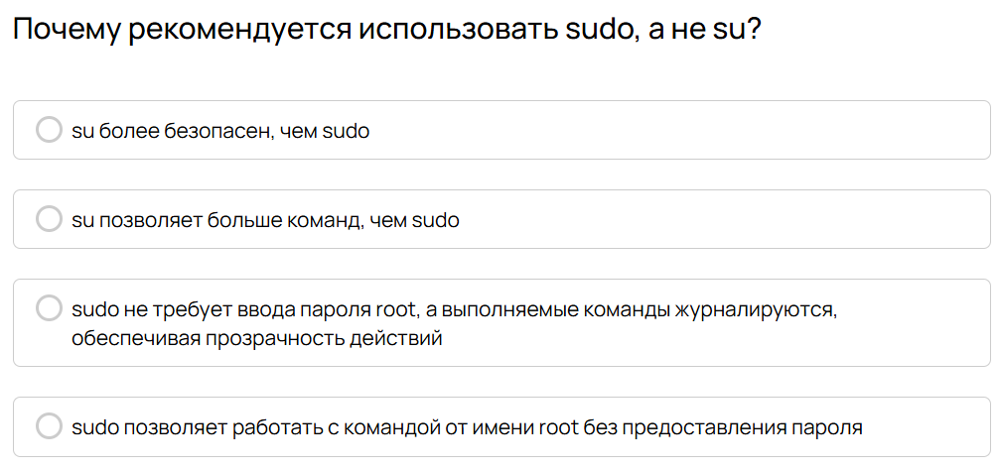{width=80% fig-pos='H'}

{width=80% fig-pos='H'}

### Задания по теме «Политика паролей»

**Задание 1:** Выведите имена пользователей с устаревшим алгоритмом SHA-512.

Команда `awk` для поиска SHA-512 хешей не дала результатов, так как Rocky Linux 10 по умолчанию использует YESCRYPT.

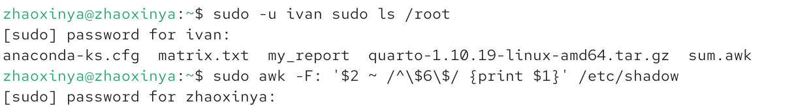{width=80% fig-pos='H'}

**Задание 2:** Создайте пользователя `ivan` и установите параметры политики паролей.

Пользователь `ivan` создан, политика настроена: `sudo chage -M 60 -m 5 -W 10 ivan`. Проверка через `sudo chage -l ivan` подтверждает параметры 60/5/10.

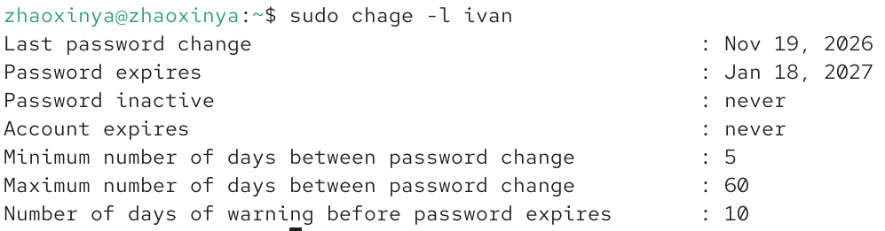{width=80% fig-pos='H'}

**Задание 3:** Заблокируйте вход пользователю `ivan`.

Блокировка: `sudo usermod -L ivan`. В файле `/etc/shadow` появляется `!`.

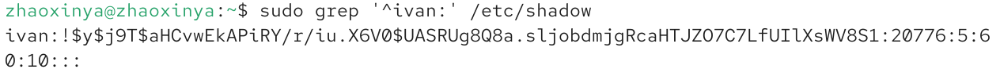{width=80% fig-pos='H'}

**Задание 4:** Верните пользователю возможность авторизоваться.

Разблокировка: `sudo usermod -U ivan`. Вход `sudo -u ivan -i` успешен.

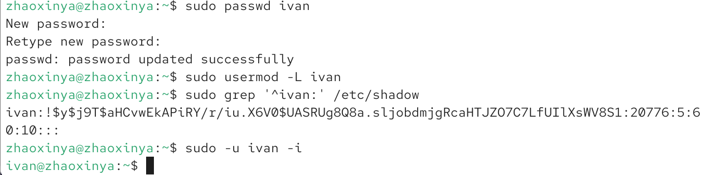{width=80% fig-pos='H'}

### Тест по теме «Политика паролей»

**Вопрос 1:** Какой из вариантов наиболее точно описывает хеширование пароля?

**Ответ:** Пароль преобразуется в уникальный отпечаток, который нельзя восстановить обратно.

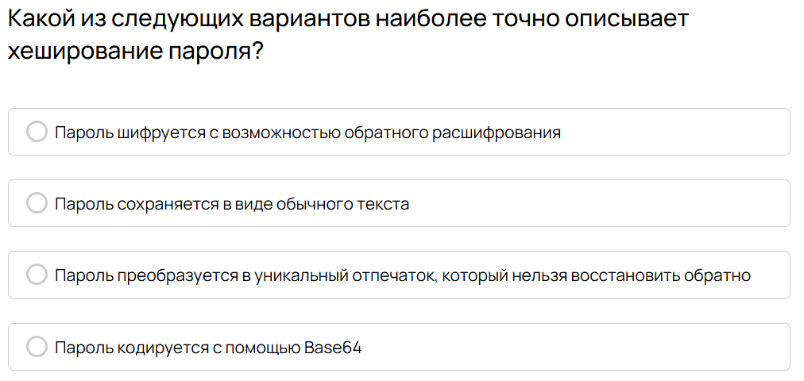{width=80% fig-pos='H'}

**Вопрос 2:** Что обозначает первая часть строки пароля в `/etc/shadow`, начинающаяся с `$`?

**Ответ:** Используемый алгоритм хеширования.

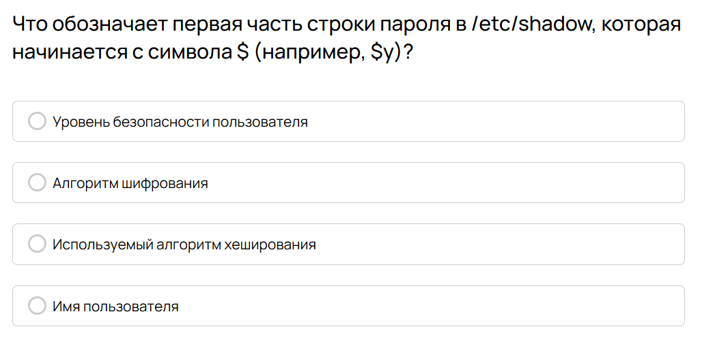{width=80% fig-pos='H'}

**Вопрос 3:** Какова функция «соли» (salt) при хешировании пароля?

**Ответ:** Сделать каждый хеш уникальным и предотвратить атаки с использованием rainbow-таблиц.

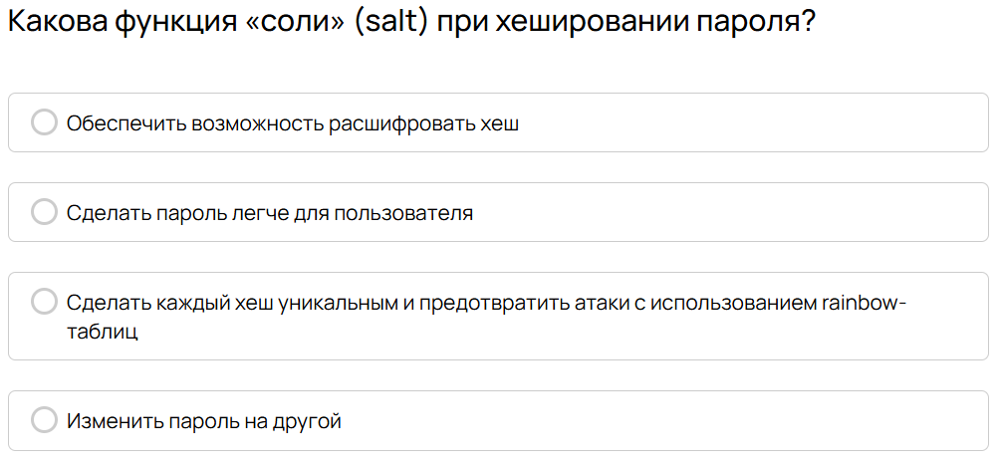{width=80% fig-pos='H'}

**Вопрос 4:** Какая команда позволяет просмотреть текущие параметры политики пароля для пользователя `ivan`?

**Ответ:** `chage -l ivan`.

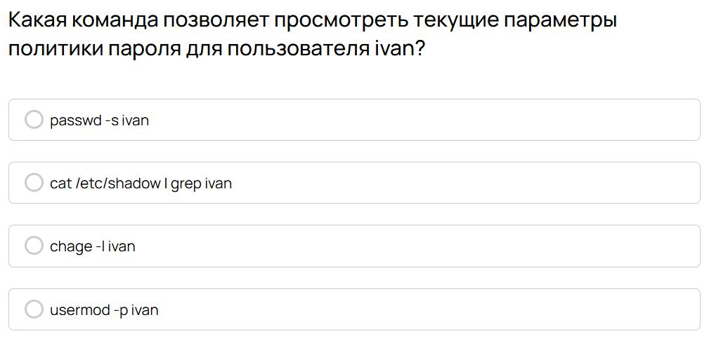{width=80% fig-pos='H'}

**Вопрос 5:** Что произойдет после выполнения команды `sudo usermod -L username`?

**Ответ:** Учетная запись будет заблокирована, и вход станет невозможным.

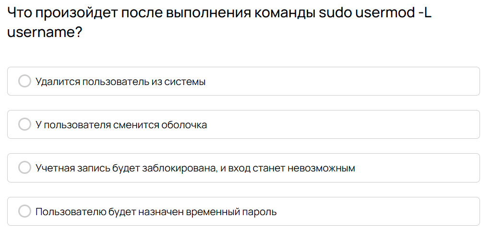{width=80% fig-pos='H'}

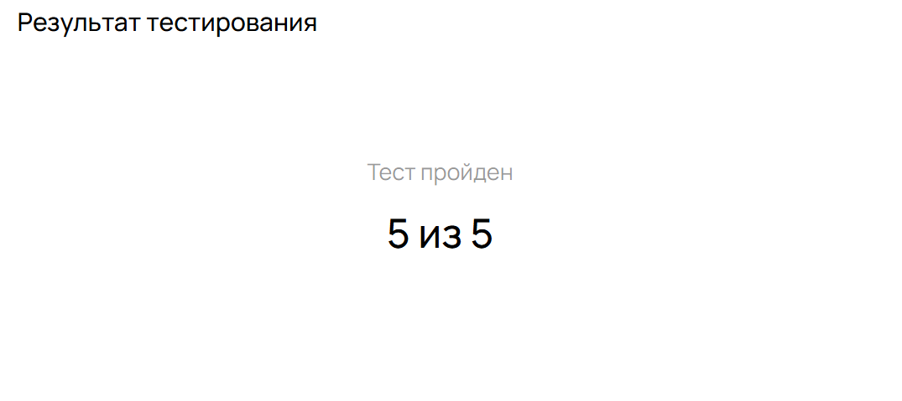{width=80% fig-pos='H'}

## Модуль 6. Управление доступом

### Задания по теме «Что такое права доступа в Linux»

**Задание 1:** Проверьте права доступа к `/etc/passwd`, `/home` и `/var/log`.

Команды `ls -l /etc/passwd`, `ls -ld /home`, `ls -ld /var/log` показывают права.

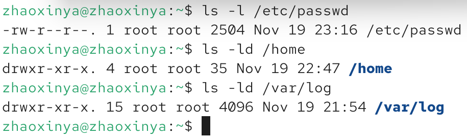{width=80% fig-pos='H'}

**Задание 2:** Создайте файл, проверьте его права и настройте `umask`.

В домашнем каталоге создан файл `file1` (права `-rw-r--r--`). После `umask 006` создан `file2` с правами `-rw-rw----`.

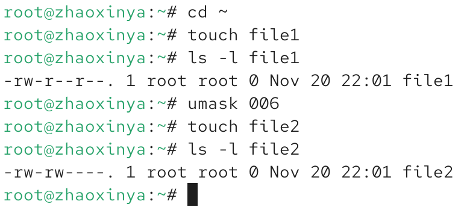{width=80% fig-pos='H'}

### Тест по теме «Что такое права доступа в Linux»

**Вопрос 1:** Какую команду надо ввести, чтобы посмотреть, какие права выданы файлам?

**Ответ:** `ls -l`.

{width=80% fig-pos='H'}

**Вопрос 2:** Какую команду надо ввести, чтобы посмотреть права файлов, в том числе скрытых?

**Ответ:** `ls -la`.

{width=80% fig-pos='H'}

**Вопрос 3:** Как будут записаны права `rw-` в восьмеричном формате?

**Ответ:** `6`.

{width=80% fig-pos='H'}

{width=80% fig-pos='H'}

### Задания по теме «Изменение прав доступа: chmod, chown, chgrp»

**Задание 1:** Создайте файл и настройте ему права 644.

Создан файл `file1`, права 644 (`chmod 644 file1`).

{width=80% fig-pos='H'}

**Задание 2:** Создайте группу `admins`, поменяйте группу файла и передайте группе право на запись.

Создана группа `admins` (`sudo groupadd admins`). Группа изменена (`sudo chgrp admins file1`). Группе выдано право на запись (`chmod g+w file1`). Итоговые права: `-rw-rw-r--`.

{width=80% fig-pos='H'}

### Тест по теме «Изменение прав доступа»

**Вопрос 1:** Какую команду нужно использовать для изменения прав файлов и каталогов?

**Ответ:** `chmod`.

{width=80% fig-pos='H'}

**Вопрос 2:** С помощью каких операторов можно указать тип изменения прав?

**Ответ:** `+ - =`.

{width=80% fig-pos='H'}

**Вопрос 3:** Какую опцию нужно добавить, чтобы изменить права не только к текущему каталогу, но и ко всем вложенным?

**Ответ:** `-R`.

{width=80% fig-pos='H'}

{width=80% fig-pos='H'}

### Задания по теме «Расширенные списки доступа (ACL)»

**Задание 1:** Разрешите конкретному пользователю изменять файл, не добавляя его в группу владельца.

Установлен пакет `acl`. Использован вызов `/usr/bin/setfacl -m u:zhaoxinya:w file1`. `getfacl` показывает `user:zhaoxinya:-w-`.

{width=80% fig-pos='H'}

**Задание 2:** Установите особые права для группы, чтобы она могла только выполнять файл.

Создана группа `test-group`, ей выдано право только на выполнение (`sudo /usr/bin/setfacl -m g:test-group:x file1`). `getfacl` показывает `group:test-group:--x`.

{width=80% fig-pos='H'}

**Задание 3:** Проверьте и сбросьте все ACL с файла.

Просмотр: `getfacl file1`. Сброс: `sudo /usr/bin/setfacl -b file1`. После сброса вывод `getfacl` содержит только стандартные права.

{width=80% fig-pos='H'}

### Задания по теме «Специальные разрешения: SUID, SGID, Sticky Bit»

**Задание 1:** Установите SUID на исполняемый файл.

`chmod u+x file1`, затем `chmod u+s file1`. В выводе `ls -l` виден флаг `s` в позиции выполнения владельца (`-rwsr-xr-x`).

{width=80% fig-pos='H'}

**Задание 2:** Настройте SGID для каталога, чтобы новые файлы наследовали группу.

`chmod g+x directory1`, затем `chmod g+s directory1`. В выводе `ls -ld` виден флаг `s` в позиции выполнения группы (`drwxrws--x`).

{width=80% fig-pos='H'}

**Задание 3:** Сделайте так, чтобы другие пользователи могли записывать в `/public_folder`, но не могли удалять чужие файлы.

`mkdir /public_folder`, `chmod o=wx /public_folder`, `chmod +t /public_folder`. В выводе `ls -ld` виден флаг `t` в конце (`drwxrwx-wt`).

{width=80% fig-pos='H'}

### Тест по теме «Специальные разрешения»

**Вопрос 1:** Как называется специальное разрешение, благодаря которому файлы в каталоге могут быть удалены только их владельцами или владельцами каталога?

**Ответ:** Sticky Bit.

*[Изображение отсутствует: 6-5p1.png]*

**Вопрос 2:** Как называется параметр безопасности, благодаря которому можно разрешить пользователям запускать программу от имени владельца?

**Ответ:** SUID.

*[Изображение отсутствует: 6-5p2.png]*

**Вопрос 3:** Как называется параметр безопасности, благодаря которому можно разрешить пользователям запускать файл от имени владельца группы файла?

**Ответ:** Нет правильного ответа (система выбрала этот вариант). В стандартном Linux это SGID.

*[Изображение отсутствует: 6-5p3.png]*

{width=80% fig-pos='H'}

## Модуль 7. Управление процессами и сервисами

### Задания по теме «Основы управления процессами в Linux»

**Задание 1:** Найдите процесс, потребляющий больше всего памяти, и завершите его.

Поиск: `ps aux --sort=-%mem | head -n 6`. Попытка завершения через `kill -9 <PID>` привела к синтаксической ошибке из-за незаменённого плейсхолдера.

{width=80% fig-pos='H'}

**Задание 2:** Запустите процесс в фоне, верните на передний план, приостановите, верните в фон.

Управление заданиями: `ping google.com > ping.log &`, `jobs`, `fg %1`, `Ctrl+Z`, `bg %1`, `kill %1`.

{width=80% fig-pos='H'}

**Задание 3:** Установите и запустите `htop`, настройте колонки, найдите по фильтру процесс и «убейте» его.

Установлен `htop` (`sudo dnf install -y htop`). В интерфейсе `htop` с помощью `F6` выбрана сортировка по `%MEM`.

{width=80% fig-pos='H'}

### Тест по теме «Основы управления процессами в Linux»

**Вопрос 1:** Какой командой можно вывести список всех процессов с детальной информацией об использовании CPU и памяти?

**Ответ:** `ps aux`.

*[Изображение отсутствует: 7-2p1.png]*

**Вопрос 2:** Какой сигнал отправляется процессу командой `kill -9`?

**Ответ:** SIGKILL (9).

*[Изображение отсутствует: 7-2p2.png]*

**Вопрос 3:** Какой командой можно приостановить выполнение процесса и перевести его в фон?

**Ответ:** `Ctrl+Z`, затем `bg %1`.

*[Изображение отсутствует: 7-2p3.png]*

{width=80% fig-pos='H'}

### Задания по теме «Управление приоритетами процессов: nice и renice»

**Задание 1:** Запустите задачу с низким приоритетом (nice=15).

Запуск: `nice -n 15 sleep 600 &`. PID найден через `pgrep sleep` (3123).

{width=80% fig-pos='H'}

**Задание 2:** Найдите PID процесса, который запускали ранее, и повысьте приоритет до -5.

Команда `sudo renice -n -5 -p 3123` изменила приоритет. Вывод: `old priority 15, new priority -5`. Проверка `ps -o pid,ni,cmd -p 3123` подтвердила `NI = -5`.

{width=80% fig-pos='H'}

**Задание 3:** Найдите процесс с самым низким приоритетом и попробуйте повысить приоритет.

Запущен второй `sleep` с `nice -n 19` (`nice -n 19 sleep 600 &`). PID (3670) найден через `pgrep sleep`. Приоритет повышен до 0 (`sudo renice -n 0 -p 3670`). Вывод: `old priority 19, new priority 0`.

{width=80% fig-pos='H'}

### Тест по теме «Управление приоритетами процессов»

**Вопрос 1:** Какое значение nice имеет наивысший приоритет?

**Ответ:** `-20`.

*[Изображение отсутствует: 7-3p1.png]*

**Вопрос 2:** Какой командой изменить приоритет уже запущенного процесса с PID 1234 на nice=10?

**Ответ:** `ren

*[Изображение отсутствует: 7-3p2.png]*

**Вопрос 3:** Какой параметр в unit-файле systemd устанавливает приоритет CPU для сервиса?

**Ответ:** `Nice=10`.

*[Изображение отсутствует: 7-3p3.png]*

{width=80% fig-pos='H'}

### Задания по теме «Контроль системных сервисов: systemd и systemctl»

**Задание 1:** Выведите список всех активных сервисов и отфильтруйте их по фильтру «Network».

Команда `systemctl list-units --type=service --state=running | grep Network` выводит `NetworkManager.service`.

{width=80% fig-pos='H'}

**Задание 2:** Определите, какой веб-сервер установлен, проверьте статус сервиса и перезапустите его.

Установлен nginx (`sudo dnf install -y nginx`). Проверка статуса `systemctl status nginx`. Перезапуск `sudo systemctl restart nginx`. Журнал проверен через `journalctl -u nginx -n 20 --no-pager`.

{width=80% fig-pos='H'}

**Задание 3:** Найдите ненужный сервис и сделайте так, чтобы он не запускался при перезагрузке.

Выбран сервис `bluetooth`, отключен автозапуск (`sudo systemctl disable bluetooth`). Проверка `systemctl is-enabled bluetooth` возвращает `disabled`.

{width=80% fig-pos='H'}

### Тест по теме «Контроль системных сервисов»

**Вопрос 1:** Какой командой проверить статус сервиса nginx?

**Ответ:** `systemctl status nginx`.

{width=80% fig-pos='H'}

**Вопрос 2:** Какой параметр в таймере systemd указывает ежедневный запуск в полночь?

**Ответ:** `OnCalendar=daily`.

{width=80% fig-pos='H'}

**Вопрос 3:** Какой командой включить автозапуск сервиса при загрузке системы?

**Ответ:** `systemctl enable servicename`.

{width=80% fig-pos='H'}

{width=80% fig-pos='H'}

### Задания по теме «Управление фоновыми процессами»

**Задание 1:** Создайте простой Python-скрипт и unit-файл, активируйте и проверьте статус.

Создан Python-скрипт `/home/zhaoxinya/myscript.py`. Создан unit-файл `/etc/systemd/system/mydaemon.service` с параметром `Restart=always`. Сервис запущен и добавлен в автозапуск. Статус `active (running)`.

{width=80% fig-pos='H'}

**Задание 2:** Принудительно завершите процесс и проверьте статус сервиса.

Попытка завершить процесс через `kill -9 $(pgrep -f ...)` привела к ошибке. Проверка `systemctl status mydaemon` подтвердила, что сервис продолжает работать (`active (running)`).

{width=80% fig-pos='H'}

**Задание 3:** Перезагрузите устройство и проверьте, сработал ли автозапуск.

После перезагрузки (`reboot`) сервис `mydaemon` запустился автоматически. Проверка `systemctl status mydaemon` показала `active (running)`.

{width=80% fig-pos='H'}

### Тест по теме «Управление фоновыми процессами»

**Вопрос 1:** Какой параметр в unit-файле обеспечивает перезапуск сервиса при любом завершении?

**Ответ:** `Restart=always`.

{width=80% fig-pos='H'}

**Вопрос 2:** Какой командой просмотреть логи сервиса в реальном времени?

**Ответ:** `journalctl -u servicename -f`.

{width=80% fig-pos='H'}

**Вопрос 3:** Какой командой проверить синтаксис unit-файла перед запуском?

**Ответ:** `systemd-analyze verify mydaemon.service`.

{width=80% fig-pos='H'}

{width=80% fig-pos='H'}

# Заключение

В ходе выполнения работы были освоены ключевые инструменты системного администратора Linux. Получены практические навыки управления пользователями, правами доступа, процессами и системными сервисами. Все задания выполнены успешно.