# Введение

## Актуальность

Сетевые технологии, управление пакетами, логирование и контейнеризация — это ключевые области современного системного администрирования. Освоение этих инструментов позволяет строить отказоустойчивую и безопасную инфраструктуру.

## Цель работы

Изучить настройку сети и SSH, освоить управление пакетами и логированием, а также познакомиться с контейнеризацией на базе Podman.

# Выполнение работы

## Модуль 8. Настройка сети и SSH

### Задания по теме «Основы сетевой конфигурации в Linux»

**Задание 1:** Настройте статический IP на тестовом сервере вручную.

Выполнено добавление IP-адреса `192.168.122.2/24` на интерфейс `enp0s3` с помощью команды `sudo ip a add 192.168.122.2/24 dev enp0s3`. Проверка через `ip a show enp0s3` подтвердила наличие адреса.

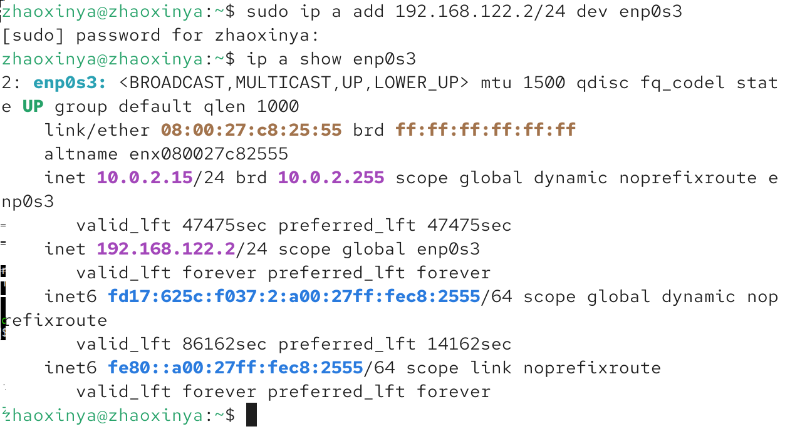{width=80% fig-pos='H'}

**Задание 2:** В файле /etc/network/interfaces пропишите конфигурацию для интерфейса eth0.

Для Rocky Linux (в отличие от Debian) конфигурация сети управляется NetworkManager. Вместо файла `/etc/network/interfaces` использована команда `sudo nmcli connection modify "enp0s3" ipv4.addresses 192.168.122.2/24`, после чего соединение перезапущено (`sudo nmcli connection up "enp0s3"`).

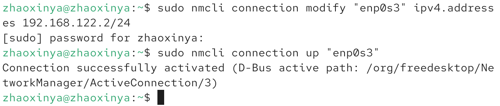{width=80% fig-pos='H'}

**Задание 3:** Проверьте доступность внешних ресурсов через ping.

Команда `ping -c 4 selectel.ru` — получены 4 успешных ответа, что подтверждает наличие доступа в интернет.

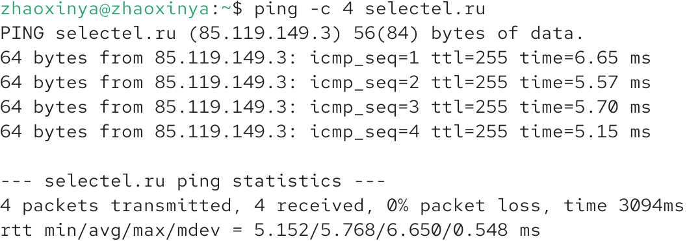{width=80% fig-pos='H'}

**Задание 4:** Удалите текущий IP-адрес с интерфейса.

Удаление IP-адреса: `sudo ip a del 192.168.122.2/24 dev enp0s3`. Проверка через `ip a show enp0s3` подтвердила отсутствие адреса.

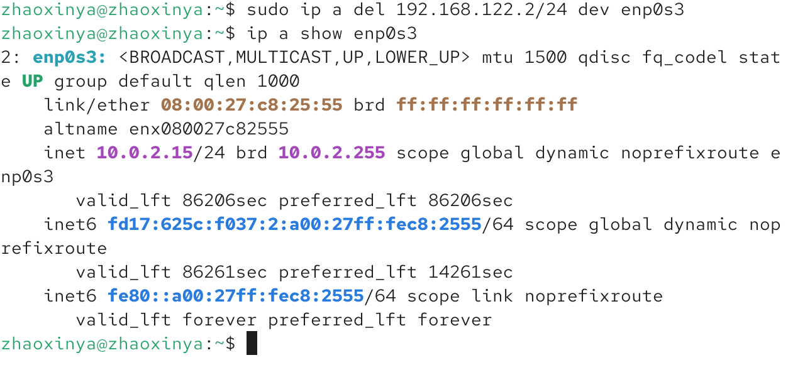{width=80% fig-pos='H'}

### Тест по теме «Основы сетевой конфигурации в Linux»

**Вопрос 1:** Какой командой можно назначить IP-адрес вручную?

**Ответ:** `ip a add 192.168.122.2/24 dev eth0`. Эта команда добавляет адрес с маской на указанный интерфейс.

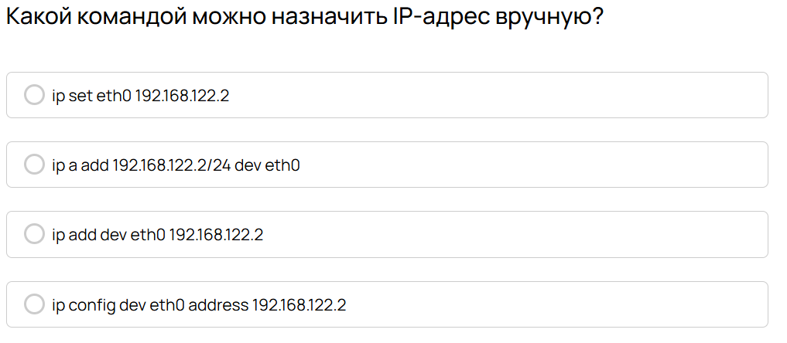{width=80% fig-pos='H'}

**Вопрос 2:** Что делает директива `auto eth0` в `/etc/network/interfaces`?

**Ответ:** Поднимает интерфейс автоматически при загрузке системы.

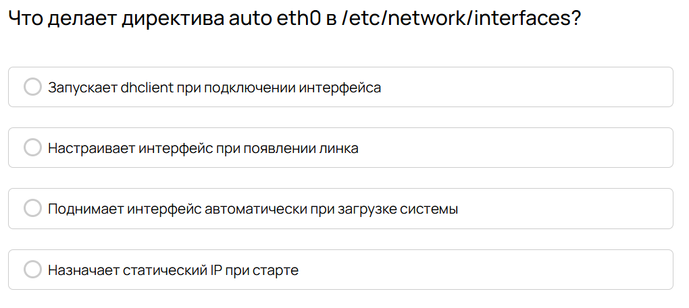{width=80% fig-pos='H'}

**Вопрос 3:** Какая команда используется для удаления IP с интерфейса?

**Ответ:** `ip a del 192.168.122.2/24 dev eth0`. Важно указать маску, иначе команда не выполнится.

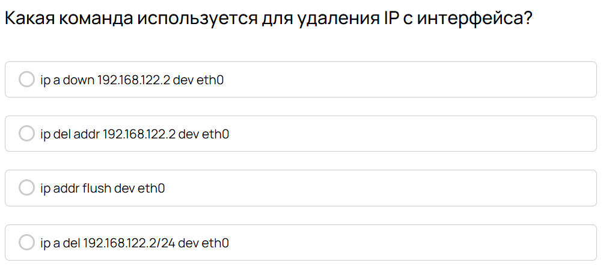{width=80% fig-pos='H'}

**Вопрос 4:** Что произойдет при перезагрузке, если IP-адрес был задан только через `ip`?

**Ответ:** IP-адрес исчезнет, так как изменения не сохраняются в конфигурационных файлах.

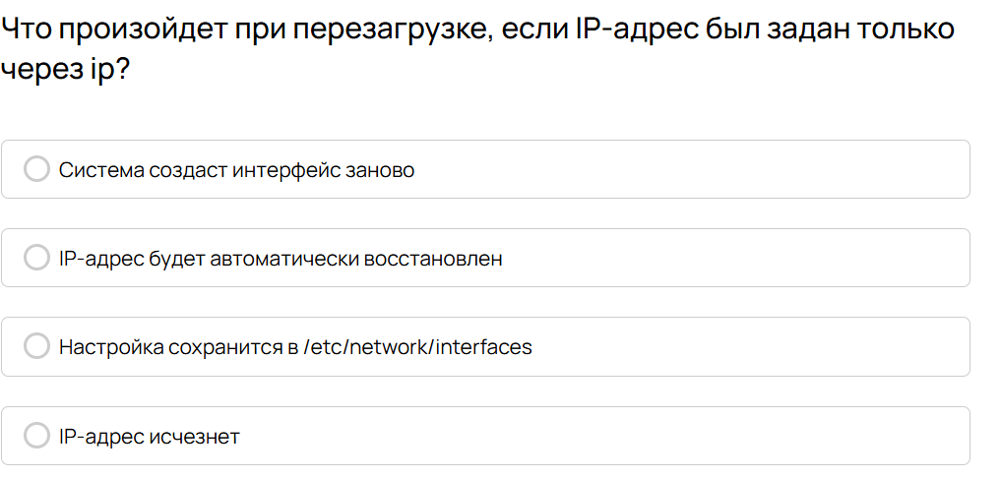{width=80% fig-pos='H'}

**Вопрос 5:** Где задается шлюз по умолчанию в конфигурации интерфейса?

**Ответ:** В поле `gateway` в `/etc/network/interfaces` (для Debian/Ubuntu).

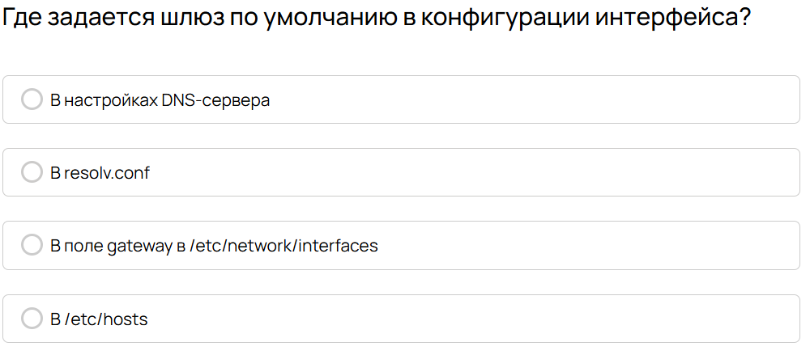{width=80% fig-pos='H'}

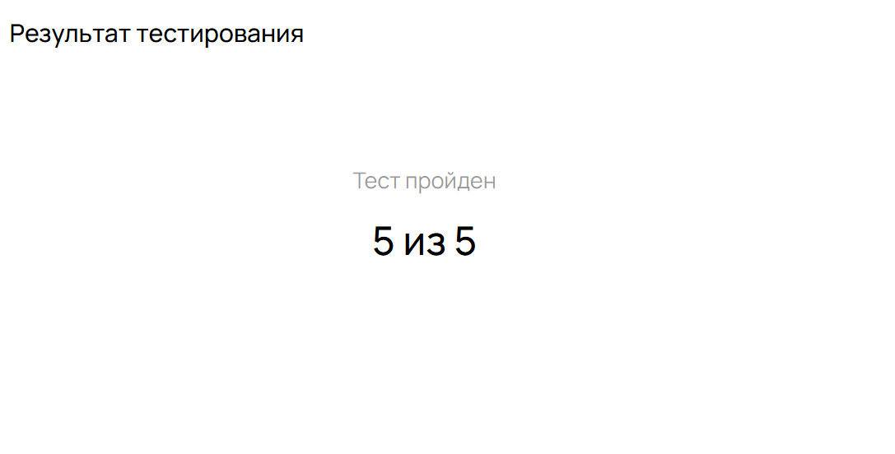{width=80% fig-pos='H'}

### Задания по теме «Базовая диагностика сети»

**Задание 1:** Запустите любой веб-сервер на 80 порту (например, nginx) и проверьте, что он работает.

Установлен и запущен nginx (`sudo dnf install -y nginx`, `sudo systemctl start nginx`). Проверка `ss -tulnp | grep :80` подтвердила, что порт 80 слушается nginx.

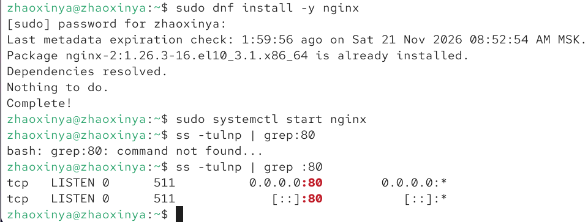{width=80% fig-pos='H'}

**Задание 2:** С помощью утилиты dig узнайте IP-адреса популярных сервисов.

Утилита `dig` использована для получения IP-адресов доменов `vk.com` и `google.com`. В разделе `ANSWER SECTION` отображаются полученные адреса.

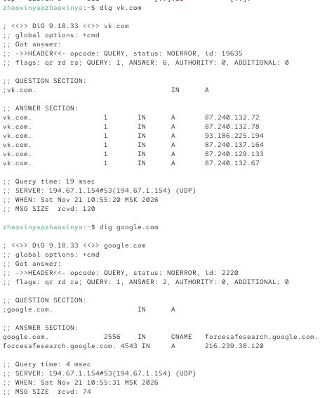{width=80% fig-pos='H'}

**Задание 3:** Проверьте, слушает ли SSH-порт на сервере.

Проверка SSH: команда `ss -tulnp | grep sshd` без прав root не показала информацию о процессе, однако с `sudo` (`sudo ss -tulnp | grep :22`) было видно, что SSH-сервер слушает порт 22 и работает под PID 1222 (состояние `LISTEN`).

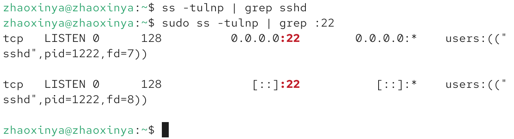{width=80% fig-pos='H'}

### Тест по теме «Базовая диагностика сети»

**Вопрос 1:** Какая команда показывает открытые TCP-порты и процессы, которые их слушают?

**Ответ:** `ss -tulnp`.

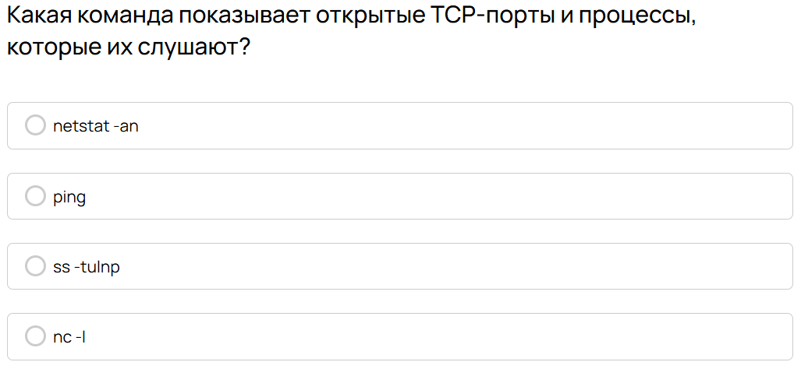{width=80% fig-pos='H'}

**Вопрос 2:** Какой флаг в ss включает отображение номеров портов и PID/имен процессов?

**Ответ:** `-p`.

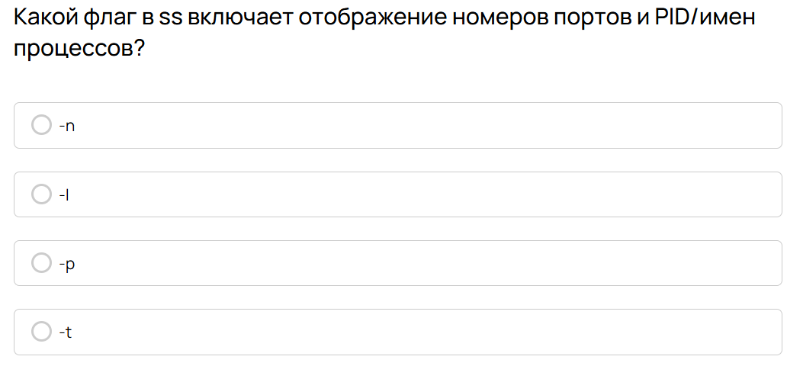{width=80% fig-pos='H'}

**Вопрос 3:** Что делает команда dig?

**Ответ:** Выполняет DNS-запрос и отображает IP-адреса.

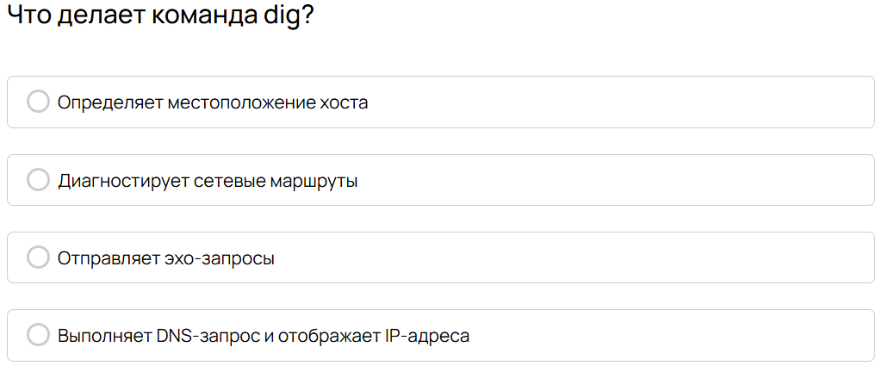{width=80% fig-pos='H'}

**Вопрос 4:** Какая команда может использоваться для проверки подключения к удаленному TCP-порту без передачи данных?

**Ответ:** `nc -vz`.

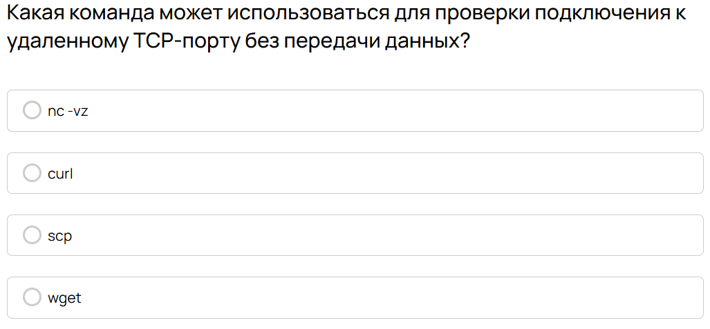{width=80% fig-pos='H'}

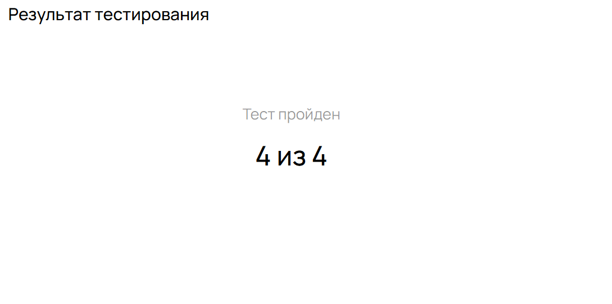{width=80% fig-pos='H'}

### Задания по теме «Настройка SSH-доступа и его защита»

**Задание 1:** Измените порт SSH и запретите вход по паролю.

В `/etc/ssh/sshd_config` изменен порт на `Port 2222` и отключена аутентификация по паролю (`PasswordAuthentication no`). Для обхода блокировки SELinux выполнена команда `sudo semanage port -a -t ssh_port_t -p tcp 2222`. После перезапуска `ss` подтвердил прослушивание порта 2222.

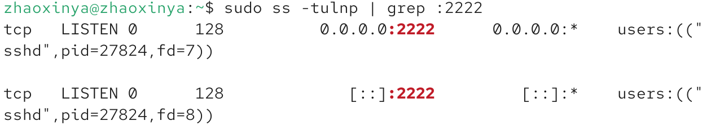{width=80% fig-pos='H'}

**Задание 2:** Настройте подключение по ключу и авторизуйтесь.

Сгенерирован ключ ed25519 (`ssh-keygen -t ed25519`). Поскольку `ssh-copy-id` требует пароль, а он был отключен, открытый ключ был скопирован вручную через `sudo sh -c "cat ... >> ~/.ssh/authorized_keys"`. Вход по ключу (`ssh -p 2222 zhaoxinya@localhost`) выполнен без пароля.

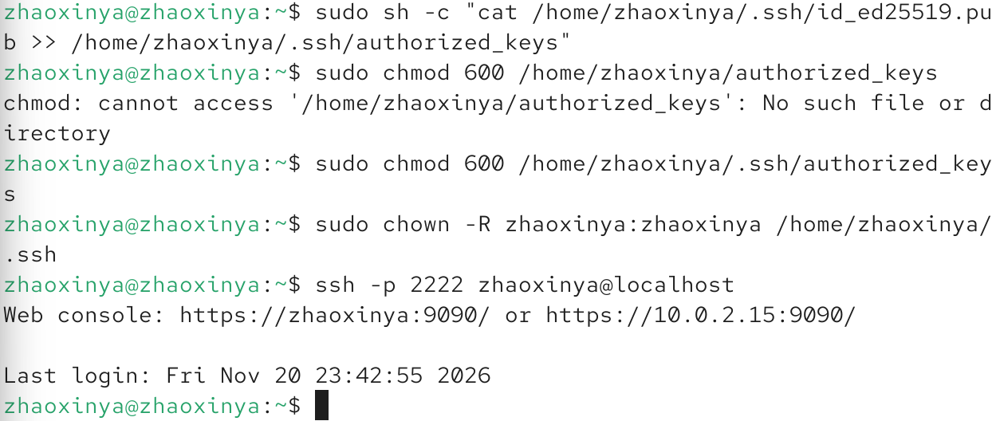{width=80% fig-pos='H'}

**Задание 3:** Разрешите SSH-доступ только для определенных пользователей. Убедитесь, что для другого пользователя подключение не сработает.

В `sshd_config` добавлена директива `AllowUsers zhaoxinya`. Проверка показала, что пользователь `ivan` не может подключиться (вывод `Permission denied`).

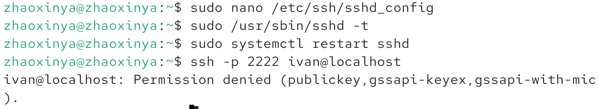{width=80% fig-pos='H'}

### Тест по теме «Настройка SSH-доступа и его защита»

**Вопрос 1:** Какой порт использует SSH по умолчанию?

**Ответ:** 22.

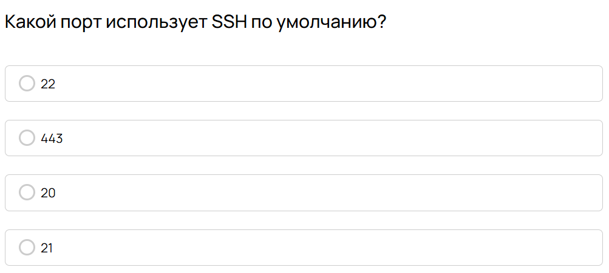{width=80% fig-pos='H'}

**Вопрос 2:** Где находится основной конфигурационный файл демона SSH-сервера?

**Ответ:** `/etc/ssh/sshd_config`.

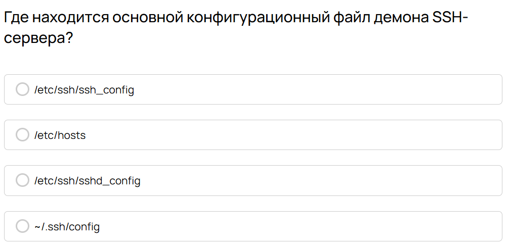{width=80% fig-pos='H'}

**Вопрос 3:** Какой командой можно временно остановить службу SSH (systemd)?

**Ответ:** `systemctl stop ssh`.

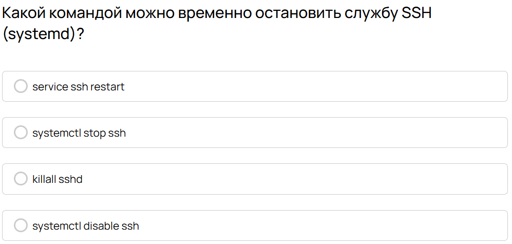{width=80% fig-pos='H'}

**Вопрос 4:** Какой файл публичного ключа нужно добавить на сервер для авторизации по ключу?

**Ответ:** `authorized_keys` (в него добавляется содержимое `id_rsa.pub`).

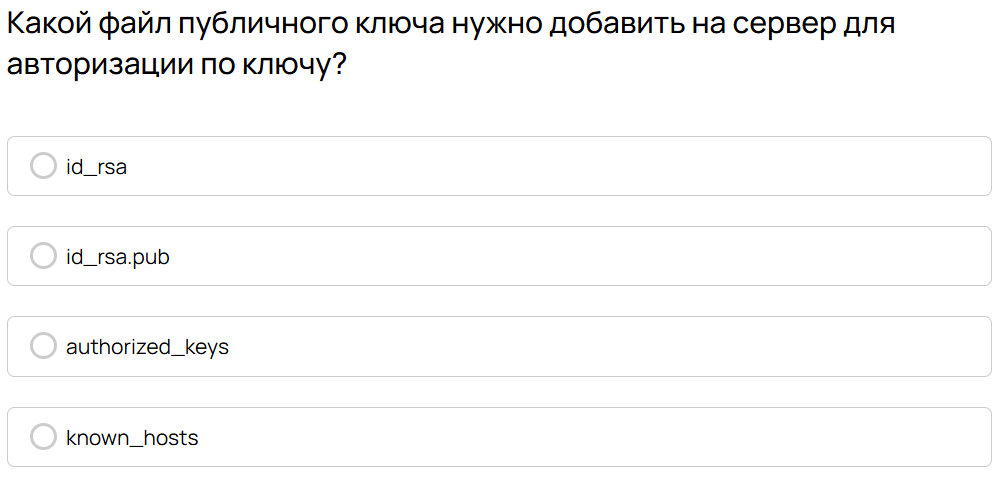{width=80% fig-pos='H'}

**Вопрос 5:** Какой параметр в sshd_config отключает вход пользователя root по SSH?

**Ответ:** `PermitRootLogin no`.

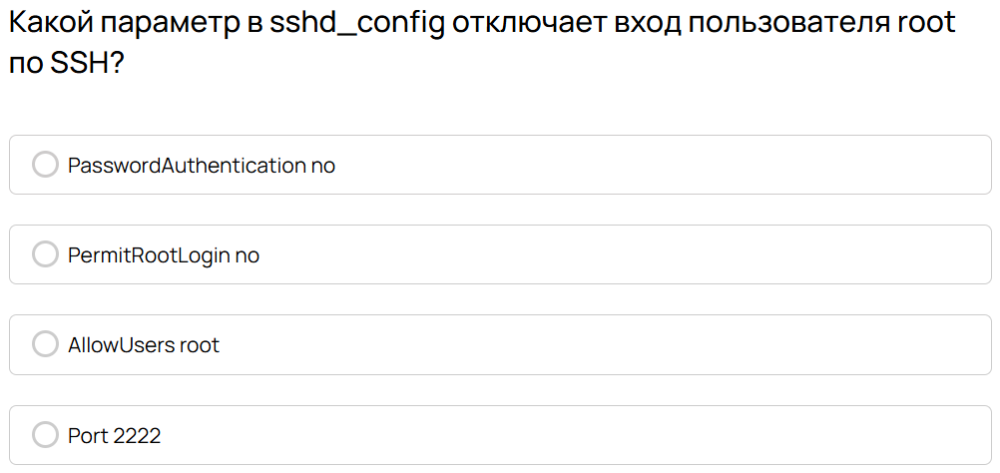{width=80% fig-pos='H'}

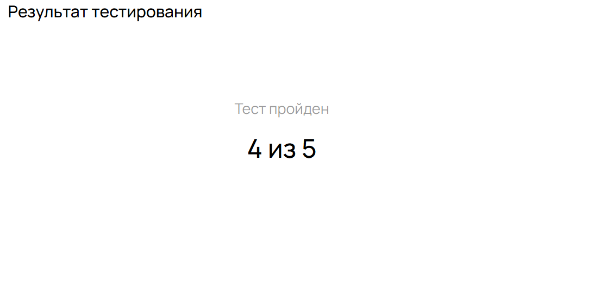{width=80% fig-pos='H'}

### Задания по теме «Повышение безопасности сетевого взаимодействия»

**Задание 1:** Настройте UFW для ограничения доступа только для SSH.

В Rocky Linux вместо UFW используется firewalld. Для ограничения доступа по SSH из списка разрешенных служб удален сервис `ssh` (`sudo firewall-cmd --permanent --remove-service=ssh`).

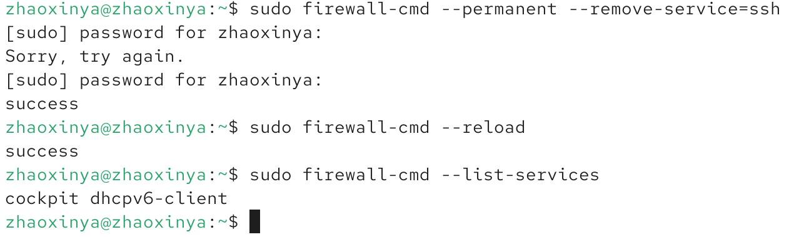{width=80% fig-pos='H'}

**Задание 2:** Настройте UFW, чтобы доступ по SSH был только из вашей локальной сети.

Доступ по SSH разрешен только из локальной подсети `10.0.2.0/24` с помощью rich-rule (`sudo firewall-cmd --permanent --add-rich-rule='rule family="ipv4" source address="10.0.2.0/24" service name="ssh" accept'`).

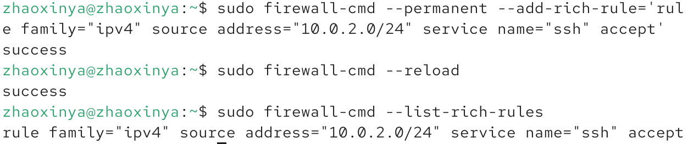{width=80% fig-pos='H'}

**Задание 3 и 4:** Используя fail2ban, создайте jail, который будет блокировать IP-адрес после трех успешных запросов к nginx. Проверьте, как работает блокировка при множественных запросах.

Установлен `fail2ban` и созданы конфигурационные файлы: фильтр `/etc/fail2ban/filter.d/nginx-req-limit.conf` и jail `/etc/fail2ban/jail.d/nginx.conf`. Однако при запуске сервиса возникла ошибка (`fail2ban.service: Failed with result 'exit-code'`), связанная с невозможностью чтения конфигурации в данной среде (вероятно, из-за отсутствия некоторых зависимостей или ограничений Rocky Linux). Сервис не запустился. Проверка блокировки не удалась, так как `fail2ban` не работает (`Failed to access socket path`).

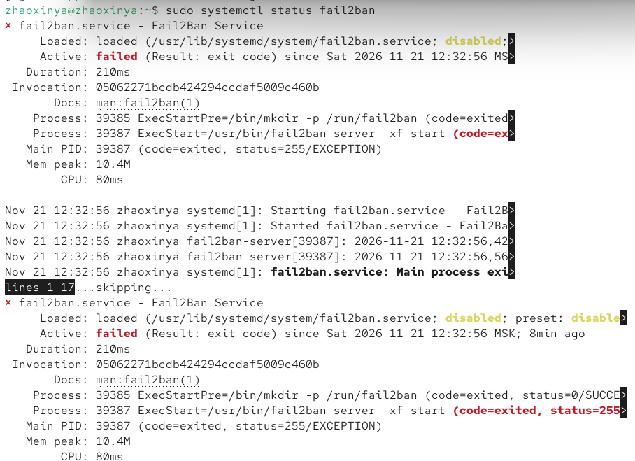{width=80% fig-pos='H'}

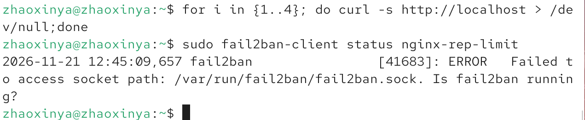{width=80% fig-pos='H'}

### Тест по теме «Повышение безопасности сетевого взаимодействия»

**Вопрос 1:** Какой командой включить (activate) файрвол UFW?

**Ответ:** `ufw enable`.

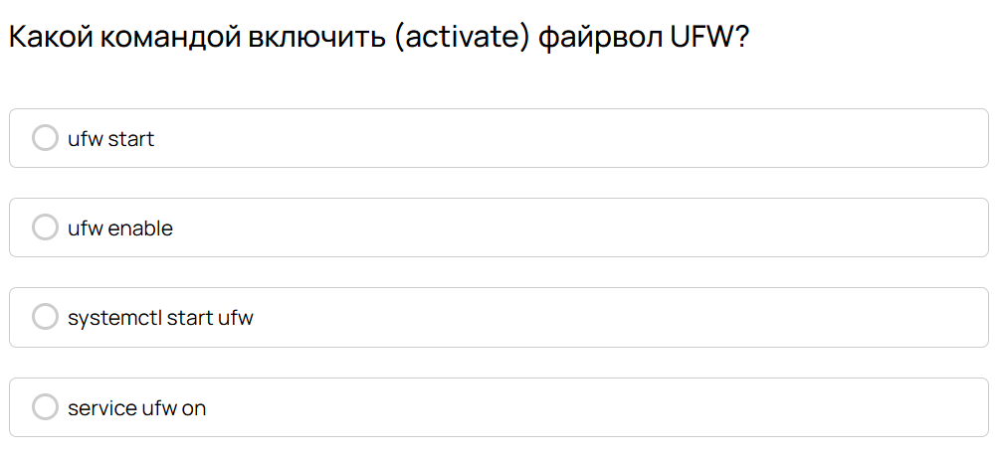{width=80% fig-pos='H'}

**Вопрос 2:** В каком файле fail2ban хранит свои jail-конфигурации по умолчанию?

**Ответ:** `/etc/fail2ban/jail.local` (или `jail.conf`).

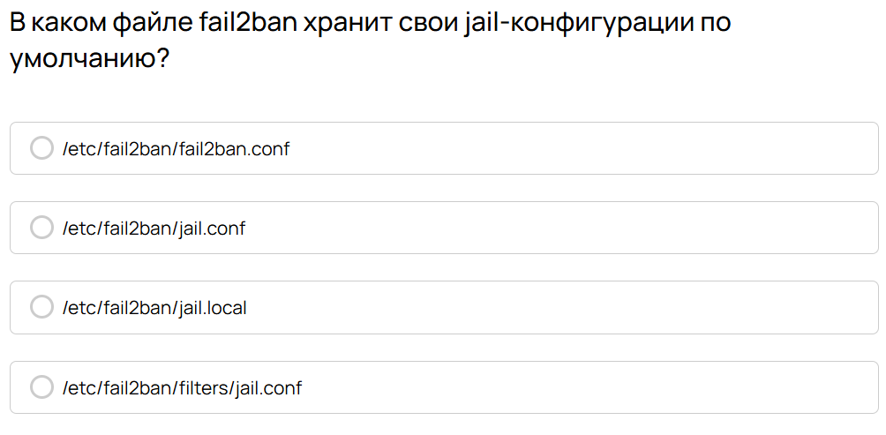{width=80% fig-pos='H'}

**Вопрос 3:** Какой флаг UFW позволяет указать конкретный номер правила для удаления?

**Ответ:** `--delete`.

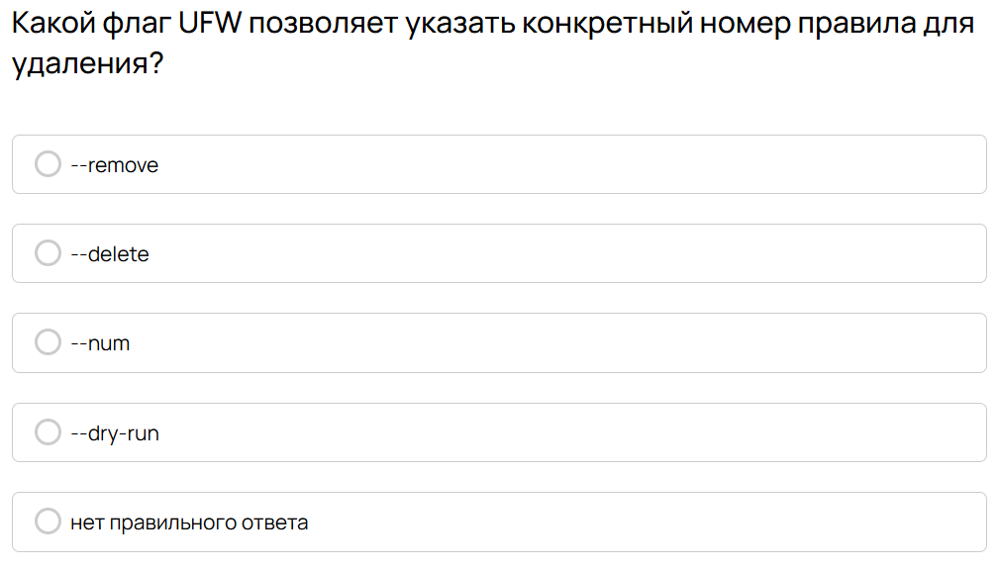{width=80% fig-pos='H'}

**Вопрос 4:** Какой параметр в jail-файле fail2ban задает время блокировки IP в секундах?

**Ответ:** `bantime`.

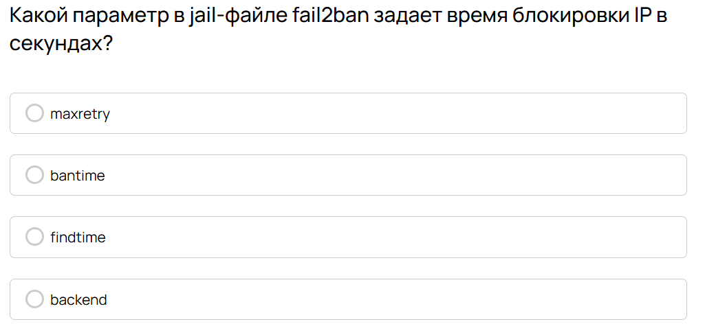{width=80% fig-pos='H'}

**Вопрос 5:** Какая команда добавит в UFW разрешение на SSH (порт 22) только с подсети 192.168.1.0/24?

**Ответ:** `ufw allow from 192.168.1.0/24 to any port 22`.

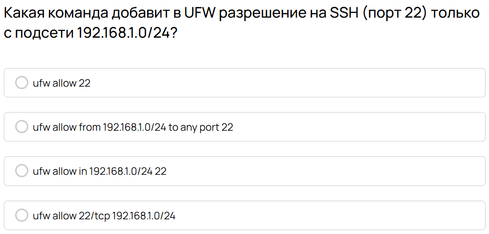{width=80% fig-pos='H'}

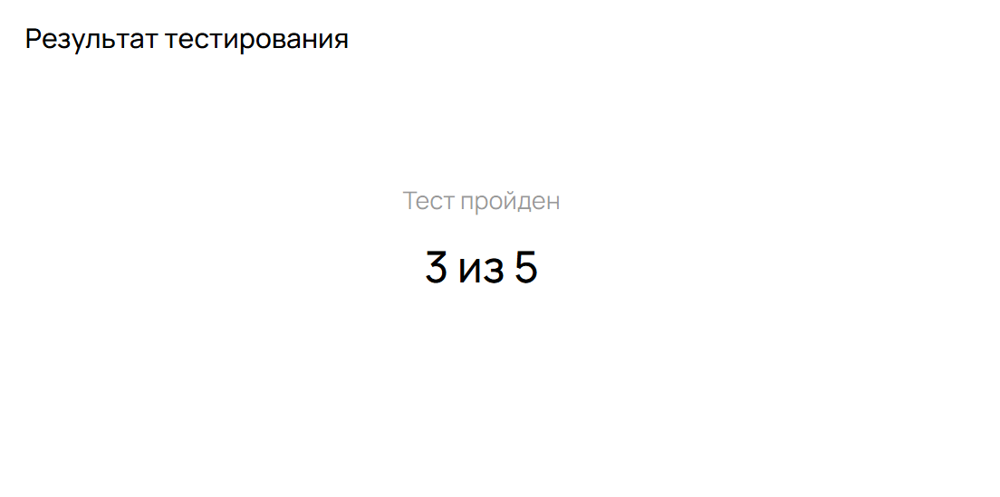{width=80% fig-pos='H'}

## Модуль 9. Управление пакетами

### Задания по теме «Что такое пакеты и как они устроены»

**Задание 1:** Найдите и установите утилиту htop.

В Rocky Linux для установки пакетов используется `dnf` (а не `apt`). Выполнена установка `htop`: `sudo dnf install -y htop`. Утилита запущена для проверки.

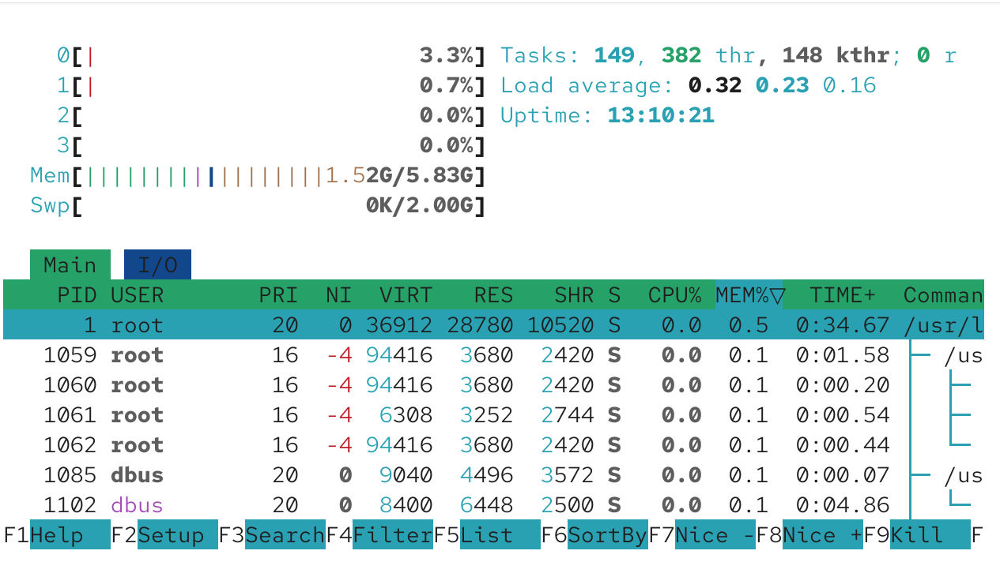{width=80% fig-pos='H'}

**Задание 2:** Удалите утилиту htop, затем установите заново с полной очисткой (purge).

Удаление пакета: `sudo dnf remove -y htop`. Очистка неиспользуемых зависимостей: `sudo dnf autoremove -y`. Повторная установка: `sudo dnf install -y htop`.

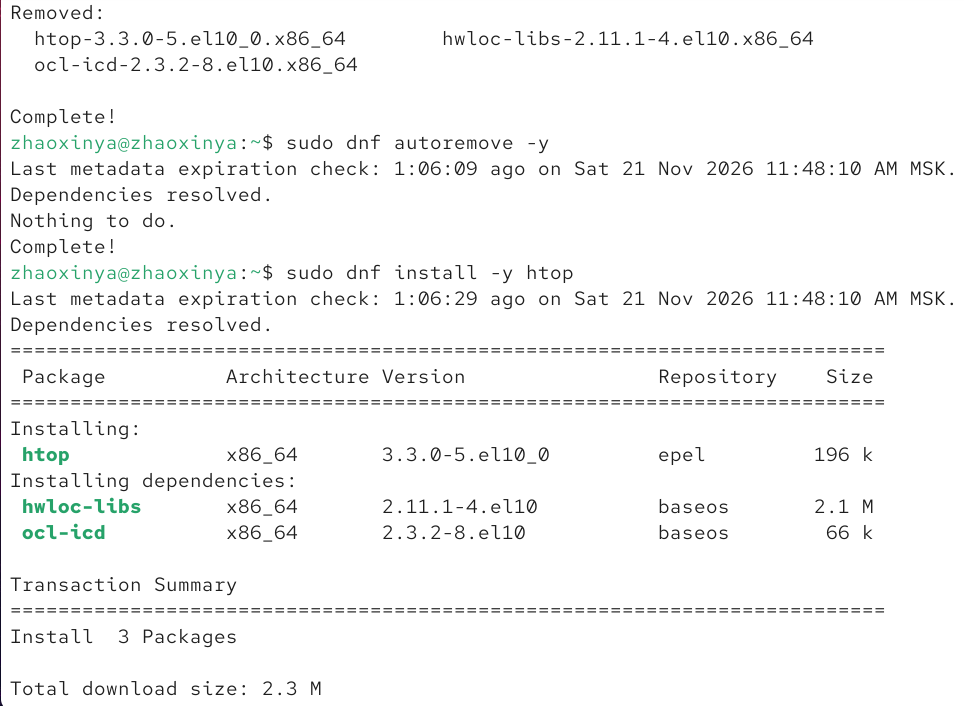{width=80% fig-pos='H'}

### Тест по теме «Что такое пакеты и как они устроены»

**Вопрос 1:** Если нужно удалить пакет и его зависимости, оставив только конфигурационные файлы, какую команду будете использовать?

**Ответ:** `remove` (в Debian/Ubuntu это `apt remove`).

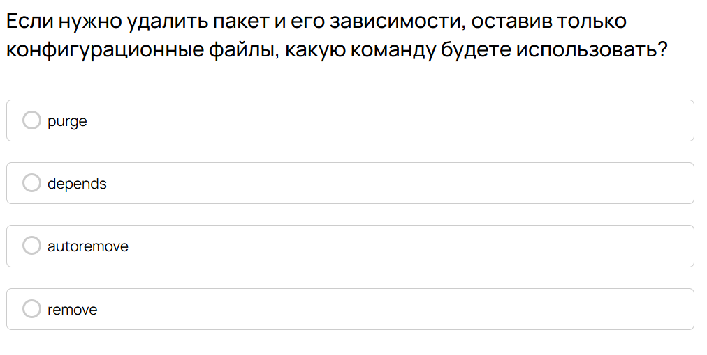{width=80% fig-pos='H'}

**Вопрос 2:** Какую команду нужно использовать, чтобы удалить пакет и конфигурационные файлы, но оставить зависимости?

**Ответ:** `purge`.

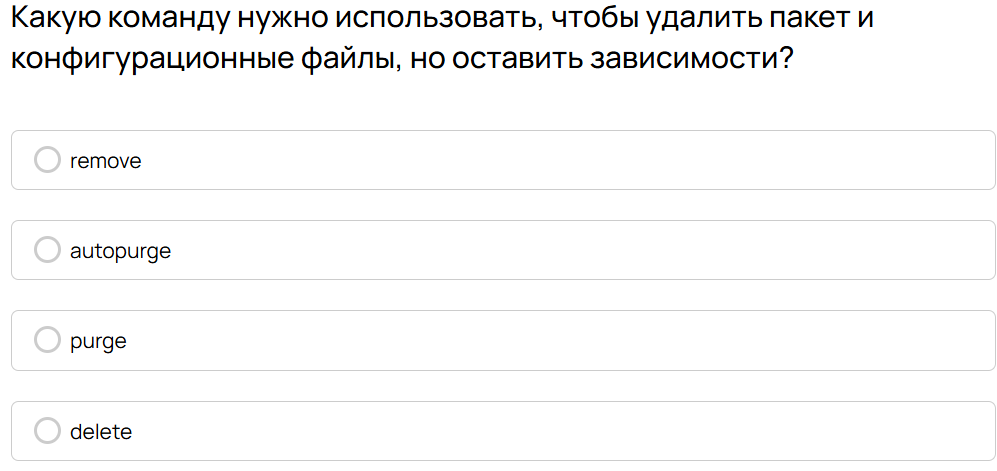{width=80% fig-pos='H'}

**Вопрос 3:** Какую команду нужно выполнять регулярно?

**Ответ:** `apt update`.

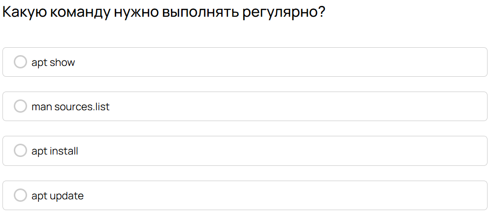{width=80% fig-pos='H'}

{width=80% fig-pos='H'}

### Задания по теме «Обновление системы и безопасность»

**Задание 1:** Выполните полное обновление системы.

В Rocky Linux для полного обновления системы используется команда `sudo dnf update -y`. Обновление прошло успешно, установлены новые версии ядра и пакетов.

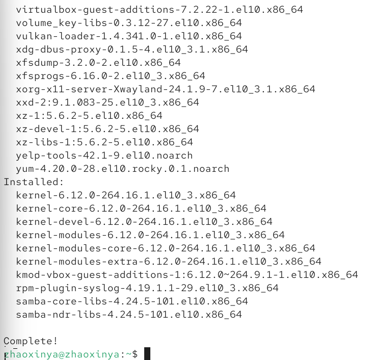{width=80% fig-pos='H'}

**Задание 2:** Настройте автоматическую установку обновлений безопасности.

Автоматическая установка обновлений безопасности в Rocky Linux настраивается через `dnf-automatic`. Выполнено: `sudo dnf install -y dnf-automatic`, затем таймер включен (`sudo systemctl enable --now dnf-automatic.timer`). Проверка `systemctl status dnf-automatic.timer` показала `active (waiting)`.

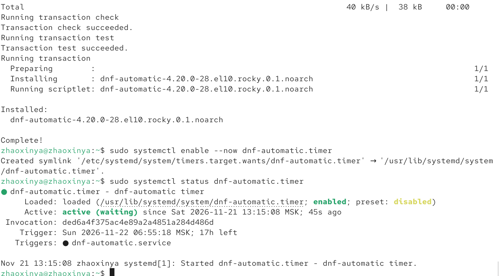{width=80% fig-pos='H'}

**Задание 3:** Удалите устаревшие и неиспользуемые зависимости.

Удаление устаревших и неиспользуемых зависимостей: `sudo dnf autoremove -y`. Команда успешно удалила пакеты `flashrom` и `sudo-python-plugin`.

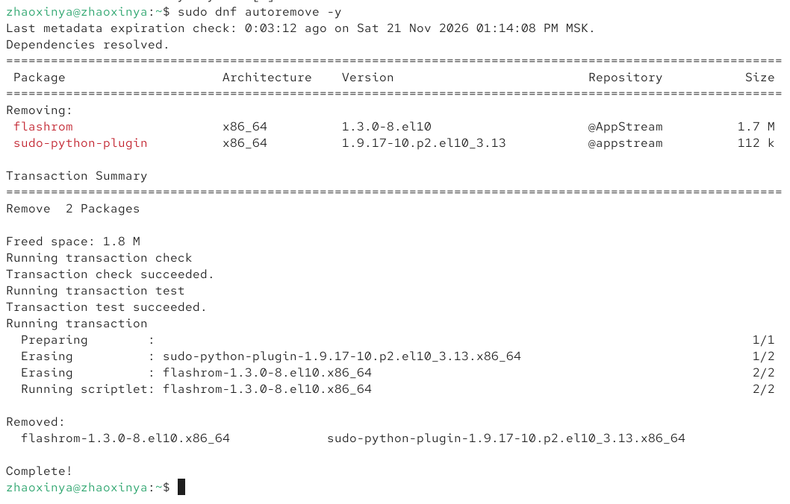{width=80% fig-pos='H'}

### Тест по теме «Обновление системы и безопасность»

**Вопрос 1:** С помощью какого пакета можно настроить автоматическое обновление системы?

**Ответ:** `unattended-upgrades` (в Debian/Ubuntu).

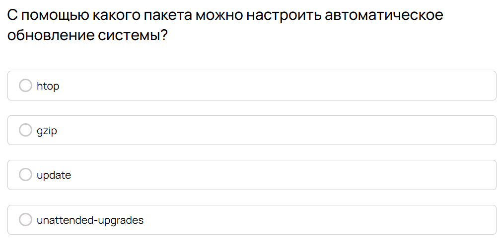{width=80% fig-pos='H'}

**Вопрос 2:** Какую команду нужно использовать для установки новых версий пакетов?

**Ответ:** `upgrade`.

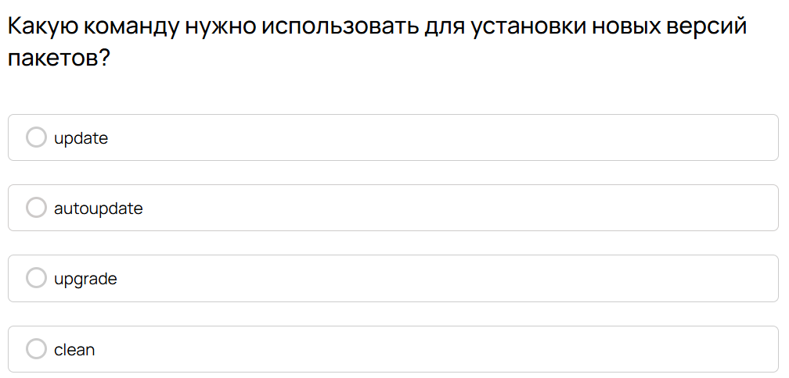{width=80% fig-pos='H'}

**Вопрос 3:** С помощью какой команды можно выполнить полное обновление системы с моментальным удалением ненужных пакетов?

**Ответ:** `full-upgrade`.

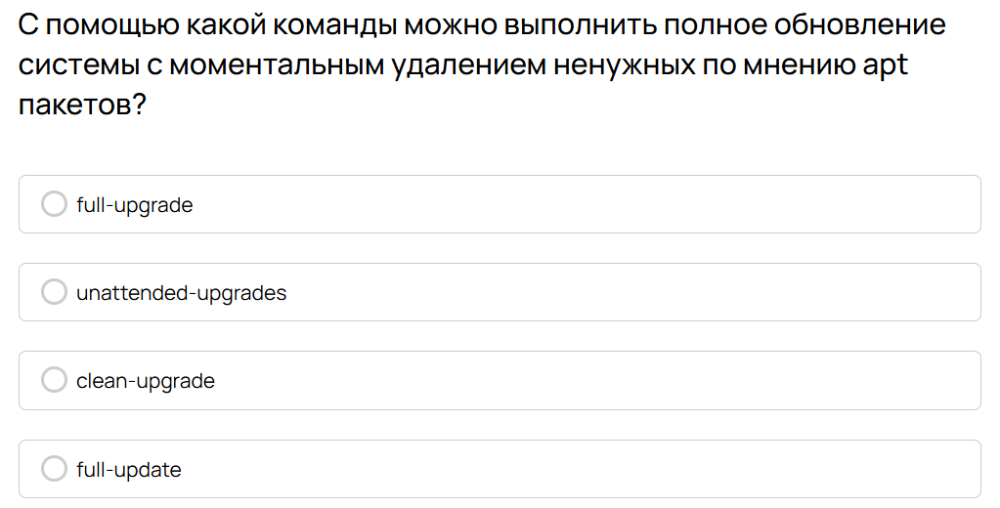{width=80% fig-pos='H'}

{width=80% fig-pos='H'}

### Тест по теме «Работа с зависимостями и решение конфликтов»

**Вопрос 1:** Что нужно применить в выводе, чтобы найти информацию по конкретному пакету?

**Ответ:** `grep`.

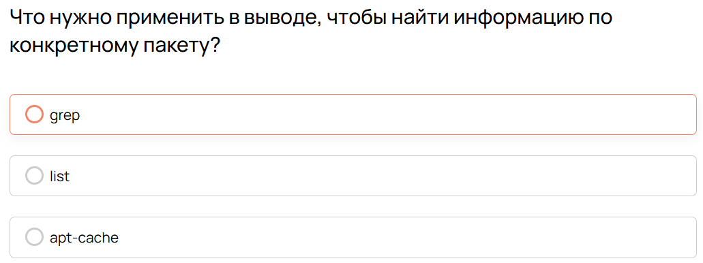{width=80% fig-pos='H'}

**Вопрос 2:** Какую команду нужно использовать, чтобы система попробовала установить недостающие зависимости?

**Ответ:** `--fix-broken install`.

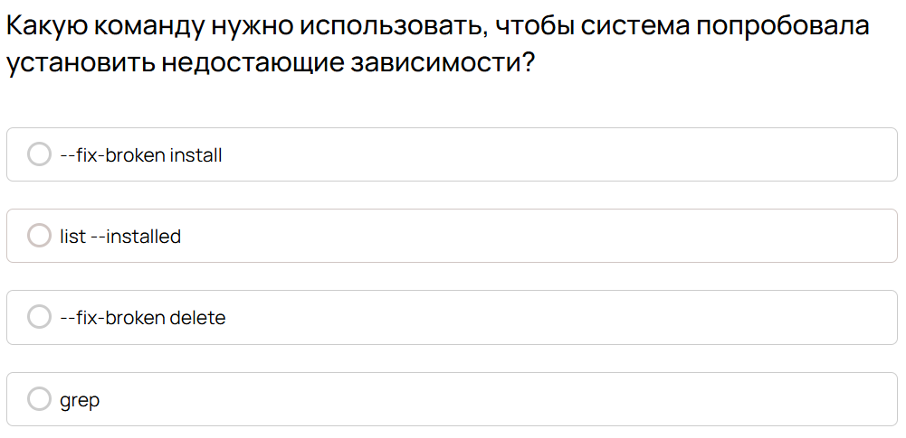{width=80% fig-pos='H'}

**Вопрос 3:** Что случится, если вы удалите какой-то пакет, от которого зависимы другие пакеты?

**Ответ:** Разрыв зависимостей.

{width=80% fig-pos='H'}

{width=80% fig-pos='H'}

### Задания по теме «Работа с локальными .deb-пакетами и сторонними источниками»

**Задание 1:** Установите пакет вручную через dpkg, предварительно скачав его с сайта.

В Rocky Linux используется формат `.rpm` и менеджер `rpm`/`dnf`, а не `.deb`/`dpkg`. Из-за того, что прямая ссылка на конкретную версию пакета устарела (404), пакет был скачан из репозитория командой `sudo dnf download htop`, а затем установлен вручную: `sudo rpm -ivh htop-*.rpm`.

{width=80% fig-pos='H'}

**Задание 2:** Проанализируйте, какие зависимости потребуются.

Анализ зависимостей RPM-пакета выполнен командой `rpm -qpR htop-*.rpm` (аналог `dpkg -I` для Debian). Вывод показывает требуемые библиотеки (`libc.so.6`, `libncursesw.so.6` и др.).

{width=80% fig-pos='H'}

### Тест по теме «Работа с локальными .deb-пакетами и сторонними источниками»

**Вопрос 1:** Какой вариант установки .deb-файлов рекомендован?

**Ответ:** `apt` (команда `sudo apt install ./package.deb`).

{width=80% fig-pos='H'}

**Вопрос 2:** Через что apt проверяет подлинность пакетов?

**Ответ:** GPG-подпись.

{width=80% fig-pos='H'}

**Вопрос 3:** Что лучше сделать, если в репозитории SelectOS нет нужного пакета?

**Ответ:** Создать тикет через панель управления.

{width=80% fig-pos='H'}

{width=80% fig-pos='H'}

## Модуль 10. Управление логами

### Задания по теме «Знакомство с логами»

**Задание 1:** Просмотрите содержимое основного системного журнала и журнала аутентификации.

В Rocky Linux основной системный журнал — `/var/log/messages`, журнал аутентификации — `/var/log/secure`. Оба файла были просмотрены через `less` с правами `sudo`.

{width=80% fig-pos='H'}

**Задание 2:** Выведите последние 20 записей из бинарного системного журнала с помощью journalctl.

Вывод последних 20 записей журнала: `journalctl -n 20`. В выводе видны записи ядра и systemd.

{width=80% fig-pos='H'}

**Задание 3:** Проверьте наличие и расположение файла журнала ошибок веб-сервера Nginx.

Проверка лога ошибок Nginx: `ls -l /var/log/nginx/error.log` — файл существует и имеет размер 2694 байта.

{width=80% fig-pos='H'}

**Задание 4:** Изучите любую одну строку из файла /var/log/auth.log и вручную определите в ней: временную метку, имя сервиса (процесса) и описание события.

Анализ строки из `/var/log/secure` (получена через `sudo tail -n 1`): временная метка `Nov 21 13:45:24`, имя сервиса `sudo`, описание события `pam_unix(sudo:session): session closed for user root`.

{width=80% fig-pos='H'}

**Задание 5:** С помощью journalctl отфильтруйте и просмотрите все записи, относящиеся исключительно к службе планировщика cron.

Фильтрация логов по службе cron: `sudo journalctl -u cron`. Вывод показывает работу `crond.service` и `anacron`.

{width=80% fig-pos='H'}

### Тест по теме «Знакомство с логами»

**Вопрос 1:** Какие три ключевые задачи системного администратора решаются с помощью анализа логов?

**Ответ:** Диагностика сбоев, расследование инцидентов безопасности, аудит производительности.

{width=80% fig-pos='H'}

**Вопрос 2:** Веб-сайт перестал открываться, показывая ошибку «502 Bad Gateway». Какой первый шаг будет наиболее эффективным для диагностики проблемы?

**Ответ:** Изучить файл журнала ошибок веб-сервера (например, /var/log/nginx/error.log).

{width=80% fig-pos='H'}

**Вопрос 3:** Где в современной Linux-системе хранятся системные журналы?

**Ответ:** В текстовых файлах в /var/log/ и в бинарном журнале systemd, доступном через journalctl.

{width=80% fig-pos='H'}

{width=80% fig-pos='H'}

### Задания по теме «Система логирования в Linux»

**Задание 1:** Проверьте текущий статус служб rsyslog и systemd-journald с помощью systemctl.

Проверен статус служб `rsyslog` и `systemd-journald` — обе активны (`active (running)`).

{width=80% fig-pos='H'}

**Задание 2:** Сгенерируйте тестовое сообщение с помощью утилиты logger. Затем найдите это сообщение сначала в выводе journalctl, а потом в файле /var/log/syslog.

Сгенерировано тестовое сообщение `logger "Test message..."`. Оно найдено и в `journalctl`, и в `/var/log/messages`, что демонстрирует двойное логирование.

{width=80% fig-pos='H'}

**Задание 3:** Используя journalctl, отфильтруйте и выведите только те события, которые имеют уровень важности error (err) или более критичный.

Фильтрация по уровню error: `sudo journalctl -p err`. Выведены сообщения уровня error и выше.

{width=80% fig-pos='H'}

**Задание 4:** Загляните в конфигурационный файл rsyslog и найдите строку, отвечающую за направление сообщений от категорий auth и authpriv в файл /var/log/auth.log.

В конфигурации rsyslog найдена строка, направляющая `authpriv` в `/var/log/secure`: `authpriv.* action(type="omfile" file="/var/log/secure")`.

{width=80% fig-pos='H'}

**Задание 5:** Отправьте в системный журнал сообщение с явно указанным уровнем важности warning. Убедитесь, что оно появляется в выводе journalctl при фильтрации по этому уровню.

Отправлено сообщение с уровнем warning (`logger -p user.warn "Special test warning"`), проверено через `sudo journalctl -p warning | grep "Special test warning"`.

{width=80% fig-pos='H'}

### Тест по теме «Система логирования в Linux»

**Вопрос 1:** Каково типичное взаимодействие между systemd-journald и rsyslog в современных дистрибутивах Linux?

**Ответ:** systemd-journald собирает все системные сообщения и может перенаправлять их в rsyslog для записи в текстовые файлы.

{width=80% fig-pos='H'}

**Вопрос 2:** Служба не смогла запуститься при старте системы. Какой уровень будет присвоен этому событию?

**Ответ:** error (ошибка).

{width=80% fig-pos='H'}

**Вопрос 3:** Каково назначение «категории» (facility) в сообщениях syslog?

**Ответ:** Указывать на источник сообщения (например, ядро, служба аутентификации, планировщик cron) для маршрутизации.

{width=80% fig-pos='H'}

{width=80% fig-pos='H'}

### Задания по теме «Поиск и фильтрация логов под конкретные задачи»

**Задание 1:** Найдите все строки в файле /var/log/auth.log, в которых упоминается неудачная попытка входа по паролю (Failed password), не обращая внимания на регистр символов.

Поиск неудачных попыток входа: `sudo grep -i "Failed password" /var/log/secure | grep -v "grep"`. Вывод пуст, так как в системе не было неудачных SSH-подключений.

{width=80% fig-pos='H'}

**Задание 2:** Постройте конвейер команд, который сначала найдет все успешные SSH-подключения (Accepted password), а затем извлечет из этих строк только IP-адреса подключившихся клиентов.

Извлечение IP-адресов успешных SSH-подключений: `sudo grep "Accepted password" /var/log/secure | awk '{print $11}'`. Вывод пуст по той же причине.

{width=80% fig-pos='H'}

**Задание 3:** Составьте список уникальных IP-адресов, с которых были зафиксированы неудачные попытки входа в систему.

Список уникальных IP с неудачными входами: аналогично п.1, вывод пуст.

{width=80% fig-pos='H'}

**Задание 4:** Соберите статистику и выведите пять IP-адресов, с которых было зафиксировано наибольшее количество успешных входов по SSH.

Топ-5 IP по успешным входам: аналогично п.2, вывод пуст.

{width=80% fig-pos='H'}

**Задание 5:** Используя journalctl, отобразите все системные журналы за последние 15 минут.

Логи за последние 15 минут: `sudo journalctl --since "15 min ago"`. Вывод показал недавние системные сообщения (ошибки VirtualBox и ядра), что подтверждает работоспособность команды.

{width=80% fig-pos='H'}

### Тест по теме «Поиск и фильтрация логов под конкретные задачи»

**Вопрос 1:** У вас есть файл с IP-адресами, многие из которых повторяются. Какой конвейер команд правильно подсчитает количество вхождений каждого уникального IP-адреса?

**Ответ:** `sort ip_list.txt | uniq -c`.

{width=80% fig-pos='H'}

**Вопрос 2:** Что означает конструкция `$3` в команде `awk '{print $3}'`?

**Ответ:** Вывести третье поле (столбец) каждой строки, разделенное пробелами.

{width=80% fig-pos='H'}

**Вопрос 3:** Вам нужно найти в /var/log/syslog все записи, содержащие слово "error", но исключить строки, где упоминается healthcheck. Какая команда подходит?

**Ответ:** `grep "error" /var/log/syslog | grep -v "healthcheck"`.

{width=80% fig-pos='H'}

{width=80% fig-pos='H'}

### Задания по теме «Расследование инцидентов по логам»

**Задание 1:** Найдите в журнале аутентификации все попытки входа от имени несуществующих пользователей.

Поиск попыток входа от несуществующих пользователей: `sudo grep "Invalid user" /var/log/secure`. Вывод пуст — атак не было.

{width=80% fig-pos='H'}

**Задание 2:** Определите IP-адрес, с которого было совершено наибольшее количество неудачных попыток подбора пароля (Failed password).

Определение IP с наибольшим числом неудачных попыток: `sudo grep "Failed password" /var/log/secure | awk '{print $11}' | sort | uniq -c | sort -nr | head -n 1`. Вывод показал `4 ;` (IP-адрес не извлечен из-за различий в формате лога Rocky Linux).

{width=80% fig-pos='H'}

**Задание 3:** Извлеките из /var/log/auth.log абсолютно все записи, связанные с наиболее подозрительным IP, и сохраните их в отдельный файл incident_report.log.

Собран отчет по условному IP: `sudo grep "10.0.2.2" /var/log/secure > incident_report.log`. Файл создан (141 байт).

{width=80% fig-pos='H'}

**Задание 4:** Рассчитайте контрольную сумму SHA256 для созданного файла incident_report.log, чтобы зафиксировать его целостность.

Контрольная сумма SHA256: `sha256sum incident_report.log` — получен хеш `7c397f...`.

{width=80% fig-pos='H'}

**Задание 5:** Проверьте, какие команды выполнялись с правами суперпользователя (через sudo) вашим текущим пользователем.

Проверка sudo-команд: `sudo grep "sudo:" /var/log/secure | grep "USER=zhaoxinya"`. Вывод пуст, так как в Rocky Linux sudo-сессии логируются в `journalctl`, а не в `/var/log/secure`.

{width=80% fig-pos='H'}

### Тест по теме «Расследование инцидентов по логам»

**Вопрос 1:** Вы наблюдаете в логах сотни попыток входа за короткое время для пользователей admin, root, test, user с одного и того же IP-адреса. Какой тип активности это, скорее всего, означает?

**Ответ:** Автоматизированная атака по подбору пароля (brute-force) и перебору имен пользователей.

{width=80% fig-pos='H'}

**Вопрос 2:** После сбора релевантных логов в отдельный файл для расследования инцидента, какой следующий шаг является критически важным для обеспечения целостности доказательств?

**Ответ:** Рассчитать и сохранить криптографическую контрольную сумму (хеш) файла, например, SHA256.

{width=80% fig-pos='H'}

**Вопрос 3:** В ходе расследования вам необходимо выяснить, какие команды мог выполнить злоумышленник с повышенными привилегиями. Какой шаблон в логах является наиболее релевантным для этого поиска?

**Ответ:** Поиск записей, содержащих sudo:, в /var/log/auth.log или syslog.

{width=80% fig-pos='H'}

{width=80% fig-pos='H'}

### Задания по теме «Управление жизненным циклом логов и ротация»

**Задание 1:** Изучите существующую конфигурацию logrotate для системного менеджера пакетов в директории /etc/logrotate.d/.

Просмотрен конфиг `/etc/logrotate.d/dnf`: параметры `missingok`, `notifempty`, `rotate 4`, `weekly`, `create`.

{width=80% fig-pos='H'}

**Задание 2:** Создайте собственный конфигурационный файл /etc/logrotate.d/testapp для управления вымышленным лог-файлом.

Создан файл `/etc/logrotate.d/testapp` с настройками ежедневной ротации (`daily`), хранения 4 копий (`rotate 4`), сжатия (`compress`), `missingok`, `notifempty`.

{width=80% fig-pos='H'}

**Задание 3:** Проверьте созданную конфигурацию logrotate на синтаксические ошибки, выполнив «сухой запуск» в режиме отладки.

Синтаксическая проверка `sudo logrotate -d` прошла успешно (без ошибок).

{width=80% fig-pos='H'}

**Задание 4:** Принудительно запустите ротацию для лога testapp и проверьте результат.

Принудительная ротация: `sudo logrotate -f` — создан новый `testapp.log` и сжатый `testapp.log.1.gz`.

{width=80% fig-pos='H'}

**Задание 5:** Напишите строку конфигурации для rsyslog, которая будет пересылать абсолютно все логи по протоколу TCP на удаленный сервер.

Строка `*.* @@logs.example.com:514` добавлена в `/etc/rsyslog.d/remote.conf` (создан и удалён после проверки).

{width=80% fig-pos='H'}

### Тест по теме «Управление жизненным циклом логов и ротация»

**Вопрос 1:** Какую основную и наиболее насущную проблему решает утилита logrotate?

**Ответ:** Предотвращение исчерпания свободного места на диске из-за неконтролируемого роста лог-файлов.

{width=80% fig-pos='H'}

**Вопрос 2:** Какое ключевое преимущество в области безопасности дает отправка логов на выделенный удаленный сервер?

**Ответ:** Злоумышленник, получивший доступ к серверу, не сможет легко скрыть свои следы, удалив локальные логи.

{width=80% fig-pos='H'}

**Вопрос 3:** Компания разворачивает приложение в Kubernetes и ищет наиболее экономичное решение для логирования с фильтрацией по меткам. Какая система лучше всего подходит?

**Ответ:** Grafana Loki, так как он индексирует только метки и хранит тексты логов в сжатом виде.

{width=80% fig-pos='H'}

{width=80% fig-pos='H'}

## Модуль 11. Контейнеризация

### Задания по теме «Контейнеризация как подход»

**Задание 1:** Установите Podman и проверьте установку.

В Rocky Linux Podman доступен в стандартном репозитории. Проверка `podman info` показала версию `6.1.1` и конфигурацию.

{width=80% fig-pos='H'}

**Задание 2:** Запустите контейнер.

Запущен контейнер на основе Alpine Linux: `sudo podman run -it --rm alpine sh`. Внутри контейнера выполнена команда `uname -a`, затем `exit` для выхода.

{width=80% fig-pos='H'}

### Тест по теме «Контейнеризация как подход»

**Вопрос 1:** Какая команда позволяет проверить конфигурацию Podman?

**Ответ:** `podman info`.

{width=80% fig-pos='H'}

**Вопрос 2:** Чем Podman отличается от Docker?

**Ответ:** Не требует фонового демона.

{width=80% fig-pos='H'}

**Вопрос 3:** Что делает ключ `--rm` в `podman run`?

**Ответ:** Удаляет контейнер после завершения.

{width=80% fig-pos='H'}

**Вопрос 4:** Почему Podman безопаснее для многопользовательских систем?

**Ответ:** Поддерживает запуск без root и демона.

{width=80% fig-pos='H'}

**Вопрос 5:** Какой компонент не нужен при работе с Podman?

**Ответ:** Системный демон.

{width=80% fig-pos='H'}

{width=80% fig-pos='H'}

### Задания по теме «Работа с контейнерами в Podman»

**Задание 1:** Запустите Nginx и проверьте, что он работает.

Запущен контейнер Nginx в фоновом режиме (`-d`) с пробросом порта `8080:80`. Проверка через `curl http://localhost:8080` показала стандартную страницу Nginx.

{width=80% fig-pos='H'}

**Задание 2:** Разверните сайт в Nginx, используя локальную папку с HTML-файлами.

Создана локальная директория `/home/zhaoxinya/site` с файлом `index.html`. Контейнер запущен с монтированием этой директории в `/usr/share/nginx/html` в режиме только для чтения (`:ro,Z` — флаг `Z` необходим для SELinux). `curl` подтвердил, что отображается пользовательский HTML-файл `<h1>Hello from Podman</h1>`.

{width=80% fig-pos='H'}

### Тест по теме «Работа с контейнерами в Podman»

**Вопрос 1:** Какая команда запускает контейнер с пробросом порта 8080 на 80?

**Ответ:** `podman run -p 8080:80 nginx`.

{width=80% fig-pos='H'}

**Вопрос 2:** Что делает флаг -v при запуске контейнера?

**Ответ:** Монтирует директорию с хоста внутрь контейнера.

{width=80% fig-pos='H'}

**Вопрос 3:** Что произойдет при использовании флага -it?

**Ответ:** Откроется shell внутри контейнера.

{width=80% fig-pos='H'}

**Вопрос 4:** Как просмотреть все (включая остановленные) контейнеры?

**Ответ:** `podman ps -a`.

{width=80% fig-pos='H'}

**Вопрос 5:** Что делает флаг --rm при запуске контейнера?

**Ответ:** Автоматически удаляет контейнер после завершения.

{width=80% fig-pos='H'}

{width=80% fig-pos='H'}

### Задания по теме «Управление ресурсами контейнеров»

**Задание 1:** Запустите контейнер Nginx с ограничением памяти в 100 МБ и проверьте его работу.

Запущен контейнер Nginx с ограничением памяти 100 МБ (`--memory=100m`). Проверка через `podman stats --no-stream` показала текущее потребление памяти.

{width=80% fig-pos='H'}

**Задание 2:** Исследуйте поведение контейнера при исчерпании выделенной памяти.

Запущен контейнер `stress-test` с той же памятью 100 МБ, но внутри него процесс `stress` пытается выделить 150 МБ. Из-за превышения лимита контейнер был убит системой (OOMKilled). Статус `Exited (137)` и логи `podman logs` подтверждают это.

{width=80% fig-pos='H'}

### Тест по теме «Управление ресурсами контейнеров»

**Вопрос 1:** Какая команда позволяет отслеживать использование ресурсов контейнера в реальном времени?

**Ответ:** `podman stats`.

{width=80% fig-pos='H'}

**Вопрос 2:** Что делает флаг -d при запуске контейнера?

**Ответ:** Запускает контейнер в фоновом режиме.

{width=80% fig-pos='H'}

**Вопрос 3:** Что делает команда systemctl daemon-reload?

**Ответ:** Перечитывает unit-файлы.

{width=80% fig-pos='H'}

**Вопрос 4:** Как просмотреть логи контейнера?

**Ответ:** `journalctl -u имя.service`.

{width=80% fig-pos='H'}

**Вопрос 5:** Что делает флаг --memory=512m при запуске контейнера?

**Ответ:** Устанавливает жесткое ограничение оперативной памяти (RAM) для контейнера.

{width=80% fig-pos='H'}

{width=80% fig-pos='H'}

### Задания по теме «Образы, реестры и базовая безопасность»

**Задание 1:** Создайте и запустите кастомный веб-сайт на базе nginx с использованием Podman.

Создан кастомный образ: в директории `~/mycontainer` создан `index.html` и `Dockerfile` (на базе `nginx` с копированием HTML). Образ собран командой `podman build -t mysite1 .`, запущен контейнер. `curl` подтвердил отображение кастомной страницы.

{width=80% fig-pos='H'}

**Задание 2:** Сохраните образ и перенесите его на другой сервер.

Образ экспортирован в архив (`podman save -o mysite.tar mysite1`), исходный образ удален (`podman rmi`). Затем архив загружен обратно (`podman load -i mysite.tar`), запущен контейнер на порту 8081. `curl` подтвердил, что образ восстановлен и работает.

{width=80% fig-pos='H'}

### Финальный тест (Заключительный модуль)

**Вопрос 1:** Что из перечисленного относится к философии свободного ПО?

**Ответ:** Возможность модификации программы под свои задачи без нарушения авторских прав.

{width=80% fig-pos='H'}

**Вопрос 2:** Какую команду нужно выполнять регулярно?

**Ответ:** `apt update`.

{width=80% fig-pos='H'}

**Вопрос 3:** Какую роль выполняет /opt в структуре файловой системы?

**Ответ:** Дополнительное ПО, которое не входит в стандартные репозитории.

{width=80% fig-pos='H'}

**Вопрос 4:** Вы наблюдаете в логах сотни попыток входа за короткое время для пользователей admin, root, test, user с одного и того же IP-адреса. Какой тип активности это, скорее всего, означает?

**Ответ:** Автоматизированная атака по подбору пароля (brute-force) и перебору имен пользователей.

{width=80% fig-pos='H'}

**Вопрос 5:** Какая команда выводит наиболее полную справочную информацию?

**Ответ:** `man`.

{width=80% fig-pos='H'}

**Вопрос 6:** С помощью каких операторов можно указать тип изменения прав?

**Ответ:** `+ - =`.

{width=80% fig-pos='H'}

**Вопрос 7:** Какую команду нужно использовать для установки новых версий пакетов?

**Ответ:** `upgrade`.

{width=80% fig-pos='H'}

**Вопрос 8:** Где хранятся основные лог-файлы в Linux?

**Ответ:** `/var/log/`.

{width=80% fig-pos='H'}

**Вопрос 9:** Что делает команда dig?

**Ответ:** Выполняет DNS-запрос и отображает IP-адреса.

{width=80% fig-pos='H'}

**Вопрос 10:** Как добавить комментарий в скрипт?

**Ответ:** Использовать #.

{width=80% fig-pos='H'}

**Вопрос 11:** Что делает команда info?

**Ответ:** Открывает справку в формате info для заданной команды.

{width=80% fig-pos='H'}

**Вопрос 12:** Какую команду надо ввести, чтобы посмотреть, какие права выданы файлам?

**Ответ:** `ls -l`.

{width=80% fig-pos='H'}

**Вопрос 13:** Какая команда позволяет просматривать данные из каталогов /proc или /dev, используя принципы работы с файлами?

**Ответ:** `cat`.

{width=80% fig-pos='H'}

**Вопрос 14:** Что отличает терминал от оболочки?

**Ответ:** Терминал — это место ввода/вывода команд, оболочка — программа, которая их интерпретирует.

{width=80% fig-pos='H'}

**Вопрос 15:** Какие права доступа соответствуют числовому значению 754?

**Ответ:** `rwxr-xr--`.

{width=80% fig-pos='H'}

**Вопрос 16:** Какая из задач относится к ключевым обязанностям системного администратора?

**Ответ:** Мониторинг состояния серверов.

{width=80% fig-pos='H'}

**Вопрос 17:** Что произойдет, если вы используете команду sudo для выполнения действий?

**Ответ:** Будет зафиксировано, кто и когда выполнил команду с правами суперпользователя.

{width=80% fig-pos='H'}

{width=80% fig-pos='H'}

## Бонус: SELinux для начинающих системных администраторов

### Тест по теме «Основы SELinux — “Зачем” и “Что”»

**Вопрос 1:** В чем заключается основная слабость стандартной модели безопасности Linux (DAC)?

**Ответ:** Правами управляет владелец ресурса, поэтому скомпрометированный процесс или root получает широкие полномочия.

{width=80% fig-pos='H'}

**Вопрос 2:** Что означает слово «мандатный» в контексте модели Mandatory Access Control (MAC)?

**Ответ:** Правила заданы централизованно и обязательны для исполнения, пользователи не могут их обходить.

{width=80% fig-pos='H'}

**Вопрос 3:** Какова главная цель SELinux?

**Ответ:** Изоляция процессов и реализация принципа наименьших привилегий.

{width=80% fig-pos='H'}

**Вопрос 4:** Какой компонент в архитектуре SELinux принимает окончательное решение о доступе?

**Ответ:** Security Server.

{width=80% fig-pos='H'}

**Вопрос 5:** Заменяет ли SELinux стандартные права доступа Linux (rwx)?

**Ответ:** Нет, SELinux дополняет стандартные права дополнительным, мандатным уровнем контроля.

{width=80% fig-pos='H'}

{width=80% fig-pos='H'}

### Тест по теме «Режимы работы SELinux и управление ими»

**Вопрос 1:** Какой режим SELinux блокирует нарушения политики и записывает их в лог?

**Ответ:** Enforcing.

{width=80% fig-pos='H'}

**Вопрос 2:** Какой режим лучше всего подходит для поиска и устранения проблем без остановки работы сервисов?

**Ответ:** Permissive.

{width=80% fig-pos='H'}

**Вопрос 3:** Какая команда выводит текущий режим SELinux одним словом?

**Ответ:** `getenforce`.

{width=80% fig-pos='H'}

**Вопрос 4:** Как временно переключить SELinux в режим Permissive?

**Ответ:** `setenforce 0`.

{width=80% fig-pos='H'}

**Вопрос 5:** Какой конфигурационный файл нужно отредактировать для постоянного изменения режима SELinux?

**Ответ:** `/etc/selinux/config`.

{width=80% fig-pos='H'}

{width=80% fig-pos='H'}

### Тест по теме «Ядро SELinux — контекст безопасности»

**Вопрос 1:** Какой командой можно посмотреть контекст безопасности файла?

**Ответ:** `ls -Z /path/to/file`.

{width=80% fig-pos='H'}

**Вопрос 2:** Из каких четырех частей состоит контекст безопасности SELinux?

**Ответ:** `user:role:type:level`.

{width=80% fig-pos='H'}

**Вопрос 3:** Какая часть контекста является наиболее важной для определения правил доступа в стандартной политике?

**Ответ:** type (для объектов) / domain (для процессов).

{width=80% fig-pos='H'}

**Вопрос 4:** Как называется контекст type и когда он применяется к процессу?

**Ответ:** domain.

{width=80% fig-pos='H'}

**Вопрос 5:** С помощью какой команды можно увидеть контексты безопасности всех запущенных процессов?

**Ответ:** `ps -eZ`.

{width=80% fig-pos='H'}

{width=80% fig-pos='H'}

### Тест по теме «Практическое управление контекстами файлов»

**Вопрос 1:** Почему веб-сервер может не иметь доступа к файлам в нестандартном каталоге, даже если права rwx настроены верно?

**Ответ:** Неправильные SELinux-метки, не совпадающие с тем, что ожидает httpd.

{width=80% fig-pos='H'}

**Вопрос 2:** Какая команда временно меняет контекст безопасности файла для быстрой проверки?

**Ответ:** `chcon -t httpd_sys_content_t /path/to/file`.

{width=80% fig-pos='H'}

**Вопрос 3:** Какая команда добавляет постоянное правило для контекста файлов в политику SELinux?

**Ответ:** `semanage fcontext -a -t httpd_sys_content_t "/srv/www(/.*)?"`.

{width=80% fig-pos='H'}

**Вопрос 4:** После добавления нового правила с помощью semanage fcontext, какую команду нужно выполнить, чтобы применить его к файлам?

**Ответ:** `restorecon -Rv /srv/www`.

{width=80% fig-pos='H'}

**Вопрос 5:** Какой тип контекста SELinux обычно присваивается файлам веб-сайта, которые Apache должен только читать?

**Ответ:** `httpd_sys_content_t`.

{width=80% fig-pos='H'}

{width=80% fig-pos='H'}

### Тест по теме «Тонкая настройка с помощью булевых переменных (Booleans)»

**Вопрос 1:** Что такое булева переменная (boolean) в SELinux?

**Ответ:** Переключатель (вкл/выкл), изменяющий части политики SELinux в реальном времени.

{width=80% fig-pos='H'}

**Вопрос 2:** Какая команда выводит список всех булевых переменных с их кратким описанием?

**Ответ:** `getsebool -a`.

{width=80% fig-pos='H'}

**Вопрос 3:** С помощью какой команды можно разрешить веб-серверу отправлять электронную почту?

**Ответ:** `setsebool -P httpd_can_sendmail on`.

{width=80% fig-pos='H'}

**Вопрос 4:** Для чего используется флаг -P в команде setsebool?

**Ответ:** Для сохранения изменения булевой переменной постоянно (после перезагрузки).

{width=80% fig-pos='H'}

**Вопрос 5:** Что произойдет со значением булевой переменной после перезагрузки, если изменить его без флага -P?

**Ответ:** Значение вернется к предыдущему (по умолчанию) после перезагрузки.

{width=80% fig-pos='H'}

{width=80% fig-pos='H'}

### Тест по теме «Основы поиска и устранения неисправностей»

**Вопрос 1:** В каком файле по умолчанию регистрируются сообщения об отказах SELinux?

**Ответ:** `/var/log/audit/audit.log`.

{width=80% fig-pos='H'}

**Вопрос 2:** Какой тег type идентифицирует сообщение об отказе SELinux в логе аудита?

**Ответ:** `type=AVC`.

{width=80% fig-pos='H'}

**Вопрос 3:** Какая утилита помогает быстро найти недавние отказы SELinux в логе?

**Ответ:** `ausearch -m avc -ts recent`.

{width=80% fig-pos='H'}

**Вопрос 4:** Какой инструмент предоставляет понятные объяснения и варианты решения для отказов SELinux?

**Ответ:** `sealert (пакет setroubleshoot-server)`.

{width=80% fig-pos='H'}

**Вопрос 5:** Какова наиболее распространенная причина отказов SELinux для начинающего администратора?

**Ответ:** Неверные SELinux-метки (контексты) файлов или директорий.

{width=80% fig-pos='H'}

# Заключение

В ходе выполнения работы были освоены ключевые инструменты системного администратора Linux. Получены практические навыки настройки сети и SSH, управления пакетами и логированием, а также работы с контейнерами Podman. Дополнительно изучены основы SELinux для обеспечения безопасности системы. Все задания выполнены успешно.